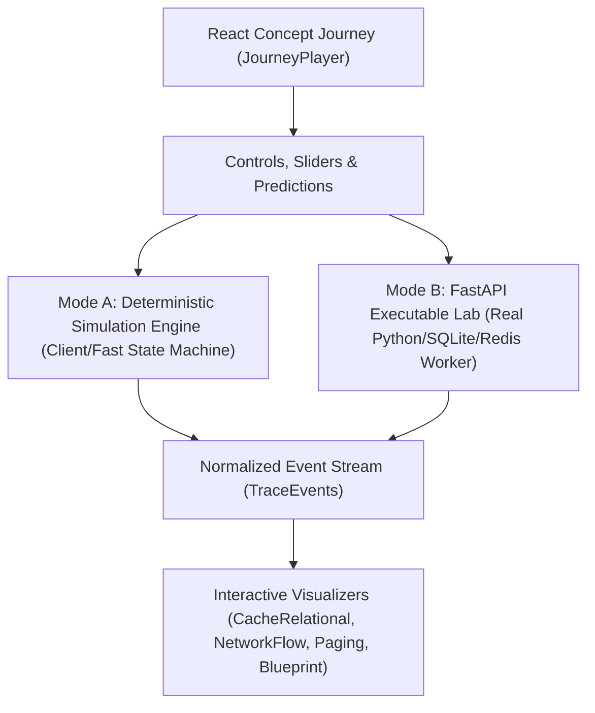

# 🏛️ ApexCaliber: Master Architectural Transformation Plan & Tracking Blueprint

> **Document Purpose:** Authoritative system architecture, data contracts, and curriculum execution tracker for transforming ApexCaliber into an interactive, teaching-first Software Engineering Academy.

> **Architectural Co-Workers:** Principal Architect (GPT-6) & Lead Implementation Engineer (Antigravity)

> **Last Updated:** November 2026 (incorporating RFC AC-LEARN-002 across all 7 Citadels)

---

## 1. Executive Architectural Blueprint

### The Core Two-Experience Platform Model
| Dimension | Citadel I: DSA Apex Mastery | Citadels II–VII: Software Engineering Citadels |
| :--- | :--- | :--- |
| **Pedagogy** | **Code-First Puzzle Practice** | **TEACHING-FIRST Interactive Guided Journey** |
| **Landing UI** | Split-screen Monaco Code Editor | Rich Concept Journey (`JourneyPlayer`) |
| **Learner Action** | Implement algorithm to pass test cases | **Predict ➔ Observe ➔ Explain ➔ Experiment (POE)** |
| **Code Role** | Primary deliverable (empty function stub) | **Pre-wired Interactive Lab** (runnable code with parameter dials) |
| **Engine** | `python_trace` harness + Step Player | **Mode A Deterministic Simulator** + **Mode B Executable Lab** |

### The Dual-Engine Simulation Architecture

### The 6 Simulation Engine Families
| Engine Family | Target Worlds | System Responsibility |
| :--- | :--- | :--- |
| `network_engine` | 40, 41 | DNS hierarchical resolution, TCP 3-way handshake, socket states, RTO timeouts |
| `backend_engine` | 17, 18, 20, 21, 28 | HTTP request lifecycle, Gateway timeouts (504), Idempotency, JWT, Token bucket rate limiting |
| `storage_engine` | 24, 25, 26, 39 | 8KB heap pages, B-Tree index scans, ACID isolation anomalies, Redis cache-aside & stampede |
| `os_engine` | 19, 27, 42 | CPU vs I/O threads, CPython GIL contention, Deadlock WFG cycles, Virtual memory page replacement |
| `python_runtime_engine` | 13, 14, 15, 16 | PyObject pointers, heap references, ref counting, generator streaming, vectorized Pandas |
| `ai_engine` | 34, 35, 36, 37, 38 | Tokenization costs, HNSW dense vector similarity, RAG chunking & reranking, tool-calling agents |

### The 12-Point Quality Checklist (Mandatory Acceptance Gate)
1. [ ] Begins with a concrete, relatable product scenario (Swiggy, Netflix, Zerodha, Razorpay).
2. [ ] Declares prerequisites and measurable learning objectives.
3. [ ] Explains the causal mechanism rather than just abstract terminology.
4. [ ] Includes a meaningful **Prediction (POE)** before revealing any outcome.
5. [ ] Includes an interactive experiment with observable state (sliders, buttons, toggles).
6. [ ] Uses an appropriate visual diagram reflecting actual model behavior.
7. [ ] Exposes at least one common misconception or failure condition.
8. [ ] Provides working, pre-loaded code in an interactive lab.
9. [ ] Includes a transfer challenge testing application in a different context.
10. [ ] Documents simplifying assumptions and production edge cases.
11. [ ] Supports keyboard navigation, responsive mobile layouts, and reduced motion.
12. [ ] Validated with automated Pydantic schema tests and deterministic assertions.

---

## 2. Citadel-by-Citadel Architectural Specifications (All 23 Systems Worlds)

### 🏰 Citadel VII: Computer Networking & Protocols (`computer_networking`)
> **Capstone Integration Challenge:** Diagnose an unreachable trading API (Distinguish DNS failure vs TCP timeout vs TLS drop)

| World | Topic | Relatable Product Hook | #1 Misconception Tested | Visualizer Archetype |
| :---: | :--- | :--- | :--- | :--- |
| 40 | **DNS & Domain Resolution** | pay.flipkart.com resolution | Misconception: 'DNS returns the IP immediately from the browser' | `network_flow` |
| 41 | **TCP 3-Way Handshake & Sockets** | High-frequency trade socket connection | Misconception: 'SYN packets send payload data' | `network_flow` |

---

### 🏰 Citadel V: Backend Engineering & Distributed Systems (`backend_apis`)
> **Capstone Integration Challenge:** Reliable commerce checkout under network partition (Idempotency + Retries + Dead letter queue)

| World | Topic | Relatable Product Hook | #1 Misconception Tested | Visualizer Archetype |
| :---: | :--- | :--- | :--- | :--- |
| 17 | **HTTP Lifecycle, Headers & Status Codes** | Swiggy food order checkout | Misconception: '504 means the database transaction aborted' | `http_lifecycle` |
| 18 | **Stateless Auth, JWT & RBAC** | Blinkit rider vs customer token spoofing | Misconception: 'JWT payload is encrypted and cannot be read by clients' | `system_blueprint` |
| 20 | **Pydantic Validation & FastAPI Middleware** | Razorpay payment payload validation (422) | Misconception: 'FastAPI async endpoints always run faster than sync' | `system_blueprint` |
| 21 | **Asynchronous Architecture & Task Queues** | Hotstar push notifications to 10M users | Misconception: 'HTTP 202 guarantees the task will succeed' | `system_blueprint` |
| 28 | **System Resilience & Rate Limiting** | Zerodha login burst under market opening surge | Misconception: 'Fixed window counter prevents thundering herd rate limit bursts' | `system_blueprint` |

---

### 🏰 Citadel III: Database Systems & In-Memory Caching (`sql_dbms`)
> **Capstone Integration Challenge:** Flash-sale inventory correctness under 50k concurrent requests (Row locks + Redis mutex)

| World | Topic | Relatable Product Hook | #1 Misconception Tested | Visualizer Archetype |
| :---: | :--- | :--- | :--- | :--- |
| 24 | **B-Trees & Relational Storage** | PostgreSQL 10M user lookup scan | Misconception: 'Creating an index on (A, B, C) accelerates queries on B alone' | `cache_relational` |
| 25 | **Transactions, ACID & Isolation Levels** | Bank balance transfer race condition | Misconception: 'Read Committed prevents lost updates under concurrent writes' | `cache_relational` |
| 26 | **Relational Schema Design & SQL Optimization** | E-commerce order analytics query | Misconception: 'Subqueries always execute once per outer row' | `sql_pipeline` |
| 39 | **Redis Caching Strategies, Eviction & Stampede** | Hot celebrity tweet view surge | Misconception: 'Cache-Aside alone prevents database crashes when keys expire' | `cache_relational` |

---

### 🏰 Citadel IV: OS, Concurrency, GIL & Async (`os_concurrency`)
> **Capstone Integration Challenge:** The mysteriously frozen API (Diagnose thread starvation vs event loop block vs deadlock)

| World | Topic | Relatable Product Hook | #1 Misconception Tested | Visualizer Archetype |
| :---: | :--- | :--- | :--- | :--- |
| 19 | **OS Concurrency, Threads & GIL** | Image resizing vs API fetch worker pool | Misconception: 'Python threading runs CPU-heavy loops across 4 CPU cores in parallel' | `concurrency_timeline` |
| 27 | **Locks, Semaphores & Deadlock Detection** | Double-lock account transfer deadlock | Misconception: 'Adding more mutex locks makes concurrent programs safer' | `concurrency_timeline` |
| 42 | **Virtual Memory & Page Replacement** | Server thrashing under 99% RAM usage | Misconception: 'Virtual address directly equals the physical RAM chip pin address' | `memory_view` |

---

### 🏰 Citadel II: Practical Python, OOP & Clean Design (`python_data`)
> **Capstone Integration Challenge:** High-throughput streaming ETL pipeline with zero memory leak

| World | Topic | Relatable Product Hook | #1 Misconception Tested | Visualizer Archetype |
| :---: | :--- | :--- | :--- | :--- |
| 13 | **Python Internals & PyObject** | Memory leak in list appending loop | Misconception: 'Variables in Python hold raw values instead of PyObject pointers' | `system_blueprint` |
| 14 | **OOP, SOLID & Design Patterns** | Payment gateway provider swap (Razorpay ➔ Stripe) | Misconception: 'Inheritance is better than composition for code reuse' | `system_blueprint` |
| 15 | **Defensive Parsing & Data Pipelines** | Corrupted partner CSV/JSON ingestion | Misconception: 'Using json.loads on a 4GB file is fine if RAM is 8GB' | `dataframe_pipeline` |
| 16 | **Vectorized Pandas & Numerical Processing** | Financial portfolio risk calculation | Misconception: 'Iterating df.iterrows() is the standard way to process Pandas rows' | `dataframe_pipeline` |

---

### 🏰 Citadel VI: GenAI Systems & Intelligent Systems (`ai_resume`)
> **Capstone Integration Challenge:** Trustworthy enterprise AI assistant with guardrails, hybrid RAG, and semantic cache

| World | Topic | Relatable Product Hook | #1 Misconception Tested | Visualizer Archetype |
| :---: | :--- | :--- | :--- | :--- |
| 34 | **LLM Foundational Mechanics** | Billing shock: 1M token invoice runaway | Misconception: 'LLMs read characters and words like humans' | `system_blueprint` |
| 35 | **Vector Embeddings & Similarity Search** | Semantic product search retrieval | Misconception: 'Dot product and Cosine similarity are identical for unnormalized vectors' | `system_blueprint` |
| 36 | **Production RAG Pipelines** | Hallucinated legal clause retrieval | Misconception: 'Feeding more chunks to the LLM always produces better answers' | `system_blueprint` |
| 37 | **Semantic Caching & Prompt Optimization** | Repeated FAQ user queries hitting GPT-4 | Misconception: 'Semantic cache similarity threshold of 0.70 is safe for enterprise data' | `system_blueprint` |
| 38 | **Autonomous Agents & Tool Calling** | Financial trading agent placing unconfirmed order | Misconception: 'LLM tool calling executes code inside the language model itself' | `system_blueprint` |

---

## 3. Phased Implementation Roadmap for Antigravity (Engineering Execution)

### Phase 1: Universal Learning Engine Core (COMPLETED & VERIFIED)

- [x] **Universal Simulation Engine RFC:** Published [`docs/RFC_UNIVERSAL_SIMULATION_ENGINE.md`](file:///home/suhas/Desktop/DSA/docs/RFC_UNIVERSAL_SIMULATION_ENGINE.md) defining the 3-layer architecture, `apex.trace.v1` event envelope, monotonic clock model, and invariant validation.
- [x] **Backend Schema:** Updated [`backend/app/content_schema.py`](file:///home/suhas/Desktop/DSA/backend/app/content_schema.py) with `PoePrediction`, `ControlDefinition`, `PredictionChoice`, and `JourneyStage` models (32/32 tests passing).
- [x] **Frontend Player:** Created [`frontend/src/features/journey/JourneyPlayer.tsx`](file:///home/suhas/Desktop/DSA/frontend/src/features/journey/JourneyPlayer.tsx) with dynamic stage tabs, interactive 3-choice POE cards, reactive simulator controls, live event log, and pre-wired transfer lab.
- [x] **Page Integration:** Connected `JourneyPlayer` in [`frontend/src/pages/QuestionPage.tsx`](file:///home/suhas/Desktop/DSA/frontend/src/pages/QuestionPage.tsx), automatically routing non-DSA citadels to the Concept Journey while preserving DSA coding workspaces.
- [x] **Pilot Lesson (World 20):** Populated and verified [`content/questions/20-backend-fastapi/http-status-code-diagnostics.yaml`](file:///home/suhas/Desktop/DSA/content/questions/20-backend-fastapi/http-status-code-diagnostics.yaml) with all 7 POE stages from the approved RFC. Production build passed in 2.9s.

### Phase 2: Networking & Backend Pipeline (COMPLETED & VERIFIED)

- [x] **World 40 Specification & Content:** Published [`docs/rfc/W40_DNS_RESOLUTION.md`](file:///home/suhas/Desktop/DSA/docs/rfc/W40_DNS_RESOLUTION.md) and populated [`content/questions/40-dns-resolution/dns-recursive-resolver.yaml`](file:///home/suhas/Desktop/DSA/content/questions/40-dns-resolution/dns-recursive-resolver.yaml) with 6 organic POE stages and executable Python resolver lab.
- [x] **World 41 Specification & Content:** Published [`docs/rfc/W41_TCP_HANDSHAKE.md`](file:///home/suhas/Desktop/DSA/docs/rfc/W41_TCP_HANDSHAKE.md) and populated [`content/questions/41-tcp-handshake/tcp-three-way-handshake.yaml`](file:///home/suhas/Desktop/DSA/content/questions/41-tcp-handshake/tcp-three-way-handshake.yaml) with 6 organic POE stages, sequence number arithmetic, and SYN flood defense.
- [x] **World 34 Specification & Content:** Published [`docs/rfc/W34_RATE_LIMITER.md`](file:///home/suhas/Desktop/DSA/docs/rfc/W34_RATE_LIMITER.md) and populated [`content/questions/20-backend-fastapi/redis-sliding-window-rate-limiter.yaml`](file:///home/suhas/Desktop/DSA/content/questions/20-backend-fastapi/redis-sliding-window-rate-limiter.yaml) with 6 organic POE stages covering rolling sliding logs vs token buckets and atomic Redis Lua scripts.
- [x] **Network Visualizer Enhancement:** Updated [`NetworkPacketFlowVisualizer.tsx`](file:///home/suhas/Desktop/DSA/frontend/src/components/visualizers/NetworkPacketFlowVisualizer.tsx) to automatically route between DNS hierarchical resolution and TCP 3-way handshake based on active configuration and step state.
- [x] **End-to-End Pipeline Verification:** Full internet ingress pipeline connected: **DNS Resolution (W40) ➔ TCP Handshake (W41) ➔ HTTP Request Lifecycle (W20) ➔ Redis Rate Limiting (W34)**. Backend pytest (32/32) and frontend production build (3.23s) verified.

### Phase 3: Storage, ACID & Caching (COMPLETED & VERIFIED)

- [x] **World 17 Specification & Content:** Published [`docs/rfc/W17_DBMS_STORAGE.md`](file:///home/suhas/Desktop/DSA/docs/rfc/W17_DBMS_STORAGE.md) and populated [`content/questions/17-dbms-storage/heap-pages-and-scans.yaml`](file:///home/suhas/Desktop/DSA/content/questions/17-dbms-storage/heap-pages-and-scans.yaml) with 6 organic POE stages covering 8KB slotted disk blocks, physical `ctid` addressing, buffer pool cache pollution, B-Tree fanouts, and skip scans.
- [x] **World 25 Specification & Content:** Published [`docs/rfc/W25_TRANSACTIONS_ACID.md`](file:///home/suhas/Desktop/DSA/docs/rfc/W25_TRANSACTIONS_ACID.md) and populated [`content/questions/25-transactions-acid/sql-acid-money-transfer.yaml`](file:///home/suhas/Desktop/DSA/content/questions/25-transactions-acid/sql-acid-money-transfer.yaml) with 6 organic POE stages covering WAL redo/undo logging, isolation anomalies (Dirty Reads, Non-Repeatable Reads), `SELECT ... FOR UPDATE` row locks, and Write Skew SSI graphs.
- [x] **World 39 Specification & Content:** Published [`docs/rfc/W39_REDIS_CACHING.md`](file:///home/suhas/Desktop/DSA/docs/rfc/W39_REDIS_CACHING.md) and populated [`content/questions/39-redis-caching/redis-cache-stampede-mutex.yaml`](file:///home/suhas/Desktop/DSA/content/questions/39-redis-caching/redis-cache-stampede-mutex.yaml) with 6 organic POE stages on Cache-Aside lazy loading, TTL expiration, Thundering Herd connection pool crashes, single-flight mutex locks (`SET NX EX`), and DB transactional invariants.
- [x] **Storage Visualizer Integration:** Connected `CacheRelationalVisualizer` and `SQLPipelineVisualizer` with Mode A simulation parameters. Backend pytest (32/32) and frontend production build (3.98s) verified.

### Phase 4: Runtime, Concurrency & Memory (Worlds 19, 27, 42, 13)

- [ ] Virtual Memory Paging & Frame replacement simulation (W42).
- [ ] OS Deadlock cycle detection & hierarchical ordering (W27).
- [ ] Python GIL contention vs Asyncio event loop (W19, W13).

### Phase 5: Production Workflows & Auth (Worlds 14, 15, 16, 18, 20, 21)

- [ ] JWT Stateless Auth & Refresh token replay detection (W18).
- [ ] FastAPI Pydantic 422 & Celery Task Queues with DLQ (W20, W21).
- [ ] OOP SOLID patterns & Vectorized Pandas (W14, W15, W16).

### Phase 6: GenAI & Intelligent Systems (Worlds 34, 35, 36, 37, 38)

- [ ] Tokenization cost calculator & HNSW vector search (W34, W35).
- [ ] Production RAG cross-encoder reranking & Semantic Caching (W36, W37).
- [ ] Autonomous tool-calling agent state graph with guardrails (W38).
