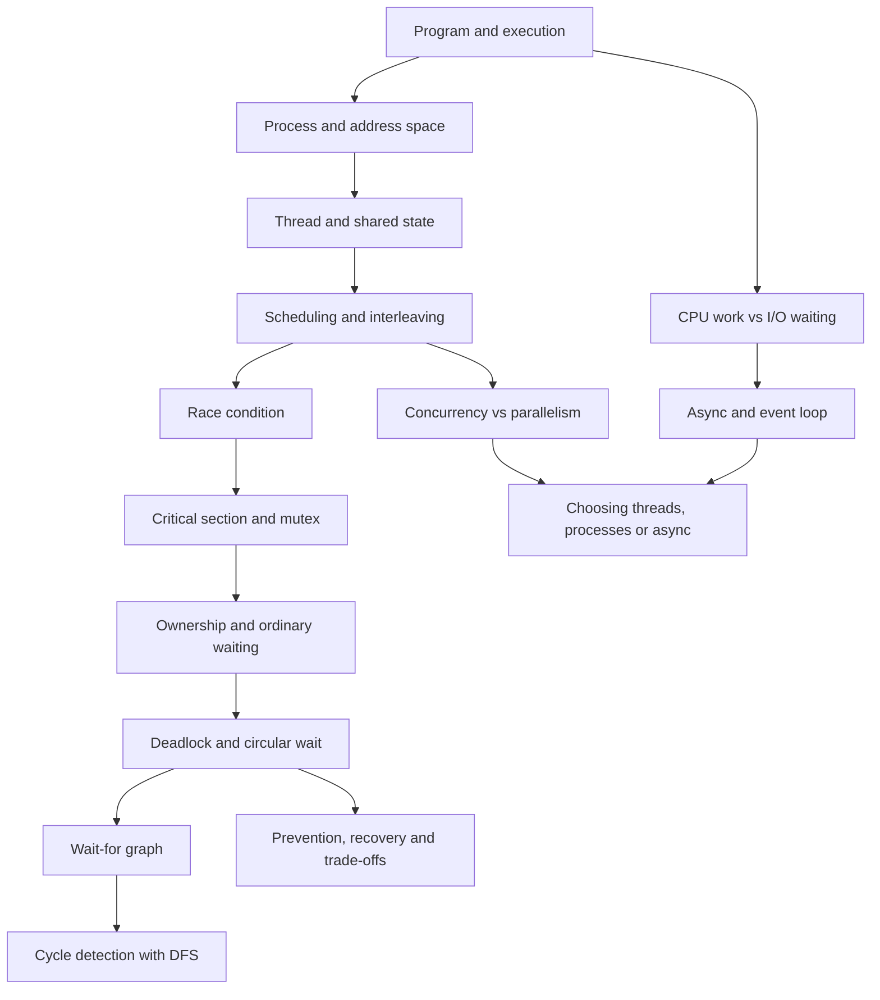

# ApexCaliber: beginner-first product and curriculum plan

Status: design and research plan, 7 November 2026. Branch: `codex/beginner-first-learning-blueprint`. This document specifies future implementation; it does not claim the curriculum or UI has already been changed.

## Product promise

ApexCaliber helps an anxious or underprepared engineer become someone who can **explain, apply, debug, build, and discuss** core engineering ideas. The first screen of a new topic must make the learner feel that there is a clear starting point. Interview preparation is the destination, not the starting screen.

The product should serve two paths:

- **Start from basics:** guided foundations, concrete examples, practice, then interview application.
- **I know this already:** a short readiness check and an explicit route to practice. Skipping does not mark a concept as understood.

Neither path should hide the other. A beginner can ask for a deeper explanation; an experienced learner can revisit one missing prerequisite without restarting an entire world.

## What the repository currently shows

The current curriculum has **7 citadels, 42 worlds and 198 question YAML files**. `frontend/src/lib/curriculum.json` describes world-level tiers and edges; it does not supply a concept-level prerequisite graph. Only **19 of 198** questions contain an authored `journey` array, and each of those 19 has a prediction in its first stage. `JourneyPlayer.tsx` renders the first phase as **Make a prediction**. For non-DSA content without a journey, it creates a fallback lesson from the question's pattern quiz, so the learning surface can still begin with a test. `QuestionPage.tsx` sends DSA questions without an authored journey to the code workspace by default.

These are code and content observations, not a claim that every existing explanation is poor. They do substantiate the user's experience: a first-time student is often asked to guess before the concepts have been established.

Specific content examples:

| Area | Current entry | Missing bridge for a novice |
| --- | --- | --- |
| OS / deadlock | `deadlock-cycle-detector` opens with Coffman conditions and a wait-for graph; its first visual is a full deadlock diagram | Process → thread → shared resource → ownership → ordinary waiting → circular waiting → graph → detection |
| Backend / HTTP | `http-status-code-diagnostics` starts its journey with “Why Does HTTP Exist?” but asks a prediction immediately | Client/server → request/response → message boundaries → methods/status → failure location → diagnostic question |
| Networks | DNS and TCP each have one world question | More concept lessons are needed inside these topics before a coding challenge; question count alone is not a syllabus |
| System Design | A learner enters SOLID or a complete HLD with scale tables, failure lists, architecture and an assignment | Start with one requirement and one simple system; reveal each new component because a concrete limitation appears |
| DSA | Some questions open in Practice | First encounter should offer a brief concept model and worked trace; experienced learners can skip to the editor |

Additional audit findings from the existing design documents remain relevant: inconsistent button sizes and accents, small text contrast issues, cramped mobile System Design layout, inconsistent navigation terms, early answer exposure, and overly fast or semantically mismatched animations. See `FRONTEND_DESIGN_AUDIT_AND_PLAN.md`, `LEARNING_IDENTITY_AND_FOUNDATIONS.md`, and `ANTIGRAVITY_MOTION_LEARNING_REDESIGN.md`.

## Research translated into product rules

1. **Teach before testing new material.** AERO recommends small sequenced tasks, clear goals, worked examples, guided practice and gradual removal of support for novices. A cold MCQ can be an optional diagnostic, but it must never block the first explanation. [AERO explicit instruction](https://www.edresearch.edu.au/guides-resources/practice-guides/explicit-instruction-practice-guide-full-publication)
2. **Pair the diagram with its explanation.** The US Institute of Education Sciences recommends connecting concrete and abstract representations, graphics with verbal descriptions, and alternating worked solutions with student attempts. Keep the caption near the state it describes. [IES practice guide](https://ies.ed.gov/ncee/wwc/PracticeGuide/1)
3. **Return to ideas later.** Spaced retrieval is more useful for long-term recall than treating a completed page as mastery. Use short recall prompts after practice and on later visits. [IES practice guide](https://ies.ed.gov/ncee/wwc/PracticeGuide/1)
4. **Separate concept learning from applied exercises.** Exercism uses concept prerequisites and practice exercises; this is evidence that the distinction is workable as a product model, not proof that its exact interface should be copied. [Exercism concept map](https://exercism.org/docs/building/tracks/concept-map.md), [practice exercises](https://exercism.org/docs/building/product/practice-exercises)
5. **Prepare for application and explanation, not trivia.** Amazon's public interview guidance emphasizes fundamentals and applying knowledge rather than memorizing detail. Microsoft describes coding, testing, design, networking and explaining trade-offs. These are role-dependent topic signals, not a ranked list of the “most asked” questions. [Amazon](https://www.amazon.jobs/content/en-gb/how-we-hire/interview-prep/software-development-topics), [Microsoft](https://careers.microsoft.com/v2/global/en/hiring-tips/technical-interviewing)
6. **Keep navigation and controls predictable.** W3C notes that consistent placement and identification reduce confusion, including for users with cognitive limitations. [W3C predictable navigation](https://www.w3.org/WAI/WCAG22/Understanding/predictable)

## The curriculum model: a graph of concepts, not a stack of questions

Create stable **concept IDs** and a prerequisite directed acyclic graph. Worlds remain attractive collections; they are not the unit of understanding. One question can assess several concepts, but a concept should have one canonical introduction. A learner should see “You need these three ideas” with links to short refreshers, not be sent through a giant prerequisite world.

The graph supports three content types:

- **Concept lesson:** explains one small idea with a worked model and a contrast or non-example.
- **Application lab:** uses several learned ideas in a realistic task, code exercise, SQL query or architecture decision.
- **Interview rehearsal:** asks the learner to explain or design under constraints after understanding and practice.

Use three evidence states: **visited**, **practiced**, **demonstrated**. A page visit, video view or correct MCQ guess is not proof of understanding. A demonstration should include explaining a mechanism or applying it in a new context, with specific feedback. Do not silently auto-grade open-text explanations with false certainty.

### Example dependency tree: concurrency and deadlock



The async branch is useful for choosing a concurrency model; it is **not** a required detour before every lock lesson. Likewise, graph DFS can be refreshed just before the detector lab. The app should adapt to known prerequisites instead of forcing one linear chain on everyone.

### Beginner sequence by citadel

| Citadel | Foundations first | Later application and interview work |
| --- | --- | --- |
| Python & Data | Values, references, functions, files, classes, memory model | OOP decisions, SOLID, parsing, Pandas pipelines, debugging |
| SQL & DBMS | Row/table/key → page/cache → scan/index → relation/joins | Query plans, indexing choices, normalization, ACID/isolation, Redis/cache |
| OS & Concurrency | Program/process/thread → scheduling → shared state → race → lock | Deadlock, semaphores, GIL/runtime caveats, async, virtual memory, architecture choices |
| Backend & APIs | Client/server → HTTP request/response → status semantics → routes/validation | Auth, CORS, async jobs, retries, idempotency, rate limiting |
| Computer Networking | Devices/IP/ports → DNS → reliable byte stream → TCP connection | TLS/HTTPS, failure diagnosis, timeouts, application protocols; link to backend lessons |
| AI & Retrieval | Task/data representation → embeddings and similarity → retrieval | RAG, evaluation, agents, prompt optimization, failure and cost trade-offs |
| System Design | Requirements → one client/server → persistence → capacity/failure | Cache, queue, replication, consistency, LLD/HLD and interview trade-offs |

DSA already has a useful world sequence; retain its structure while correcting first entry and teaching traces. These are proposed **learning dependencies**, not a demand to rename or delete existing worlds. Run an inventory of the actual questions before finalizing reordering.

## What one lesson should feel like

Use a stable sequence with one main idea per screen or section:

1. **Start here:** plain-language goal, why the idea matters, estimated scope, and 2–4 prerequisites. “New to this?” offers a short refresher. No scored MCQ yet.
2. **Concrete situation:** one ordinary example with actors and a visible initial state. Introduce each technical term beside the thing it names.
3. **Worked model:** demonstrate the first few changes, with pause and captions. Keep each visual step causally meaningful.
4. **Try a small change:** ask a prediction only after the relevant entities and behavior have been taught. Allow “show me” without penalty.
5. **Explain the rule:** connect the observed behavior to the correct definition, constraints and a non-example.
6. **Transfer:** change the scenario. Ask the learner to explain what happens and why, or to fix a new failure.
7. **Practice:** code, query, trace or design a solution. Include hints from least revealing to most revealing.
8. **Interview:** ask a realistic spoken or written prompt, follow-ups and trade-offs; reveal a reference answer deliberately.
9. **Revisit:** schedule a short retrieval task later. Show the learner what remains uncertain.

Do not make the nine stages nine permanent cards on one page. Show the current action and one compact overview of progress. Advanced detail, sources and interview notes should be available when needed, not in the primary reading path.

### What a deadlock lesson would actually say

Begin: “Two workers need two tools to finish. What happens if each worker keeps one tool while waiting for the other?” First show one worker waiting and then progressing after release; distinguish ordinary waiting from deadlock. Let the learner assign the tools to workers in a second schedule. Pause when both are waiting and ask who could move next. Only then name deadlock and the four conditions. Map the wait-for arrows, derive the cycle and eventually code a detector. Finish with a different example involving database row locks and ask the learner to choose a lock order and explain its cost.

The “two workers and tools” analogy teaches ownership and waiting. The database example tests transfer. State the analogy's limit: people can negotiate; software needs an explicit resource policy. Distinguish deadlock from starvation, long processing and livelock. Numeric edge weights are unnecessary in the basic single-instance wait-for model. Validate technical claims and model assumptions with [OSTEP concurrency material](https://pages.cs.wisc.edu/~remzi/OSTEP/) before publishing.

### What the HTTP lesson would actually say

Start with a browser asking a server for one page. Show the client, connection, request message and response message. Explain what HTTP defines and what the connection carries. Then vary one request: missing path, invalid credentials, server error. A status-code diagnostic question belongs **after** the student sees where a failure occurs. For TCP, begin with why a reliable ordered byte stream is useful, then ports, connection establishment, data transfer, retransmission and close. Make the relationship to HTTP explicit without claiming every HTTP version runs over TCP: HTTP/3 uses QUIC. Use [MDN's HTTP overview](https://developer.mozilla.org/en-US/docs/Web/HTTP/Guides/Overview) as a learner-friendly reference and [RFC 9293](https://www.rfc-editor.org/info/rfc9293/) for TCP accuracy.

### What a system-design lesson would actually say

Start with “one user sends one request to one server.” Ask for a simple design. Introduce a database only when persistence is required. Introduce a queue when synchronous work exceeds the request budget. Introduce multiple workers when throughput exceeds one worker. Add retries and idempotency when failure makes them necessary. The architecture diagram grows one component at a time; the caption states **requirement → failure → design choice → trade-off**. The full diagram, scale table and interview thesis appear at the end as a recap. Never open a beginner lesson with the full final architecture.

## Interview relevance: how to research without inventing a ranking

Do not label a question “most asked” without a dated, representative dataset. Public company guidance is broad and changes by role and level. Maintain a **source-backed topic map** instead:

| Topic group | Public evidence | ApexCaliber outcome |
| --- | --- | --- |
| Coding, algorithms and data structures | Amazon and Microsoft technical interview pages | Explain choice, code, test edge cases and complexity |
| OS, databases and internet topics | Amazon's technical topics; Microsoft's networking guidance | Explain mechanisms and diagnose failures |
| System design and distributed systems | Both companies describe design assessment, especially experienced roles | Clarify constraints, start simple, defend trade-offs |
| AI/ML | Role-dependent guidance, not universal SDE requirement | Add specialized track with evaluation and failure analysis |

Annotate each interview task with role/level relevance, source URL, last reviewed date and uncertainty. Prefer transferable prompts (“How would you make this safe under a contest spike?”) over company-name claims. Do not fabricate employer incidents or precise performance figures.

## External video and reference policy

Videos are optional help, not the primary lesson. The app must teach the minimum concept in its own text and visual. For each curated link record: exact title, creator, URL, duration, language, concept covered, prerequisite level, last checked date and why it helps. Link to a specific relevant segment when verified. Offer one beginner explanation and at most one deeper reference by default.

Initial verified reference candidates for content editors:

- [MDN: How the web works](https://developer.mozilla.org/en-US/docs/Learn_web_development/Getting_started/Web_standards/How_the_web_works) — browser/server foundation.
- [MDN: HTTP overview](https://developer.mozilla.org/en-US/docs/Web/HTTP/Guides/Overview) — messages and client/server model.
- [RFC 9293: TCP](https://www.rfc-editor.org/info/rfc9293/) — authoritative technical reference, not a novice's first reading.
- [Stanford CS144 course](https://cs144.github.io/) — official networking course; editors must verify a specific lecture video and its current access before adding it to a lesson.
- [Amazon interview prep videos](https://www.amazon.jobs/content/en-gb/how-we-hire/interview-prep/software-development-topics) — official coding and design examples for interview rehearsal.

Do not paste a popular YouTube link into content solely because it ranks highly. A content editor should watch and verify the exact segment, factual accuracy, captions and availability first. External links open in a new tab with clear labeling; the student should be able to continue the lesson without leaving ApexCaliber.

## Homepage and interface design

The current dark, mostly neutral direction is suitable for focused study. The 60–30–10 rule is a useful **review heuristic**, not a numeric target and not a reason to recolor the homepage. Keep roughly 60% quiet canvas, 30% secondary surfaces and restrained accent use. The actual design work is assigning stable roles to colors, reducing simultaneous saturated accents and fixing text contrast. Run contrast checks in both themes under [WCAG 2.2](https://www.w3.org/TR/WCAG22/).

The homepage should answer three questions without jargon: **What will I learn? Where should I start? What did I last work on?** Suggested top section: one plain promise, `Start from basics` primary action, `Continue where I left off` when available, and a compact preview of the concept map. Show citadels as clear subject areas with a readable list alongside the visual map. Avoid leading with level, streak, a giant question count or a wall of world cards. Keep the game's sense of progress as supporting motivation, not the core information architecture.

Keep ApexCaliber's own identity: a guided concept map, “why this component exists” architecture building, visual cause-and-effect, and a calm study workspace. Familiar editor controls are fine; a numbered challenge-first page and `LeetCodeLeftPanel`/`LeetCodeRightPanel` structure reinforce a coding-site impression. Change the learning experience, hierarchy and language before styling around that impression.

### Component standardization

Use one local token system and shadcn/ui primitives where they fit, customized for ApexCaliber. [shadcn/ui theming](https://ui.shadcn.com/docs/theming) supports semantic tokens and a shared radius scale. Inventory current components before adding another copy.

Define roles for Button, IconButton, Tabs, Breadcrumb, Progress, Accordion, Sheet/drawer, Tooltip, Skeleton, Alert and code actions. Standardize height, hit target, padding, radius, border, focus ring, disabled/busy state and icon size. Audit the homepage, world map, question toolbar, System Design sidebar, motion player and editor. In particular, theme and other utility buttons should align with their peer controls, while primary learning actions remain visually prominent. The same `Learn / Practice / Interview` vocabulary should appear across the journey.

### Motion and screen hierarchy

Apply the detailed player requirements in `ANTIGRAVITY_MOTION_LEARNING_REDESIGN.md`: explicit lesson mapping, guided step mode, slower optional playback, topic-specific chapters, reduced motion and scoped shortcuts. On a laptop, the active diagram, caption and next action should be visible together. On mobile, use one learning pane and a drawer for the outline. New concepts should appear one at a time; motion should point to the event that changed the model.

## Data and implementation plan for Antigravity or the next coding pass

### Phase 0 — inventory and quality rubric

Export all 198 question records and the 42 worlds into a review table: concept assessed, assumed knowledge, first-screen state, example quality, answer leakage, source status, factual risks and interview relevance. Review all 20 System Design lessons separately. Identify gaps, duplication and false prerequisite edges. Have a subject expert verify the revised graph and technical claims.

### Phase 1 — concept graph and compatible content model

Add stable concept metadata without breaking existing YAML or saved progress. Suggested shape:

```yaml
concept_id: os.deadlock.circular_wait
title: Circular waiting
prerequisites: [os.thread.shared_state, os.lock.ownership]
goal: Explain why two workers cannot progress under the shown lock policy.
examples:
  - type: worked
    id: workshop-tools
  - type: transfer
    id: database-row-locks
misconceptions:
  - Ordinary waiting is always deadlock.
assumptions:
  - Each modeled lock has one exclusive owner.
sources: []
```

Keep concept lessons separate from question assessments. Maintain a single source of truth for shared concept explanations. Add schema validation for unique IDs, missing references, graph cycles, source fields and orphaned questions. Migrate old progress defensively; preserve drafts and completed practice.

### Phase 2 — first-visit learning flow

Change `QuestionPage.tsx` and `JourneyPlayer.tsx` so fresh entries open the learning goal and foundation, not a prediction or editor. A readiness check is optional and ungraded. Add a `Build foundations` route with short prerequisite refreshers and a return link to the exact prior step. Keep `Skip to practice` visible. Move prediction after the worked model and reserve interview answers for deliberate reveal. Separate visited, practiced, demonstrated and solution-studied states.

### Phase 3 — pilot content before bulk generation

Fully author three vertical slices and one System Design slice:

1. **OS:** process → thread → scheduling → shared state → race → lock → deadlock → wait-for graph → detector.
2. **Backend/networks:** browser/server → IP/port → TCP byte stream → HTTP request/response → status diagnostics.
3. **DBMS:** row/table → page/buffer → scan/index → transaction/lock.
4. **System Design:** one request → one server → persistence → queue/workers → resilience, using Remote Code Execution or another carefully scoped architecture.

Within each slice, create worked examples, non-examples, one meaningful interaction, a transfer prompt, feedback and a deliberate interview task. Use real sources for factual claims. Pilot with learners before scaling. The motion work should follow the concept objectives; do not commission a new animation for each YAML file.

### Phase 4 — revise the rest of the syllabus

Map existing worlds into the concept graph. Add missing bridge lessons where the current world begins too high. Reduce duplicate intros and correct misleading world titles. Keep DSA's useful sequence; improve its entry state and examples. Add a Networking foundation path that connects to Backend instead of treating DNS/TCP as isolated final questions. For System Design, add a foundation track before SOLID and HLD, with role-based entry for experienced candidates.

### Phase 5 — interface system and validation

Apply the button/token system and homepage hierarchy. Fix responsive System Design navigation. Run content and UI checks: 320/390/768/1440px, 200% zoom, keyboard navigation, reduced motion, contrast, long titles, direct links, refresh and resuming drafts. Build and test the migrated state model. Observe beginners attempting the OS and HTTP pilots; ask them to explain a new case without the teaching diagram. Repeat a short transfer task days later. Use those results to revise confusing nodes before generating the rest.

## Acceptance criteria

- A novice can enter a fresh OS, HTTP, DBMS, AI or System Design topic and see a plain goal, known entities and a suitable first example before any assessed MCQ.
- A student can reach a difficult problem from its prerequisite tree, refresh one concept, and return to the same place.
- Every assessed question links to the concepts it uses. Every concept has a goal, prerequisite list, worked example, misconception/non-example and transfer check.
- A random correct guess does not mark a concept demonstrated. A practiced question does not automatically mark the interview answer mastered.
- At least one new scenario confirms the student can explain or apply the concept after a pilot lesson.
- Deadlock, HTTP/TCP and one HLD architecture follow the ordered sequences above and do not expose final diagrams before their parts are explained.
- External links are curated, verified and optional. Company incident stories are sourced or clearly fictional examples.
- The homepage clearly offers starting and resuming actions; the question flow uses consistent Learn / Practice / Interview language.
- Shared controls and color roles are consistent across the major surfaces, with accessible contrast in both themes.
- Mobile has no page-level horizontal overflow. Motion remains understandable when paused or reduced.
- Existing tests and build pass after migration; focused tests cover entry state, prerequisite routing, progress migration and answer reveal.

## Implementation status on this branch

The first product slice is implemented: fresh questions open in Learn; authored journeys put a short foundation screen before the first prediction; fifteen OS, backend and networking topics have a plain-language bridge and example. DSA solution traces and the interview reference answer are revealed deliberately. The question toolbar now uses a consistent control scale and a clearer world back link. System Design opens at an overview, has a mobile curriculum drawer and uses the next available citadel numeral. The question loading state uses a layout skeleton. The frontend build and existing journey-state checks pass.

This is **not** a completed curriculum migration. Most question YAML still lacks an authored prerequisite graph, worked/non-examples and a transfer check. The first-stage fallback is a useful interruption to the immediate quiz, but its text can still be too advanced. The entire System Design track also needs foundations before SOLID, LLD and HLD lessons, and the remaining worlds need content review. Do not mark the acceptance criteria above complete until those authored lessons, beginner pilots, responsive/contrast checks and targeted tests are done. `ANTIGRAVITY_MOTION_LEARNING_REDESIGN.md` remains the motion implementation brief.
