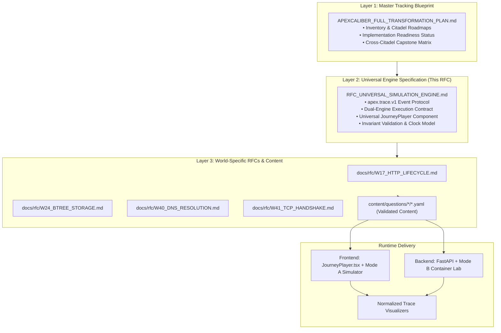

# ApexCaliber — Universal Simulation Engine Specification

<text color="secondary" size="xs" weight="medium">RFC ENG-001 · UNIVERSAL EVENT PROTOCOL & SIMULATION ARCHITECTURE · V1.0</text>

<badge color="success">Core Architecture Standard</badge>

This document defines the technical contract for ApexCaliber's teaching-first simulation engine across Citadels II through VII. It establishes the 3-layer architecture, the normalized event stream protocol (`apex.trace.v1`), simulation execution lifecycles, and front-end integration contracts.

---

## 1. The 3-Layer Architectural Standard

ApexCaliber organizes curriculum, simulation, and implementation across three distinct layers:



---

## 2. Event Envelope Protocol (`apex.trace.v1`)

Both Mode A (deterministic client-side simulator) and Mode B (executable server-side lab) MUST emit events conforming to `apex.trace.v1`.

### 2.1 JSON Schema Definition

```typescript
export interface ApexTraceEnvelope {
  version: "apex.trace.v1";
  session_id: string;
  topic_slug: string;
  stage_id: string;
  timestamp_ms: number; // Monotonic relative milliseconds from simulation start
  source: "mode_a_simulator" | "mode_b_lab";
  event_family: EventFamily;
  event_type: string;
  payload: Record<string, unknown>;
  annotations?: {
    highlight_nodes?: string[];
    log_level?: "info" | "warn" | "error" | "success";
    callout_message?: string;
  };
}

export type EventFamily =
  | "http"
  | "network"
  | "storage"
  | "memory"
  | "concurrency"
  | "auth"
  | "queue"
  | "ai";
```

### 2.2 Event Families & Types

| Family | Key Event Types | Typical Visualizer |
|---|---|---|
| `http` | `request_initiated`, `headers_parsed`, `route_matched`, `middleware_executed`, `status_emitted`, `stream_chunk` | `network_flow`, `system_blueprint` |
| `network` | `dns_query_sent`, `dns_record_resolved`, `tcp_syn_sent`, `tcp_syn_ack_received`, `tcp_ack_sent`, `packet_dropped` | `network_flow` |
| `storage` | `page_read_disk`, `buffer_pool_hit`, `buffer_pool_miss`, `wal_flushed`, `b_tree_seek`, `lock_acquired` | `cache_relational`, `memory_view` |
| `memory` | `refcount_inc`, `refcount_dec`, `mmu_page_fault`, `frame_allocated`, `swap_out`, `gc_sweep` | `memory_view` |
| `concurrency` | `thread_spawned`, `mutex_acquired`, `mutex_contended`, `deadlock_detected`, `coroutine_yielded` | `concurrency_timeline`, `system_blueprint` |
| `auth` | `token_received`, `signature_verified`, `claims_decoded`, `permission_granted`, `forbidden_rejected` | `auth_flow` |
| `queue` | `job_enqueued`, `worker_polled`, `lease_heartbeat`, `ack_completed`, `dlq_dead_lettered` | `queue_flow` |
| `ai` | `tokens_tokenized`, `embedding_projected`, `hnsw_distance_computed`, `prompt_expanded`, `graph_stepped` | `token_flow`, `vector_space`, `rag_pipeline`, `agent_state_graph` |

---

## 3. Simulation Lifecycles & Engine Execution Contracts

### 3.1 Mode A: Pure Client-Side Deterministic Simulator

- **Target**: Explanatory stages, micro-experiments, parameter sweeps, and POE observation.
- **Latency**: 0 ms network round-trip.
- **Implementation**: Pure TypeScript state-transition functions:
  $$\text{State}_{t+1} = \delta(\text{State}_t, \text{Action}, \text{Params})$$
- **Guarantee**: Same seed + same controls = strictly identical sequence of `ApexTraceEnvelope` events.

### 3.2 Mode B: Isolated Executable Lab Worker

- **Target**: Capstone stages, real SQL concurrency, Redis race conditions, Python GIL thread execution.
- **Safety**: Ephemeral in-memory SQLite / mock Redis / subprocess cgroups with CPU and memory limits.
- **Telemetry Extraction**: Intercepts socket, DB, or ASGI middleware calls and translates them directly into `apex.trace.v1` events via backend telemetry adapter.

---

## 4. POE (Predict $\rightarrow$ Observe $\rightarrow$ Explain) Pedagogical Contract

Every interactive stage must enforce the POE pattern:

1. **Scenario & Mechanism**:
   The problem context is established with real architecture (e.g. Stripe webhook timeouts, thundering herd crash).
2. **Predict**:
   User must select from 3 structured options before the simulation is unlocked:
   - Option A: Accurate causal hypothesis.
   - Option B: Intuitive common misconception.
   - Option C: Plausible adjacent error.
3. **Observe**:
   Once locked in, the user manipulates controls (sliders, drop-downs, inject chaos buttons) and observes the animated state machine and telemetry stream.
4. **Explain**:
   The system reveals the technical explanation of *why* the system behaved that way, directly addressing why Option B or C fails in production.
5. **Transfer Lab**:
   Pre-wired working code sandbox where the learner tests the fixed solution.

---

## 5. Invariant Validation Rules

To protect against logically impossible telemetry, the simulation engine validates the following invariants before trace rendering:

1. **Monotonic Clocks**: `events[i].timestamp_ms <= events[i+1].timestamp_ms`.
2. **Causal Ordering**: A response status cannot be emitted before the request header has been parsed.
3. **Resource Balances**: Buffer pool frames or connection pool counts can never drop below 0 or exceed configured pool maximums.
4. **Finite State Transitions**: All state changes must correspond to a known edge in the world's finite state automaton.
