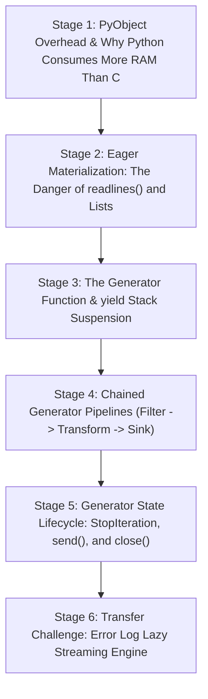

# ApexCaliber — World 13 Engineering & Pedagogical Specification

<text color="secondary" size="xs" weight="medium">RFC W13-001 · PYTHON PYOBJECT INTERNALS, LIST MATERIALIZATION & LAZY GENERATOR STREAMING · V1.0</text>

<badge color="success">Phase 5: Production Workflows, Python Internals & Auth</badge>

This specification governs World 13 (`generators-memory-streaming`), establishing the organic stage dependency graph, the POE micro-experiments, Mode A/B simulation contracts, and the pre-wired executable code lab.

---

## 1. Product & Incident Anchor
- **World ID**: 13
- **Slug**: `generators-memory-streaming` (lc: 9202)
- **Citadel**: `python_data`
- **Real-World Incident**:
  *FitLabs ZeroGPU OOM Crash:* During peak marketing traffic for AI virtual try-on models, the backend analytics node suddenly collapsed with Linux kernel Out-Of-Memory (OOM) kills every 45 minutes. An engineer wrote a routine to inspect daily access logs: `logs = [json.loads(line) for line in open('access.log').readlines()]`. On a 20GB daily log file, reading lines into memory and creating intermediate parsed dictionaries attempted to allocate 48GB of RAM on an 8GB machine, instantly invoking the kernel OOM killer (`kill -9`) and terminating the analytics ingestion daemon.
- **Core Insight**:
  1. Everything in Python is a `PyObject` with substantial memory overhead (e.g., a simple integer is 28 bytes; an empty list is 56 bytes plus 8 bytes per pointer).
  2. List comprehensions and `readlines()` eagerly materialize all elements into physical RAM simultaneously, scaling memory as $O(N)$.
  3. Python Generators (`yield`) are state machines that preserve local stack frames, suspending execution and yielding values lazily on demand.
  4. Chaining lazy generators allows petabyte-scale data pipelines to run with strictly $O(1)$ constant working memory.

---

## 2. Organic Learning Progression (6 Stages)

---

## 3. Stage Specifications & POE Contracts

### Stage 1: PyObject Overhead & Why Python Consumes More RAM Than C
- **Scenario**: In C, an array of 1,000,000 64-bit integers takes exactly 8MB of RAM ($10^6 \times 8$ bytes). In Python, a list of 1,000,000 integers takes over 36MB. Why?
- **Mechanism**: Every integer in CPython is a full `PyLongObject` structure containing `ob_refcnt` (8 bytes), `ob_type` pointer (8 bytes), `ob_size` (8 bytes), and digit array (4+ bytes), totaling 28 bytes per int! The `PyListObject` is an array of 8-byte pointers pointing to these distinct heap allocations. Thus, eager collections suffer a massive memory amplification factor.
- **Predict**: How much heap memory does Python allocate for a list of 1,000,000 integers compared to a contiguous C array?
  - `opt_a` (Correct): Around 4x to 5x more memory (~36MB to 40MB vs 8MB) due to 28-byte PyObject headers and 8-byte pointer indirection for every single number.
  - `opt_b`: Exactly the same (8MB) because all modern compilers optimize memory identically.
  - `opt_c`: Less memory (4MB) because Python automatically compresses lists.
- **Controls**:
  - `element_count`: Slider (100,000 to 5,000,000, default 1,000,000)
  - `data_type`: Select (`int_pyobject`, `string_pyobject`, `numpy_array`)

### Stage 2: Eager Materialization: The Danger of readlines() and Lists
- **Scenario**: You need to filter 5xx errors from a 10GB access log file on a server with 2GB of physical RAM. You run: `errors = [line for line in open('log.txt').readlines() if '500' in line]`. What happens?
- **Mechanism**: `file.readlines()` reads the entire 10GB file from disk into RAM at once, allocating thousands of string `PyObject` instances. Then the list comprehension creates a second list in memory. Because total memory demand exceeds physical RAM and swap space, the Linux kernel OOM killer terminates the process immediately.
- **Predict**: What happens when an engineer calls `.readlines()` on a 10GB file on an 8GB RAM production machine?
  - `opt_a` (Correct): The operating system runs out of physical memory and swap, triggering an Out-Of-Memory (OOM) kill that terminates the process with signal 9.
  - `opt_b`: Python automatically pauses the code and downloads more RAM from the cloud.
  - `opt_c`: Python writes the overflow lines to CPU cache without performance loss.
- **Controls**:
  - `file_size_gb`: Slider (1 to 20, default 10)
  - `server_ram_gb`: Slider (2 to 16, default 8)

### Stage 3: The Generator Function & yield Stack Suspension
- **Scenario**: When Python encounters `def count_up(): yield 1; yield 2`, how does it differ from a standard function returning a list?
- **Mechanism**: Calling a generator function does not execute the body immediately; it returns a `generator` object. When `next()` is called, the CPython interpreter executes bytecode until it hits `yield`. It captures the current value, saves the frame's execution state (instruction pointer, local variables), and yields control back to the caller. On the next call, it resumes exactly where it stopped. Memory consumption remains strictly $O(1)$.
- **Predict**: When a Python function containing the `yield` keyword is invoked as `gen = my_func()`, what happens?
  - `opt_a` (Correct): The function does not run immediately; it returns a suspended generator object without executing any loop iterations or allocating collections.
  - `opt_b`: The entire function executes from start to end and returns a completed list.
  - `opt_c`: Python creates a background thread that executes the loop asynchronously.
- **Controls**:
  - `step_execution`: Button (Step `next(gen)`)
  - `inspect_frame`: Select (`instruction_pointer`, `local_variables`, `allocated_memory`)

### Stage 4: Chained Generator Pipelines (Filter -> Transform -> Sink)
- **Scenario**: How can we build an end-to-end log processing pipeline that reads a 100GB log file, extracts 5xx errors, parses JSON, and computes average latency in 50MB of RAM?
- **Mechanism**: Generator composition! Chain multiple generator expressions:
  `raw_lines = (line for line in open('log.txt'))` (Generator 1: line reader)
  `error_lines = (line for line in raw_lines if ' 500 ' in line)` (Generator 2: filter)
  `parsed = (parse_log(line) for line in error_lines)` (Generator 3: transform)
  Each record flows through all 3 stages individually in a "pull" architecture before the next line is read from disk.
- **Predict**: In a chained generator pipeline (Reader $\rightarrow$ Filter $\rightarrow$ Parser), how many log lines reside in RAM simultaneously?
  - `opt_a` (Correct): Exactly 1 record at any instant; each record is read, filtered, and processed before the next line is pulled from disk.
  - `opt_b`: All 100GB of log lines are loaded in parallel into a thread pool.
  - `opt_c`: Exactly 1,024 lines because Python requires power-of-two buffer sizes.
- **Controls**:
  - `pipeline_depth`: Slider (1 to 5 stages, default 3)
  - `records_in_flight`: Select (`lazy_single_record`, `eager_batch_materialization`)

### Stage 5: Generator State Lifecycle: StopIteration, send(), and close()
- **Scenario**: How does a `for` loop know when a generator has finished, and how can resources (such as open file descriptors) be cleaned up cleanly?
- **Mechanism**: When a generator reaches a `return` statement or the end of the code block, CPython raises a `StopIteration` exception. The standard Python `for` loop catches this exception internally to terminate cleanly. If a generator is abandoned early, calling `gen.close()` raises a `GeneratorExit` exception inside the suspended frame, triggering any `finally:` cleanup blocks.
- **Predict**: How does a standard Python `for item in generator:` loop determine when the generator has exhausted all items?
  - `opt_a` (Correct): The generator raises a `StopIteration` exception, which the `for` loop catches internally to exit cleanly.
  - `opt_b`: The generator returns a special `NULL` pointer value.
  - `opt_c`: Python polls the operating system file descriptor table.
- **Controls**:
  - `simulate_exception`: Select (`normal_exhaustion`, `early_break_close`, `unhandled_error`)

### Stage 6: Transfer Challenge: Error Log Lazy Streaming Engine
- **Challenge**: Implement `parse_error_logs(raw_lines: list[str]) -> list[dict]` using clean generator logic:
  1. Strip whitespace and filter out blank lines lazily.
  2. Filter lines where status code is a 5xx server error (`500 <= int(status) <= 599`).
  3. Parse each record into `{"status": int, "path": str, "latency": int}`.
  4. Collect and return the parsed records.

---

## 4. Verification & Content Quality Guardrails
- Memory complexity contrasts are explicitly quantified ($O(1)$ vs $O(N)$).
- All predictions directly attack eager collection habits common in junior Python development.
- Solution passes all tests in `generators-memory-streaming.yaml`.
