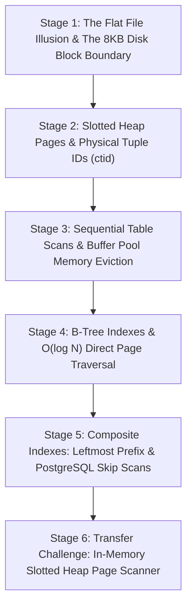

# ApexCaliber — World 17 Engineering & Pedagogical Specification

<text color="secondary" size="xs" weight="medium">RFC W17-002 · 8KB DISK HEAP PAGES, BUFFER POOLS & B-TREE SCANS · V1.0</text>

<badge color="success">Phase 3: Storage, ACID & Caching</badge>

This specification governs World 17 (`heap-pages-and-scans`), establishing the organic stage dependency graph, the POE micro-experiments, Mode A/B simulation contracts, and the pre-wired executable code lab.

---

## 1. Product & Incident Anchor
- **World ID**: 17
- **Slug**: `heap-pages-and-scans` (lc: 9301)
- **Citadel**: `sql_dbms`
- **Real-World Incident**:
  *PostgreSQL Buffer Pool Exhaustion on Unindexed Query:* After migrating an analytical test ledger from DynamoDB to PostgreSQL, queries like `SELECT * FROM test_runs WHERE user_id = 999` spiked p99 latency from 15ms to 18 seconds. Disk I/O saturated at 100% NVMe utilization. An `EXPLAIN ANALYZE` revealed a `Seq Scan on test_runs` reading 240,000 unindexed 8KB heap pages (1.9 GB) into the buffer pool on every single request, flushing hot working sets from RAM.
- **Core Insight**:
  1. Relational databases do not read individual rows from disk. They transfer fixed-size blocks (typically 8KB Heap Pages).
  2. Unindexed queries force exhaustive Sequential Scans, transferring gigabytes of irrelevant blocks into RAM.
  3. B-Tree indexes store key-to-`ctid` (page index, item offset) pointers, allowing $O(\log N)$ point lookups that read exactly 1 leaf page.

---

## 2. Organic Learning Progression (6 Stages)

---

## 3. Stage Specifications & POE Contracts

### Stage 1: The Flat File Illusion & The 8KB Disk Block Boundary
- **Scenario**: When storing 10,000,000 user rows, why can't a database engine read and write individual bytes directly to disk like a text file?
- **Mechanism**: Physical storage devices (HDDs and NVMe SSDs) operate in discrete physical blocks (4KB sectors). Operating systems and databases (PostgreSQL/SQLite) organize storage into fixed-size Pages (typically 8KB). A database engine cannot read less than one full 8KB page from disk.
- **Predict**: If a row is 100 bytes in size and you query for 1 row on an unindexed table, how much physical disk data must the storage engine load into RAM?
  - `opt_a` (Correct): At least 8KB (one complete disk page), and potentially every single 8KB page in the entire table if the row is near the end.
  - `opt_b`: Exactly 100 bytes, because modern SSDs support byte-level addressing.
  - `opt_c`: 0 bytes, because SQL queries execute directly on the disk controller.
- **Controls**:
  - `table_row_count`: Slider (100 to 100000, default 1000)
  - `page_size_kb`: Slider (4 to 64, default 8)

### Stage 2: Slotted Heap Pages & Physical Tuple IDs (`ctid`)
- **Scenario**: Inside an 8KB disk page, rows can be variable-length (e.g. variable length text strings). How does the storage engine locate a row within a page without scanning from the start?
- **Mechanism**: Slotted page layout:
  - Header at the top holds an array of item pointers (offsets).
  - Row tuples are inserted from the bottom of the page upward.
  - Every row has a physical address: `ctid = (page_number, slot_index)`.
- **Predict**: What happens to a row's `ctid` in PostgreSQL when you execute an `UPDATE` on a row that increases its string length?
  - `opt_a` (Correct): Because the updated row might not fit in the existing slot, MVCC inserts a new version on a different page or slot, changing its `ctid`.
  - `opt_b`: The row's `ctid` is an immutable primary key that can never change.
  - `opt_c`: The database shifts all other rows in the file to make space.
- **Controls**:
  - `record_size_bytes`: Slider (64 to 2048, default 256)
  - `page_capacity`: Slider (2 to 50, default 10)

### Stage 3: Sequential Table Scans & Buffer Pool Memory Eviction
- **Scenario**: What happens to the database buffer pool cache when a developer runs an unindexed query across a 50GB table?
- **Mechanism**: The storage engine loads Page 0, Page 1, Page 2... into the shared buffer pool in RAM. Hot cache pages (like frequently queried user profiles) are evicted to make room for cold pages read during the sequential scan, causing a global latency spike across all application queries.
- **Predict**: Why does a Sequential Scan on an unindexed table hurt other unrelated queries running on the same database?
  - `opt_a` (Correct): The sequential scan pollutes the shared buffer pool cache with single-use pages, evicting hot cached tables and forcing subsequent queries to read from slow disk.
  - `opt_b`: Sequential scans lock the entire operating system kernel.
  - `opt_c`: Unindexed queries consume all available TCP network sockets.
- **Controls**:
  - `buffer_pool_size_pages`: Slider (10 to 500, default 50)
  - `execute_unindexed_scan`: Toggle (default: true)

### Stage 4: B-Tree Indexes & $O(\log N)$ Direct Page Traversal
- **Scenario**: How does an index avoid scanning thousands of 8KB disk pages?
- **Mechanism**: A B-Tree index is an auxiliary sorted tree where leaf nodes store `(indexed_value, ctid)`. The database traverses root $\rightarrow$ internal branch $\rightarrow$ leaf page in $O(\log N)$ page reads (typically 3 to 4 I/O operations), and then fetches the exact single heap page using the `ctid`.
- **Predict**: For a table with 10,000,000 rows across 500,000 heap pages, how many disk page reads does a B-Tree index lookup require to find a single user?
  - `opt_a` (Correct): Approximately 3 to 4 page reads (tree height + 1 heap page read).
  - `opt_b`: Approximately 250,000 page reads (half the table).
  - `opt_c`: Exactly 1 page read for all table sizes.
- **Controls**:
  - `b_tree_fanout`: Slider (10 to 500, default 100)
  - `index_enabled`: Toggle (default: true)

### Stage 5: Composite Indexes: Leftmost Prefix & PostgreSQL Skip Scans
- **Scenario**: You create an index on `(country, signup_date, user_id)`. A query filters on `signup_date` only. Does the database use the index?
- **Mechanism**:
  - Traditional leftmost prefix rule: B-Trees sort lexicographically. Without the leading column (`country`), the index cannot be traversed from the root in standard logarithmic seeks.
  - *Advanced Nuance (PostgreSQL / SQLite)*: Modern query planners can sometimes perform an Index Skip Scan or loose index scan if the leading column has very low cardinality (e.g. 3 countries), but it is significantly slower than having the leading column.
- **Predict**: When querying on `(signup_date = '2026-01-01')` against an index `(country, signup_date)`, why is the query planner reluctant to use a standard B-Tree seek?
  - `opt_a` (Correct): Because the B-Tree is sorted first by country; records with that date are scattered across every country branch, preventing a single contiguous range scan.
  - `opt_b`: Because dates cannot be stored in B-Tree data structures.
  - `opt_c`: Because composite indexes can only contain integer numbers.
- **Controls**:
  - `leading_col_cardinality`: Slider (2 to 50, default 5)
  - `query_uses_leading_col`: Toggle (default: false)

### Stage 6: Transfer Challenge: In-Memory Slotted Heap Page Scanner
- **Scenario**: Build a disk storage engine simulator in Python: pack records into fixed-capacity 8KB pages, assign physical `ctid = (page, slot)` coordinates, simulate sequential scan page I/O, and measure page access efficiency.
- **Starter Code**: Preloaded Python function `simulate_heap_scan(records, page_capacity, search_id)`.

---

## 4. Telemetry Contract (`apex.trace.v1`)
Events emitted during storage simulation:
- `heap_page_allocated`: New 8KB page created.
- `tuple_inserted`: Row stored at `ctid (page, slot)`.
- `page_read_disk`: Page fetched from disk into RAM buffer pool.
- `buffer_pool_hit`: Page located in RAM cache.
- `b_tree_seek`: Logarithmic branch traversal.
