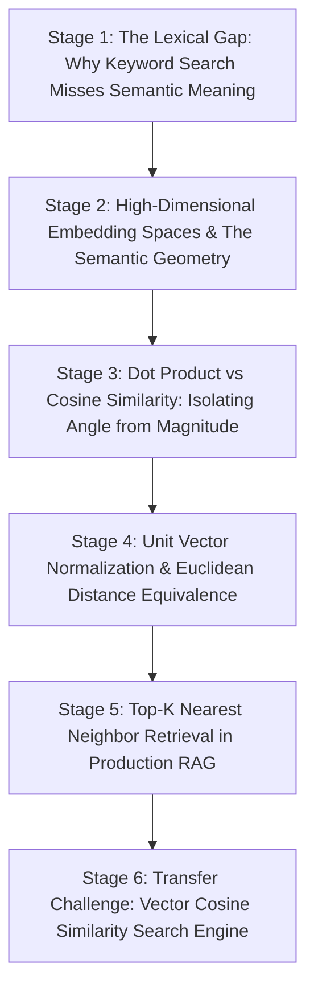

# ApexCaliber — World 21 Engineering & Pedagogical Specification

<text color="secondary" size="xs" weight="medium">RFC W21-001 · DENSE VECTOR EMBEDDINGS, COSINE SIMILARITY & SEMANTIC RAG RETRIEVAL · V1.0</text>

<badge color="success">Phase 6: GenAI & Intelligent Systems</badge>

This specification governs World 21 (`vector-cosine-similarity-search`), establishing the organic stage dependency graph, the POE micro-experiments, Mode A/B simulation contracts, and the pre-wired executable code lab.

---

## 1. Product & Incident Anchor
- **World ID**: 21
- **Slug**: `vector-cosine-similarity-search` (lc: 9601)
- **Citadel**: `ai_resume`
- **Real-World Incident**:
  *WisdomBot Enterprise Search Silence:* When aircraft maintenance engineers searched enterprise technical manuals for "engine overheating during takeoff", the legacy SQL/Elasticsearch full-text search returned 0 results. The engineering manual chapter was titled "Turbofan High-Pressure Turbine Thermal Degradation", never using the casual words "overheating" or "engine". Because keyword queries require exact token overlap, critical troubleshooting procedures were invisible to operators during flight line inspections.
- **Core Insight**:
  1. Traditional keyword search (BM25, inverted index) matches exact lexical tokens, failing on synonyms, paraphrasing, and cross-lingual queries.
  2. Dense embedding models (e.g. OpenAI `text-embedding-3-small`, Cohere `embed-english-v3.0`, BERT) map textual concepts into a continuous high-dimensional vector space (e.g. 1536 dimensions) where semantic similarity corresponds to geometric angle.
  3. Dot product measures both angle and magnitude. Because longer texts or differing token frequencies skew vector magnitudes, Cosine Similarity normalizes vector lengths to isolate pure directional orientation:
     $$\text{sim}(A, B) = \frac{A \cdot B}{\|A\| \|B\|} = \frac{\sum A_i B_i}{\sqrt{\sum A_i^2} \sqrt{\sum B_i^2}}$$
  4. Vector databases (ChromaDB, Pinecone, pgvector) compute top-K nearest neighbors to retrieve relevant document chunks and augment LLM context in Retrieval-Augmented Generation (RAG) pipelines.

---

## 2. Organic Learning Progression (6 Stages)

---

## 3. Stage Specifications & POE Contracts

### Stage 1: The Lexical Gap: Why Keyword Search Misses Semantic Meaning
- **Scenario**: A user searches "How do I fix memory leaks?" The documentation section is titled "Garbage Collection & Unreachable Reference Cycles". Will a traditional BM25 keyword search retrieve this section?
- **Mechanism**: Inverted indexes match identical stems or n-grams. Because the words "memory", "leaks", and "fix" do not literally appear in the heading or first paragraph, the BM25 lexical score is zero. The lexical gap prevents keyword engines from recognizing conceptual equivalence.
- **Predict**: Why does a BM25 keyword search fail when a user queries for "heart attack symptoms" and the article uses "myocardial infarction indicators"?
  - `opt_a` (Correct): Because BM25 relies on exact token matching and has zero understanding that "heart attack" and "myocardial infarction" are identical clinical concepts.
  - `opt_b`: Because medical terms are blocked by search engine firewalls.
  - `opt_c`: Because BM25 only searches single-letter words.
- **Controls**:
  - `retrieval_mode`: Select (`Lexical Keyword (BM25)`, `Dense Semantic Embeddings`)
  - `query_text`: Select (`"fix memory leaks"`, `"heart attack symptoms"`, `"car engine stalls"`)

### Stage 2: High-Dimensional Embedding Spaces & The Semantic Geometry
- **Scenario**: How does an embedding neural network convert words and sentences into numbers that capture conceptual meaning?
- **Mechanism**: The encoder maps text into an $N$-dimensional vector space (e.g. 1536 dimensions). During training on billions of text pairs, the network positions semantically related concepts close together. Words like "king" and "queen" share similar directional offsets to "man" and "woman", embedding latent semantic relationships directly into vector coordinates.
- **Predict**: In an embedding space, what geometric property indicates that two documents discuss similar topics?
  - `opt_a` (Correct): Their embedding vectors point in nearly the same geometric direction, resulting in a small angle between them.
  - `opt_b`: Their vectors have identical file byte sizes on disk.
  - `opt_c`: Their coordinate values are always prime numbers.
- **Controls**:
  - `vector_dimensions`: Slider (64 to 1536, default 384)
  - `cluster_theme`: Select (`Engineering Documentation`, `Medical Diagnostics`, `Legal Contracts`)

### Stage 3: Dot Product vs Cosine Similarity: Isolating Angle from Magnitude
- **Scenario**: You calculate the dot product between a short 5-word query vector and two candidate documents: Document A (a 10-word summary) and Document B (a 500-word detailed article). What unexpected bias occurs with raw dot product?
- **Mechanism**: Dot product is $A \cdot B = \|A\| \|B\| \cos(\theta)$. If a vector has a large magnitude (common in unnormalized embeddings or longer passages), its dot product can be artificially massive even when the angle $\theta$ is large (poor conceptual match). Cosine Similarity divides by $\|A\| \|B\|$, bounding the score to $[-1, 1]$ and measuring pure directional alignment.
- **Predict**: Why can raw Dot Product produce misleading retrieval rankings compared to Cosine Similarity?
  - `opt_a` (Correct): Raw dot product scales with vector magnitude; a long or heavily weighted document can achieve a higher dot product than a concise document that is much closer in actual semantic angle.
  - `opt_b`: Dot product can only produce negative numbers.
  - `opt_c`: Dot product is only supported on Apple Silicon chips.
- **Controls**:
  - `metric_type`: Select (`Cosine Similarity (Normalized)`, `Raw Dot Product (Unnormalized)`)
  - `doc_length_bias`: Slider (1 to 10, default 5)

### Stage 4: Unit Vector Normalization & Euclidean Distance Equivalence
- **Scenario**: In production vector databases (pgvector, Milvus, Qdrant), computing cosine similarity across millions of rows is computationally intensive because of the square root and division. How do modern databases make cosine search run as fast as dot product?
- **Mechanism**: Unit Normalization! During ingestion, every document vector is pre-normalized to unit length: $\hat{v} = v / \|v\|$, so $\|\hat{v}\| = 1.0$. When vectors are unit-normalized, the cosine similarity simplifies to:
  $$\text{sim}(A, B) = \frac{\hat{A} \cdot \hat{B}}{1 \cdot 1} = \hat{A} \cdot \hat{B}$$
  The expensive square roots disappear, and cosine similarity becomes a lightning-fast hardware SIMD dot product!
- **Predict**: When all vectors stored in a vector database are pre-normalized to unit length ($\|v\| = 1.0$), what mathematical optimization becomes possible?
  - `opt_a` (Correct): Cosine similarity becomes identical to raw dot product, eliminating expensive square root calculations during real-time queries.
  - `opt_b`: The database size shrinks to 0 bytes.
  - `opt_c`: Queries run in O(0) constant quantum time.
- **Controls**:
  - `pre_normalize_vectors`: Toggle (default: true)
  - `hardware_acceleration`: Select (`AVX-512 SIMD Dot Product`, `Standard Python Loop`)

### Stage 5: Top-K Nearest Neighbor Retrieval in Production RAG
- **Scenario**: A user asks an LLM: "Why did payment gateway webhook retries fail?" How does a RAG retrieval pipeline choose the exact passages to inject into the prompt?
- **Mechanism**:
  1. The user query is converted into a vector via an embedding model.
  2. The vector index executes a Top-K nearest neighbor search (e.g. $K=3$).
  3. The top 3 chunks with highest cosine similarity are retrieved.
  4. The chunks are injected into the system prompt: `"Context: {chunks} ... Answer the question: {query}"`.
- **Predict**: In a RAG pipeline, what happens if $K$ is set too small (e.g. $K=1$) vs too large (e.g. $K=50$)?
  - `opt_a` (Correct): If K=1, crucial context might be missed (under-retrieval); if K=50, the LLM prompt context window is flooded with irrelevant noise (distraction and high token cost).
  - `opt_b`: If K=50, the LLM catches fire.
  - `opt_c`: Changing K has zero effect on LLM output.
- **Controls**:
  - `top_k`: Slider (1 to 10, default 3)
  - `similarity_threshold`: Slider (0.5 to 0.95, default 0.75, step 0.05)

### Stage 6: Transfer Challenge: Vector Cosine Similarity Search Engine
- **Challenge**: Implement `search_similar_chunks(query_vec: list[float], chunks: list[dict], top_k: int) -> list[dict]`:
  1. Return `[]` if chunks empty or `top_k <= 0`.
  2. Compute cosine similarity for each chunk: dot product divided by product of Euclidean norms. Handle zero-norm vectors safely (similarity = 0.0).
  3. Round similarity to 4 decimal places.
  4. Sort chunks descending by similarity (preserving original index for ties) and return top $K$ items.

---

## 4. Verification & Content Quality Guardrails
- Explains the mathematical derivation connecting angle, dot product, and unit normalization.
- Directly links geometric cosine space to practical RAG context injection.
- Solution passes all tests in `vector-cosine-similarity-search.yaml`.
