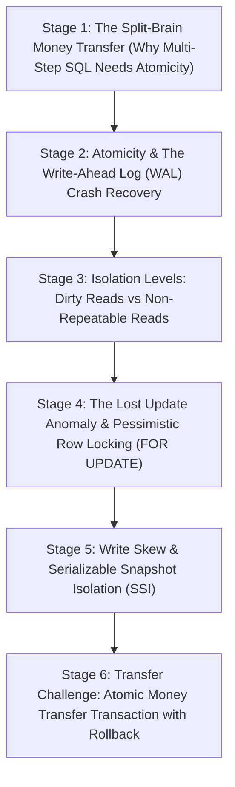

# ApexCaliber — World 25 Engineering & Pedagogical Specification

<text color="secondary" size="xs" weight="medium">RFC W25-001 · SQL ACID TRANSACTIONS, ISOLATION ANOMALIES & MVCC · V1.0</text>

<badge color="success">Phase 3: Storage, ACID & Caching</badge>

This specification governs World 25 (`sql-acid-money-transfer`), establishing the organic stage dependency graph, the POE micro-experiments, Mode A/B simulation contracts, and the pre-wired executable code lab.

---

## 1. Product & Incident Anchor
- **World ID**: 25
- **Slug**: `sql-acid-money-transfer` (lc: 9321)
- **Citadel**: `sql_dbms`
- **Real-World Incident**:
  *PayLoop Core Banking Ledger Discrepancy:* During peak UPI payment hours, network timeouts severed socket connections between the payment switch and bank database midway through wallet balance transfers. Because scripts executed independent `UPDATE` statements without atomic transactions and rollback fences, Account 1 was debited ₹2,000, but Account 2 was never credited. ₹2,000 vanished into phantom accounting loss.
- **Core Insight**:
  1. ACID Atomicity enforces the "all-or-nothing" rule: all state modifications succeed and commit together, or the transaction aborts with zero side-effects.
  2. Isolation levels (Read Committed, Repeatable Read, Serializable) protect concurrent transactions from interleaving anomalies: Dirty Reads, Non-Repeatable Reads, Lost Updates, and Write Skew.

---

## 2. Organic Learning Progression (6 Stages)

---

## 3. Stage Specifications & POE Contracts

### Stage 1: The Split-Brain Money Transfer (Why Multi-Step SQL Needs Atomicity)
- **Scenario**: Transferring ₹200 from Aarav to Priya requires two distinct operations: `UPDATE Accounts SET balance = balance - 200 WHERE id = 1` and `UPDATE Accounts SET balance = balance + 200 WHERE id = 2`. What happens if the database crashes between statement 1 and statement 2?
- **Mechanism**: Without an explicit `BEGIN TRANSACTION ... COMMIT` boundary, each statement commits autocommit-style. A mid-flight crash results in balance destruction (money deducted without being credited).
- **Predict**: If the power cuts off between two unfenced UPDATE statements during a bank transfer, what state is the ledger left in after reboot?
  - `opt_a` (Correct): Corrupted state: the sender has lost ₹200, the recipient never received it, and total money in the system has decreased.
  - `opt_b`: The database automatically detects the intent and completes statement 2 upon reboot.
  - `opt_c`: The database rolls back statement 1 automatically even without a transaction block.
- **Controls**:
  - `crash_after_debit`: Toggle (default: true)
  - `use_atomic_transaction`: Toggle (default: false)

### Stage 2: Atomicity & The Write-Ahead Log (WAL) Crash Recovery
- **Scenario**: How does a relational database ensure it never loses a committed transaction even if the operating system crashes seconds later?
- **Mechanism**: Write-Ahead Logging (WAL):
  1. Before dirty 8KB heap pages are flushed to slow disk tables, changes are appended sequentially to the WAL log file.
  2. On reboot after a crash, the recovery process performs REDO for all committed transactions and UNDO for any uncommitted transactions.
- **Predict**: Why does a database write to the WAL on disk before modifying the actual table heap pages?
  - `opt_a` (Correct): Sequential disk writes to WAL are orders of magnitude faster than random writes to scattered table pages, ensuring durability with minimal latency.
  - `opt_b`: WAL files are stored in cloud object storage, not on physical disks.
  - `opt_c`: The database cannot modify heap pages until the operating system restarts.
- **Controls**:
  - `wal_flush_mode`: Select (`Synchronous_Commit`, `Asynchronous_Commit`)

### Stage 3: Isolation Levels: Dirty Reads vs Non-Repeatable Reads
- **Scenario**: Transaction A transfers money and updates balance to ₹800. Transaction B reads the ₹800. Then Transaction A encounters an error and ROLLS BACK. What did Transaction B just see?
- **Mechanism**: A Dirty Read occurs when a transaction reads uncommitted changes from another transaction. Under `READ COMMITTED` (PostgreSQL default), transactions only read rows that have been officially committed. Under `REPEATABLE READ`, a transaction sees a snapshot of the database as of the transaction start time.
- **Predict**: Under READ COMMITTED, can a transaction read row X, have another transaction modify and commit row X, and then read row X again and see different values?
  - `opt_a` (Correct): Yes! That is the definition of a Non-Repeatable Read, which is permitted in Read Committed isolation.
  - `opt_b`: No, Read Committed prevents all concurrent row changes.
  - `opt_c`: Yes, but only if the row is a foreign key.
- **Controls**:
  - `isolation_level`: Select (`READ_UNCOMMITTED`, `READ_COMMITTED`, `REPEATABLE_READ`, `SERIALIZABLE`)

### Stage 4: The Lost Update Anomaly & Pessimistic Row Locking (`FOR UPDATE`)
- **Scenario**: Two concurrent customers click "Buy Last Ticket". Both read `tickets = 1`. Both compute `tickets - 1 = 0`. Both execute `UPDATE tickets = 0`. Two tickets were sold, but only one existed in inventory!
- **Mechanism**: The Lost Update anomaly occurs under concurrent read-modify-write patterns. In PostgreSQL, using `SELECT ... FOR UPDATE` acquires an exclusive row-level write lock, forcing Transaction 2 to block until Transaction 1 commits.
- **Predict**: How does `SELECT * FROM inventory WHERE id = 1 FOR UPDATE` prevent two concurrent checkouts from overselling inventory?
  - `opt_a` (Correct): It locks the physical row in the buffer pool, forcing concurrent transactions trying to lock or update the same row to wait in a queue.
  - `opt_b`: It locks the entire database server, pausing all read queries across all tables.
  - `opt_c`: It cancels the second user's credit card transaction immediately.
- **Controls**:
  - `concurrent_buyers`: Slider (2 to 20, default 2)
  - `use_select_for_update`: Toggle (default: true)

### Stage 5: Write Skew & Serializable Snapshot Isolation (SSI)
- **Scenario**: Two doctors are on call. Hospital policy requires at least one doctor on call. Both doctors check out concurrently. Both see that the other is active. Both check out. Zero doctors are on call!
- **Mechanism**: Write Skew occurs when two transactions read overlapping datasets, satisfy a constraint, and then modify non-overlapping rows that mutually violate the constraint. Only `SERIALIZABLE` isolation detects read-write conflict dependencies (rw-antidependencies) and aborts one transaction.
- **Predict**: Why does standard Repeatable Read (Snapshot Isolation) fail to prevent the two doctors on-call dilemma?
  - `opt_a` (Correct): Because each doctor modifies their OWN row, neither transaction experiences a row-level write conflict, yet the global business invariant is violated.
  - `opt_b`: Because doctor schedules are stored in NoSQL databases.
  - `opt_c`: Because transactions cannot read other transactions' user IDs.
- **Controls**:
  - `isolation_mode`: Select (`Repeatable_Read_Snapshot`, `Serializable_SSI`)

### Stage 6: Transfer Challenge: Atomic Money Transfer Transaction with Rollback
- **Scenario**: Implement an atomic money transfer in SQL that checks for sufficient funds, updates both accounts, sets status to `'COMMITTED'` on success, and cleanly reports `'ROLLEDBACK'` if funds are insufficient.
- **Starter Code**: Preloaded SQL query script for SQLite/PostgreSQL.

---

## 4. Telemetry Contract (`apex.trace.v1`)
Events emitted during ACID simulation:
- `tx_begin`: Transaction allocated `txid`.
- `wal_flush`: Undo/Redo delta written to disk.
- `row_lock_acquired`: Exclusive lock placed on row `id=1`.
- `tx_committed`: State committed; changes visible to subsequent transactions.
- `tx_rolled_back`: Transaction aborted; original values restored.
