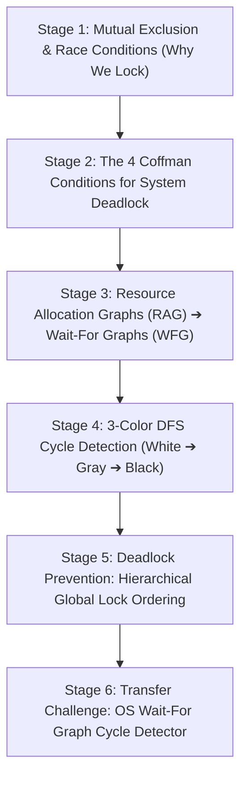

# ApexCaliber — World 27 Engineering & Pedagogical Specification

<text color="secondary" size="xs" weight="medium">RFC W27-001 · LOCKS, SEMAPHORES, WAIT-FOR GRAPHS & DEADLOCK CYCLES · V1.0</text>

<badge color="success">Phase 4: Runtime, Concurrency & Memory</badge>

This specification governs World 27 (`deadlock-cycle-detector`), establishing the organic stage dependency graph, the POE micro-experiments, Mode A/B simulation contracts, and the pre-wired executable code lab.

---

## 1. Product & Incident Anchor
- **World ID**: 27
- **Slug**: `deadlock-cycle-detector` (lc: 9422)
- **Citadel**: `os_concurrency`
- **Real-World Incident**:
  *Food Delivery Dispatcher Thread Freeze:* During Friday evening rush hour, Swiggy's delivery assignment service froze completely with 0 orders dispatched. Thread 1 acquired the exclusive lock on Delivery Partner `P42` and attempted to acquire Order `O99`. Concurrently, Thread 2 acquired the lock on Order `O99` and attempted to acquire Delivery Partner `P42`. Neither thread could proceed or release its lock, forming a classic cyclic deadlock that halted dispatch operations until the application was killed and restarted.
- **Core Insight**:
  1. Concurrency locks prevent race conditions, but uncoordinated locking introduces Deadlocks.
  2. Deadlock requires all 4 Coffman conditions: Mutual Exclusion, Hold & Wait, No Preemption, and Circular Wait.
  3. Circular wait can be modeled as a directed Wait-For Graph (WFG). A directed cycle detected via 3-color DFS is necessary and sufficient for deadlock in single-unit resource systems.
  4. Hierarchical Lock Ordering (always acquiring locks in strict global identifier order) mathematically eliminates circular wait.

---

## 2. Organic Learning Progression (6 Stages)

---

## 3. Stage Specifications & POE Contracts

### Stage 1: Mutual Exclusion & Race Conditions (Why We Lock)
- **Scenario**: Two threads increment a shared counter variable `count = count + 1` concurrently without a mutex. What happens to the final value?
- **Mechanism**: Incrementing is not an atomic CPU instruction: it involves 1. Read memory to register, 2. Add 1, 3. Write register to memory. An interleaved thread context switch overwrites updates, causing lost increments. Mutexes enforce mutual exclusion so only one thread enters the critical section.
- **Predict**: If Thread A and Thread B each increment a shared counter 1,000 times without locks on a multi-core machine, what is the final counter value?
  - `opt_a` (Correct): Less than 2,000 (often 1,200 to 1,600) due to race condition overwrites.
  - `opt_b`: Exactly 2,000 every time.
  - `opt_c`: Always 0 because concurrent writes cancel each other out.
- **Controls**:
  - `iterations_per_thread`: Slider (100 to 5000, default 1000)
  - `mutex_enabled`: Toggle (default: false)

### Stage 2: The 4 Coffman Conditions for System Deadlock
- **Scenario**: When does a system of threads and locks freeze in an unrecoverable deadlock?
- **Mechanism**: Deadlock can occur if and only if all four Coffman conditions hold simultaneously:
  1. Mutual Exclusion: Resources cannot be shared.
  2. Hold and Wait: A thread holding a resource requests additional resources.
  3. No Preemption: Resources cannot be forcibly seized from a thread.
  4. Circular Wait: A closed chain of threads exists where each waits for a resource held by the next.
- **Predict**: If you break ANY ONE of the four Coffman conditions in an operating system, can a deadlock still occur?
  - `opt_a` (Correct): No! All 4 conditions are strictly required simultaneously; breaking any single condition makes deadlock mathematically impossible.
  - `opt_b`: Yes, deadlocks can occur spontaneously due to CPU overheating.
  - `opt_c`: Yes, breaking Circular Wait only delays the deadlock.
- **Controls**:
  - `preemption_allowed`: Toggle (default: false)
  - `hold_and_wait_allowed`: Toggle (default: true)

### Stage 3: Resource Allocation Graphs (RAG) ➔ Wait-For Graphs (WFG)
- **Scenario**: How can an operating system kernel monitor hundreds of threads and locks to detect deadlocks programmatically?
- **Mechanism**: The OS maintains a Wait-For Graph (WFG) where nodes are threads. If Thread A requests a lock currently held by Thread B, a directed edge `Thread_A -> Thread_B` is added. A directed cycle in this graph proves the existence of Circular Wait!
- **Predict**: If Thread 1 holds Lock A and requests Lock B, while Thread 2 holds Lock B and requests Lock A, what edges exist in the Wait-For Graph?
  - `opt_a` (Correct): A directed cycle: `T1 -> T2` and `T2 -> T1`.
  - `opt_b`: A disconnected graph with no edges.
  - `opt_c`: A single bidirectional tree edge.
- **Controls**:
  - `number_of_threads`: Slider (2 to 8, default 2)
  - `number_of_locks`: Slider (2 to 8, default 2)

### Stage 4: 3-Color DFS Cycle Detection (White ➔ Gray ➔ Black)
- **Scenario**: How does the kernel detect directed cycles in a Wait-For Graph in $O(V + E)$ time?
- **Mechanism**: 3-Color Depth-First Search:
  - White (0): Unvisited node.
  - Gray (1): Node is currently in the active recursion call stack.
  - Black (2): Node and all its descendants are fully explored.
  If DFS encounters a node that is currently GRAY, a back-edge to an ancestor on the stack has been discovered: a DEADLOCK CYCLE!
- **Predict**: During DFS traversal of a Wait-For Graph, what does encountering a node marked GRAY indicate?
  - `opt_a` (Correct): A directed cycle (deadlock) has been detected, because the path has looped back to a node currently waiting in the active call stack.
  - `opt_b`: The node is safe and has zero outgoing dependencies.
  - `opt_c`: The node has already completed execution and released all locks.
- **Controls**:
  - `dfs_animation_speed`: Slider (1 to 10, default 5)

### Stage 5: Deadlock Prevention: Hierarchical Global Lock Ordering
- **Scenario**: How do major systems like the Linux kernel or PostgreSQL guarantee that code will NEVER deadlock in production?
- **Mechanism**: Enforce a global lock hierarchy (e.g. acquire locks in increasing numerical or alphabetical order). If an operation requires `Lock 5` and `Lock 2`, it MUST acquire `Lock 2` first, then `Lock 5`. This eliminates the Circular Wait condition entirely!
- **Predict**: If all threads in an application are strictly required to acquire locks in increasing resource ID order (`min(A, B)` before `max(A, B)`), can a circular deadlock ever form?
  - `opt_a` (Correct): No, because cycles require an edge from a higher-numbered lock to a lower-numbered lock, which strict hierarchical ordering makes impossible.
  - `opt_b`: Yes, if the network drops between lock acquisitions.
  - `opt_c`: Yes, if the locks are held for longer than 10 seconds.
- **Controls**:
  - `enforce_hierarchical_lock_order`: Toggle (default: true)

### Stage 6: Transfer Challenge: OS Wait-For Graph Cycle Detector
- **Scenario**: Implement the OS Wait-For Graph cycle detector in Python: build the directed graph from allocations and requests, run 3-color DFS to detect directed cycles, and return the deadlocked thread cycle.
- **Starter Code**: Preloaded Python function `detect_deadlock(allocations, requests)`.

---

## 4. Telemetry Contract (`apex.trace.v1`)
Events emitted during Deadlock simulation:
- `lock_requested`: Thread requests resource.
- `lock_acquired`: Mutex granted.
- `wfg_edge_added`: Directed dependency `T_A -> T_B` registered.
- `dfs_node_colored`: DFS coloring transition (0 -> 1 -> 2).
- `deadlock_cycle_found`: Directed cycle identified and highlighted.
