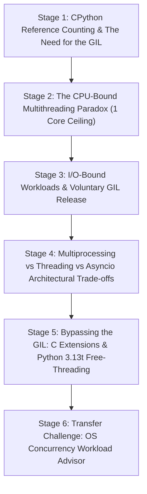

# ApexCaliber — World 28 Engineering & Pedagogical Specification

<text color="secondary" size="xs" weight="medium">RFC W28-001 · CPYTHON REFERENCE COUNTING, GIL CONTENTION & MULTI-CORE SCALING · V1.0</text>

<badge color="success">Phase 4: Runtime, Concurrency & Memory</badge>

This specification governs World 28 / World 19 (`python-gil-contention`), establishing the organic stage dependency graph, the POE micro-experiments, Mode A/B simulation contracts, and the pre-wired executable code lab.

---

## 1. Product & Incident Anchor
- **World ID**: 28 / 19
- **Slug**: `python-gil-contention` (lc: 9402)
- **Citadel**: `os_concurrency`
- **Real-World Incident**:
  *Drizz Mobile 8-Core Performance Regression:* During high-volume regression testing of 500 mobile application flows, the test harness performed two operations: fetching device screenshots over HTTP and parsing dense OCR XML DOM trees with bounding-box intersection calculations. An engineer wrapped both tasks in a 50-worker `concurrent.futures.ThreadPoolExecutor` on an 8-core cloud instance, expecting an 8x throughput boost. Instead, CPU-bound XML parsing slowed by 35%, and latency skyrocketed. The 8 CPU cores spent more time in thread scheduling and GIL lock contention than executing user code.
- **Core Insight**:
  1. CPython uses reference counting (`ob_refcnt`, adjusted via `Py_INCREF` and `Py_DECREF`) for deterministic memory cleanup. To protect reference counters from race conditions without thousands of fine-grained locks, CPython enforces the Global Interpreter Lock (GIL).
  2. Only one native OS thread can execute Python bytecode at any moment per interpreter. Adding threads to CPU-bound workloads introduces lock thrashing without utilizing extra cores.
  3. When threads perform I/O (disk, network sockets, database queries), CPython voluntarily releases the GIL, allowing other threads to run freely.
  4. CPU-bound parallelism in Python requires `multiprocessing` (isolated memory and interpreters), C/Rust extensions releasing the GIL via `Py_BEGIN_ALLOW_THREADS`, or Python 3.13t free-threaded mode (PEP 703).

---

## 2. Organic Learning Progression (6 Stages)

---

## 3. Stage Specifications & POE Contracts

### Stage 1: CPython Reference Counting & The Need for the GIL
- **Scenario**: In CPython, every object is wrapped in a `PyObject` structure containing an integer `ob_refcnt`. When an object is referenced, `Py_INCREF(op)` increments the counter; when dereferenced, `Py_DECREF(op)` decrements it. If multiple OS threads manipulate Python objects simultaneously without a lock, what memory hazard occurs?
- **Mechanism**: Incrementing and decrementing `ob_refcnt` is not atomic in standard C. Without locking, two threads reading and updating `ob_refcnt` simultaneously cause race conditions: an object with active references could have its refcount drop to 0 and be freed prematurely (use-after-free vulnerability), or memory can be leaked indefinitely. The GIL solves this globally by ensuring only one thread executes bytecode at a time.
- **Predict**: What happens if multiple native OS threads modify CPython object reference counts concurrently without the GIL or atomic operations?
  - `opt_a` (Correct): Race conditions corrupt `ob_refcnt`, triggering heap corruption, segmentation faults, and use-after-free security vulnerabilities.
  - `opt_b`: CPython automatically converts all variables into atomic CPU registers without overhead.
  - `opt_c`: Python switches to Java's generational garbage collector automatically.
- **Controls**:
  - `thread_count`: Slider (1 to 8, default 4)
  - `atomic_refcount`: Toggle (default: false)

### Stage 2: The CPU-Bound Multithreading Paradox (1 Core Ceiling)
- **Scenario**: You run a CPU-intensive mathematical loop (calculating 10,000,000 prime numbers) on an 8-core server. You split the workload across 8 threads using `threading.Thread`. How does total wall-clock execution time compare to a single thread?
- **Mechanism**: Because the GIL prevents simultaneous bytecode execution, all 8 threads take turns acquiring the GIL, running for a brief switch interval (default 5ms), and releasing it. The 8 threads must serialize onto a single CPU core. Furthermore, OS thread context-switching overhead, cache thrashing, and lock contention make the 8-thread run SLOWER than a single thread.
- **Predict**: How does running an intensive CPU-bound computation across 8 Python threads compare to 1 Python thread on an 8-core machine?
  - `opt_a` (Correct): The 8-thread program is actually slower or at best equal, utilizing only 100% of 1 core (out of 800%) due to GIL lock serialization and context switching.
  - `opt_b`: It runs 8x faster because modern OS schedulers bypass Python locks.
  - `opt_c`: It utilizes 800% CPU capacity with 0 context switches.
- **Controls**:
  - `thread_count`: Slider (1 to 8, default 4)
  - `task_type`: Dropdown (`cpu_bound_primes`, `matrix_math`)

### Stage 3: I/O-Bound Workloads & Voluntary GIL Release
- **Scenario**: You have 100 concurrent HTTP requests fetching device screenshots from remote mobile testing farms. Each request spends 95% of its time waiting for network packets. If you use 100 threads, does the GIL block them?
- **Mechanism**: Before initiating blocking system calls (like `recv()`, `select()`, or disk reads), CPython executes `Py_BEGIN_ALLOW_THREADS`, dropping the GIL. While Thread 1 waits on socket I/O, Thread 2 acquires the GIL and submits its request. Thus, I/O-bound multithreading in Python achieves true concurrency.
- **Predict**: When a Python thread makes a blocking network socket call (e.g. `requests.get()` or database query), what happens to the GIL?
  - `opt_a` (Correct): The thread voluntarily releases the GIL before waiting on the socket, allowing other threads to run Python code concurrently.
  - `opt_b`: The thread holds the GIL until all data packets arrive, freezing all other threads.
  - `opt_c`: The GIL crashes because sockets are incompatible with Python bytecode.
- **Controls**:
  - `network_latency_ms`: Slider (10 to 200, default 50)
  - `concurrent_requests`: Slider (5 to 100, default 20)

### Stage 4: Multiprocessing vs Threading vs Asyncio Architectural Trade-offs
- **Scenario**: Drizz Mobile needs to choose an architecture for: A) 1,000 concurrent REST API calls, and B) 8-core OCR image edge detection. Which concurrency model fits each?
- **Mechanism**:
  - `asyncio`: Single-threaded event loop utilizing non-blocking OS I/O primitives (`epoll`/`kqueue`). Lowest memory footprint (~2KB per coroutine), ideal for massive I/O concurrency.
  - `threading`: Native OS threads (~8MB stack each). Good for I/O when synchronous legacy libraries are required, but limited by GIL for CPU tasks.
  - `multiprocessing`: Spawns separate OS processes via `fork`/`spawn`. Each process has its own Python interpreter and GIL, providing true multi-core CPU scaling, but incurs memory duplication and IPC serialization overhead.
- **Predict**: For an OCR image processing pipeline that needs to max out an 8-core CPU, which concurrency primitive must be used in Python?
  - `opt_a` (Correct): `multiprocessing` (or `ProcessPoolExecutor`), because each process has an independent interpreter and GIL running across physical cores.
  - `opt_b`: `asyncio`, because async code automatically runs on all CPU cores simultaneously.
  - `opt_c`: `threading`, because threads share memory without any overhead.
- **Controls**:
  - `workload`: Dropdown (`ocr_cpu_bound`, `http_io_bound`)
  - `runtime`: Dropdown (`multiprocessing`, `threading`, `asyncio`)

### Stage 5: Bypassing the GIL: C Extensions & Python 3.13t Free-Threading
- **Scenario**: Modern data science and machine learning libraries like NumPy, PyTorch, and Polars execute matrix operations in parallel across all CPU cores without `multiprocessing`. How?
- **Mechanism**:
  1. **C Extensions**: Operations like `numpy.dot()` are implemented in compiled C/C++/Fortran. The extension explicitly releases the GIL using `Py_BEGIN_ALLOW_THREADS`, executes parallel SIMD/OpenMP loops across all cores, and re-acquires the GIL before returning to Python.
  2. **PEP 703 Free-Threaded Python (3.13t)**: Python 3.13 introduces an experimental build (`python3.13t`) that disables the GIL entirely, replacing coarse-grained locking with mimalloc thread-safe memory allocators, biased reference counting, and immortal objects.
- **Predict**: How does NumPy run multi-threaded matrix multiplications across all CPU cores in a standard Python process?
  - `opt_a` (Correct): NumPy drops the GIL at the C level (`Py_BEGIN_ALLOW_THREADS`), executes hardware-accelerated C/BLAS threads across all cores, and re-acquires the GIL before returning.
  - `opt_b`: NumPy forces the Linux kernel to rewrite the Python bytecode interpreter in assembly.
  - `opt_c`: NumPy runs inside a virtual machine that ignores CPU registers.
- **Controls**:
  - `library`: Dropdown (`numpy_blas`, `pure_python_loop`)
  - `python_version`: Dropdown (`cpython_3_12_standard`, `python_3_13t_nogil`)

### Stage 6: Transfer Challenge: OS Concurrency Workload Advisor
- **Challenge**: Implement `classify_concurrency_workload(workload_type: str, worker_count: int) -> dict` that inspects workload characteristics and recommends the optimal runtime strategy (`multiprocessing` for CPU-bound, `asyncio` for I/O-bound), estimating core utilization and GIL contention status.
- **Pre-wired Lab Starter**: Complete test suite ensuring edge cases (unknown workloads, worker scaling) are validated.

---

## 4. Verification & Content Quality Guardrails
- All stage explanations provide clear mental models before revealing code.
- Predict choices provide immediate cognitive validation with detailed feedback.
- Pre-wired solution passes all test cases in `python-gil-contention.yaml`.
