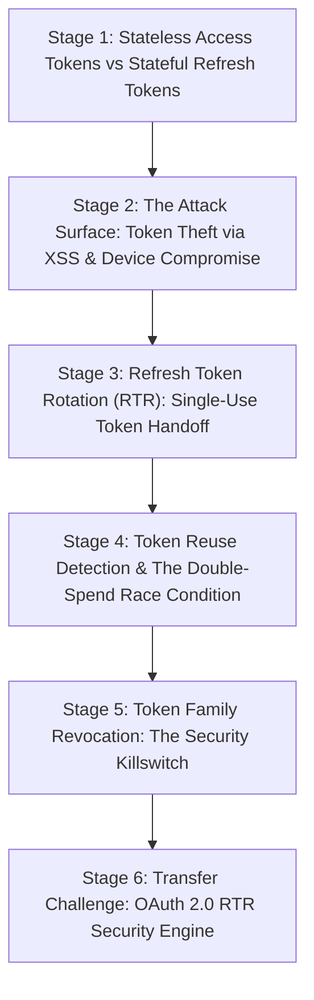

# ApexCaliber — World 31 Engineering & Pedagogical Specification

<text color="secondary" size="xs" weight="medium">RFC W31-001 · OAUTH 2.0 REFRESH TOKEN ROTATION (RTR), REPLAY ATTACKS & FAMILY REVOCATION · V1.0</text>

<badge color="success">Phase 5: Production Workflows, Python Internals & Auth</badge>

This specification governs World 31 (`refresh-token-rotation-reuse`), establishing the organic stage dependency graph, the POE micro-experiments, Mode A/B simulation contracts, and the pre-wired executable code lab.

---

## 1. Product & Incident Anchor
- **World ID**: 31
- **Slug**: `refresh-token-rotation-reuse` (lc: 9522)
- **Citadel**: `backend_apis`
- **Real-World Incident**:
  *BharatPay Merchant Portal Token Hijacking Incident:* A merchant's laptop was infected with a credential-harvesting browser extension that scraped cached OAuth tokens from Chrome local storage. The attacker extracted a long-lived refresh token valid for 30 days. Two weeks later, after the merchant closed their business for the day, the attacker used the stolen refresh token to mint new access tokens and initiate unauthorized refund transfers. Because the backend auth server used static refresh tokens without rotation or reuse detection, the compromised session operated undetected until monthly accounting reconciliation.
- **Core Insight**:
  1. Access tokens are short-lived (5-15 mins) and cryptographically signed (HMAC/RSA), eliminating database lookups on every API request.
  2. Refresh tokens are long-lived (30+ days) and stored in a database to grant renewed access without re-prompting users for credentials.
  3. Under Refresh Token Rotation (RTR), every time a client exchanges a refresh token for a new access token, the auth server invalidates the old refresh token and returns a brand new single-use refresh token.
  4. If a previously used refresh token is ever presented again, the auth server identifies an active Replay Attack (either the legitimate client or the attacker is presenting an already-spent token) and immediately invalidates the entire token family/session, locking out both parties.

---

## 2. Organic Learning Progression (6 Stages)

---

## 3. Stage Specifications & POE Contracts

### Stage 1: Stateless Access Tokens vs Stateful Refresh Tokens
- **Scenario**: Why don't web and mobile applications simply give users an access token that lasts for 1 year so they never have to log in again?
- **Mechanism**: Access tokens are stateless (JWTs): services verify their signature locally using a public key without querying a central database. If an access token were valid for 1 year, revoking access when a user is fired or their phone is stolen would be impossible without creating a distributed blacklist that negates the stateless performance benefits. Therefore, access tokens expire quickly (15 minutes), while a stateful refresh token stored in the database is used to request new access tokens periodically.
- **Predict**: If an API uses purely stateless JWT access tokens with a 6-month lifespan, what security problem arises when an employee is terminated?
  - `opt_a` (Correct): The terminated employee can continue using the token until expiration because services verify the cryptographic signature locally without checking employee employment status.
  - `opt_b`: The server immediately revokes the JWT through hardware CPU memory invalidation.
  - `opt_c`: The JWT self-destructs after 10 API calls.
- **Controls**:
  - `access_token_ttl_mins`: Slider (5 to 1440, default 15)
  - `token_type`: Select (`stateless_jwt`, `stateful_session_cookie`)

### Stage 2: The Attack Surface: Token Theft via XSS & Device Compromise
- **Scenario**: A malicious third-party script runs in a user's browser via Cross-Site Scripting (XSS). It reads `localStorage.getItem('refresh_token')` and sends it to an attacker's C2 server. If the refresh token is static and valid for 30 days, what can the attacker do?
- **Mechanism**: Because the server only checks if the token exists and is unexpired, the attacker can silently generate new access tokens whenever they want for the next 30 days. The legitimate user and the attacker operate side-by-side, completely invisible to the backend.
- **Predict**: If an attacker steals a static, non-rotating refresh token, how long can they maintain unauthorized access?
  - `opt_a` (Correct): Until the token expires (e.g. 30 days) or the user manually changes their password, because the auth server cannot distinguish legitimate requests from attacker requests.
  - `opt_b`: For only 1 request, because HTTP packets verify the user's physical fingerprint.
  - `opt_c`: Never, because browsers encrypt all tokens with quantum encryption.
- **Controls**:
  - `token_storage_location`: Select (`local_storage`, `http_only_cookie`, `in_memory_state`)
  - `rotation_enabled`: Toggle (default: false)

### Stage 3: Refresh Token Rotation (RTR): Single-Use Token Handoff
- **Scenario**: How does Refresh Token Rotation prevent stolen tokens from being reused indefinitely?
- **Mechanism**: Every time a refresh token (e.g. `RT_1`) is submitted to `/auth/refresh`:
  1. The server marks `RT_1` as spent/used.
  2. The server issues a brand new access token `AT_2` AND a brand new refresh token `RT_2`.
  3. The client discards `RT_1` and stores `RT_2`.
  Every refresh token is strictly Single-Use.
- **Predict**: What does the OAuth server do with the presented refresh token during a successful rotation?
  - `opt_a` (Correct): It moves the presented token into a spent/used list and returns a brand new single-use refresh token alongside the new access token.
  - `opt_b`: It extends the lifespan of the presented refresh token by 30 days.
  - `opt_c`: It deletes the user's password from the database.
- **Controls**:
  - `step_rotation`: Button (Execute Token Rotation)
  - `token_lineage`: Select (`token_v1`, `token_v2`, `token_v3`)

### Stage 4: Token Reuse Detection & The Double-Spend Race Condition
- **Scenario**: Suppose an attacker stole `RT_1`. The legitimate user uses `RT_1` to rotate to `RT_2`. Later, the attacker attempts to use `RT_1`. What should happen? Or conversely, suppose the attacker uses `RT_1` first, rotating to `RT_2_attacker`. When the legitimate user tries to use `RT_1`, what happens?
- **Mechanism**: In either case, `RT_1` is already in the `used_tokens` history! The server detects that an already-spent token was presented. This is Token Reuse. Because the server cannot know which party is the legitimate user and which is the attacker, it assumes a breach has occurred.
- **Predict**: When an auth server receives a refresh token that is already marked as "used", what does this indicate?
  - `opt_a` (Correct): Token reuse (replay attack): either an attacker is presenting a stolen spent token, or a legitimate user was overtaken by an attacker who rotated their token first.
  - `opt_b`: A temporary network glitch that should be ignored.
  - `opt_c`: The client's clock is running 5 minutes fast.
- **Controls**:
  - `attacker_timing`: Select (`attacker_presents_after_user`, `attacker_presents_before_user`)

### Stage 5: Token Family Revocation: The Security Killswitch
- **Scenario**: When Token Reuse is detected on a spent refresh token, what is the safest action for the auth server to take?
- **Mechanism**: Immediate Family Revocation! The auth server sets `revoked = True` for the entire session record. All active refresh tokens in that family are destroyed. The next time either the attacker or the legitimate user attempts any authenticated action, they receive an HTTP 401 Unauthorized and are forced to re-authenticate with multi-factor authentication (MFA).
- **Predict**: Why does Refresh Token Rotation revoke the ENTIRE session rather than just rejecting the reused token?
  - `opt_a` (Correct): If the attacker already rotated the token earlier, rejecting only the spent token would leave the attacker with the valid active token; revoking the entire family cuts off the attacker immediately.
  - `opt_b`: Because databases cannot delete single rows without truncating tables.
  - `opt_c`: To force the user to pay a penalty fee.
- **Controls**:
  - `revocation_policy`: Select (`revoke_entire_family`, `reject_only_spent_token`)

### Stage 6: Transfer Challenge: OAuth 2.0 RTR Security Engine
- **Challenge**: Implement `rotate_refresh_token(presented_token: str, sessions_db: dict) -> dict`:
  1. Revocation check: If `sessions_db['revoked']` is True, return 401 `session_revoked`.
  2. Replay check: If `presented_token` in `sessions_db['used_tokens']`, mark `sessions_db['revoked'] = True` and return 401 `token_reuse_detected`.
  3. Active check: If `presented_token != sessions_db['active_token']`, return 404 `token_not_found`.
  4. Rotation: Move `presented_token` to `used_tokens`, issue new `active_token` and `access_token`, and return 200.

---

## 4. Verification & Content Quality Guardrails
- Distinguishes clearly between stateless JWT verification and stateful refresh storage.
- Concrete attack sequences illustrate why token family revocation is required.
- Solution passes all tests in `refresh-token-rotation-reuse.yaml`.
