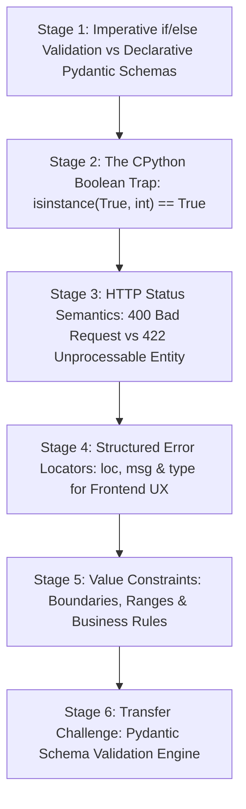

# ApexCaliber — World 32 Engineering & Pedagogical Specification

<text color="secondary" size="xs" weight="medium">RFC W32-001 · PYDANTIC SCHEMA VALIDATION, CPYTHON TYPE ANOMALIES & HTTP 422 SPECIFICATION · V1.0</text>

<badge color="success">Phase 5: Production Workflows, Python Internals & Auth</badge>

This specification governs World 32 (`pydantic-payload-validator`), establishing the organic stage dependency graph, the POE micro-experiments, Mode A/B simulation contracts, and the pre-wired executable code lab.

---

## 1. Product & Incident Anchor
- **World ID**: 32
- **Slug**: `pydantic-payload-validator` (lc: 9511)
- **Citadel**: `backend_apis`
- **Real-World Incident**:
  *UrbanFix Home Maintenance Booking Crash:* In UrbanFix's service dispatch API, booking requests contained arbitrary JSON fields submitted by diverse mobile clients. Customers entered string values like `"two"` for technician counts and negative numbers (`-5`) for spare parts. The legacy Flask API lacked unified validation; deep inside the SQL transaction layer, the application crashed with unhandled `TypeError` and `ValueError` exceptions, generating 500 Internal Server Errors, corrupting invoice math, and filling Sentry error queues with hundreds of alert pages during weekend booking spikes.
- **Core Insight**:
  1. Imperative validation (scattering manual `if` statements throughout route handlers) is brittle, incomplete, and leaks implementation details when exceptions slip through.
  2. Declarative schema validation parses, type-checks, and boundary-validates incoming payloads before route handlers execute.
  3. Python's type hierarchy includes historical quirks: `bool` is a subclass of `int` in CPython (`isinstance(True, int)` evaluates to `True`), requiring explicit type filtering in strict schema validators.
  4. FastAPI standardizes on HTTP 422 Unprocessable Entity (RFC 4918 / RFC 9457) with nested locator arrays (`loc: ["body", "user", "age"]`) so frontends can bind error messages directly to UI input fields.

---

## 2. Organic Learning Progression (6 Stages)

---

## 3. Stage Specifications & POE Contracts

### Stage 1: Imperative if/else Validation vs Declarative Pydantic Schemas
- **Scenario**: A developer writes 25 lines of `if not isinstance(data.get('age'), int): return {"error": "bad age"}` checks inside a route handler. What happens as new fields are added?
- **Mechanism**: Imperative validation leads to code bloat, forgotten field checks, inconsistent error response shapes, and security vulnerabilities (e.g., negative balances or missing required fields). Declarative Pydantic schemas define the data contract up front, automatically validating presence, types, and constraints in a single pass before business logic runs.
- **Predict**: What is the primary architectural advantage of declarative schema validation (like Pydantic) over manual `if/else` checks?
  - `opt_a` (Correct): It guarantees consistent validation rules, uniform error responses, and automatic type coercion before handler code executes.
  - `opt_b`: It speeds up network transmission by 500% over the wire.
  - `opt_c`: It converts all incoming JSON strings into compiled C binary code.
- **Controls**:
  - `validation_approach`: Select (`declarative_pydantic`, `manual_imperative_checks`)
  - `field_count`: Slider (2 to 20, default 5)

### Stage 2: The CPython Boolean Trap: isinstance(True, int) == True
- **Scenario**: You have a schema requiring an integer `technician_count`. A client sends `{"technician_count": True}`. If your validator simply checks `isinstance(val, int)`, does it pass?
- **Mechanism**: In Python, `bool` is an explicit subclass of `int` (`issubclass(bool, int) is True`). Therefore, `isinstance(True, int)` returns `True`! In raw Python math, `True + 1 == 2`. To prevent clients from passing booleans where integers are required, strict validators must verify `isinstance(val, int) and not isinstance(val, bool)`.
- **Predict**: In standard CPython, what is the output of `isinstance(True, int)`?
  - `opt_a` (Correct): True! In CPython, bool inherits from int, so True is treated as a valid integer unless explicitly excluded.
  - `opt_b`: False! Integers and Booleans belong to completely separate memory types in all languages.
  - `opt_c`: It raises a TypeError at runtime.
- **Controls**:
  - `strict_type_checking`: Toggle (default: true)
  - `submitted_value`: Select (`True`, `False`, `42`, `"42"`)

### Stage 3: HTTP Status Semantics: 400 Bad Request vs 422 Unprocessable Entity
- **Scenario**: A client sends a POST request with valid JSON syntax `{"age": "twenty"}`. Should the server respond with HTTP 400 Bad Request or HTTP 422 Unprocessable Entity?
- **Mechanism**:
  - HTTP 400 Bad Request indicates that the HTTP message itself is malformed (e.g., invalid JSON syntax like trailing commas, corrupted headers).
  - HTTP 422 Unprocessable Entity indicates that the syntax is well-formed (valid JSON), but the semantic instructions cannot be processed due to validation errors (e.g., age must be an int, not a string). FastAPI standardizes on HTTP 422 for all schema validation failures.
- **Predict**: When an incoming JSON payload is syntactically valid JSON but violates schema data types, which HTTP status code is standard in FastAPI?
  - `opt_a` (Correct): HTTP 422 Unprocessable Entity, indicating the syntax is valid JSON but fails semantic schema rules.
  - `opt_b`: HTTP 500 Internal Server Error, because the server encountered a bug.
  - `opt_c`: HTTP 200 OK with an error message inside the body.
- **Controls**:
  - `error_scenario`: Select (`semantic_type_error_422`, `malformed_json_syntax_400`)

### Stage 4: Structured Error Locators: loc, msg & type for Frontend UX
- **Scenario**: When an API rejects a nested request payload, how does the frontend know which form input field to highlight in red?
- **Mechanism**: FastAPI / Pydantic error details include a `loc` array path (e.g. `["body", "address", "zipcode"]`), an error message `msg`, and a machine-readable error `type` (`missing`, `int_type`, `greater_than_equal`). Client libraries (like React Hook Form or Formik) map these locators directly to form inputs to render inline error messages without custom parsing.
- **Predict**: Why does Pydantic return errors with a locator array like `loc: ["body", "user", "email"]`?
  - `opt_a` (Correct): It allows frontend frameworks to map validation errors directly to the exact nested input field in the UI.
  - `opt_b`: It informs the database which column index to delete.
  - `opt_c`: It traces the GPS coordinates of the mobile device.
- **Controls**:
  - `payload_nesting`: Select (`flat_payload`, `nested_address_payload`)

### Stage 5: Value Constraints: Boundaries, Ranges & Business Rules
- **Scenario**: An age field must be an integer between 18 and 120. A user submits `age = 16`. How are numeric boundary constraints applied?
- **Mechanism**: After type verification, validators check boundary constraints: `min` (greater than or equal to) and `max` (less than or equal to). If `val < min`, the validator emits `type: "greater_than_equal"` with message `"Input should be greater than or equal to {min}"`.
- **Predict**: What error should be generated for a field with constraint `min: 18` when the submitted value is `16`?
  - `opt_a` (Correct): `{"loc": ["body", "age"], "msg": "Input should be greater than or equal to 18", "type": "greater_than_equal"}` with status 422.
  - `opt_b`: `{"error": "Underage"}` with status 403 Forbidden.
  - `opt_c`: The value is automatically rounded up to 18 with status 200.
- **Controls**:
  - `min_bound`: Slider (0 to 100, default 18)
  - `submitted_age`: Slider (10 to 30, default 16)

### Stage 6: Transfer Challenge: Pydantic Schema Validation Engine
- **Challenge**: Implement `validate_payload(schema: dict, payload: dict) -> dict`:
  1. Check required fields: missing fields produce `type: "missing"`.
  2. Verify types (`str`, `int` without bool, `float` without bool, `bool`): mismatches produce `type: f"{expected}_type"`.
  3. Validate boundary constraints (`min`, `max`): produce `type: "greater_than_equal"` or `"less_than_equal"`.
  4. Return `{"status_code": 422, "detail": errors, "valid": False}` if any error, else `{"status_code": 200, "data": payload, "valid": True}`.

---

## 4. Verification & Content Quality Guardrails
- Clarifies the Python type inheritance trap (`bool` subclass of `int`).
- Teaches proper RFC 9457 / HTTP 422 semantic distinction over generic 400s.
- Pre-wired code passes all test cases in `pydantic-payload-validator.yaml`.
