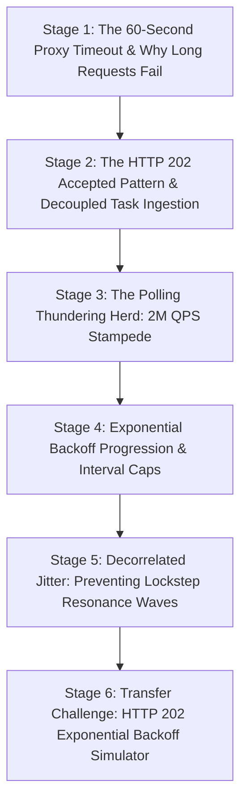

# ApexCaliber — World 33 Engineering & Pedagogical Specification

<text color="secondary" size="xs" weight="medium">RFC W33-001 · HTTP 202 ACCEPTED, LONG-RUNNING ASYNC JOBS & EXPONENTIAL BACKOFF POLLING · V1.0</text>

<badge color="success">Phase 5: Production Workflows, Python Internals & Auth</badge>

This specification governs World 33 (`http-202-polling-backoff`), establishing the organic stage dependency graph, the POE micro-experiments, Mode A/B simulation contracts, and the pre-wired executable code lab.

---

## 1. Product & Incident Anchor
- **World ID**: 33
- **Slug**: `http-202-polling-backoff` (lc: 9531)
- **Citadel**: `backend_apis`
- **Real-World Incident**:
  *SwiftCart GST Invoice Generation Outage:* At month-end tax filing, 200,000 e-commerce sellers clicked "Generate GST Report" within a 30-minute window. Each report required 15 to 45 seconds of heavy SQL aggregation. The client web frontend polled `/api/v1/jobs/{id}` in a tight `while True: sleep(0.1)` loop. 200,000 browser tabs polling 10 times per second generated a massive **2,000,000 queries per second (QPS)** stampede against the database. Connection pools exhausted, CPU spiked to 100%, and PostgreSQL crashed, bringing down all checkout and checkout-adjacent services.
- **Core Insight**:
  1. Synchronous HTTP connections held open for minutes inevitably fail due to upstream gateway timeouts (e.g. AWS ALB 60s, Cloudflare 100s HTTP 504).
  2. The standard protocol for deferred work is `HTTP 202 Accepted` returning a `Location` header pointing to the job resource.
  3. Polling at fixed fast intervals creates a "thundering herd" stampede that destroys backend capacity.
  4. Truncated Exponential Backoff (`interval = min(int(interval * multiplier), max_interval)`) decreases query frequency as tasks progress, dramatically reducing query load while preserving responsiveness.
  5. Full Jitter decorrelates client retry timings, breaking destructive resonance waves.

---

## 2. Organic Learning Progression (6 Stages)

---

## 3. Stage Specifications & POE Contracts

### Stage 1: The 60-Second Proxy Timeout & Why Long Requests Fail
- **Scenario**: A user clicks "Generate 100-Page PDF Invoice". The PDF takes 90 seconds to render on the backend. What happens if the browser waits synchronously on a single POST request?
- **Mechanism**: Modern cloud infrastructure routes traffic through reverse proxies and load balancers (Cloudflare, AWS ALB, Nginx). These intermediaries enforce hard connection timeout ceilings (typically 30s to 60s). If the backend does not return an HTTP response within this window, the proxy forcibly cuts the TCP socket and returns an HTTP 504 Gateway Timeout, even if the backend is still running the task.
- **Predict**: What happens to a client waiting synchronously on an HTTP request that takes 90 seconds on a cloud server behind an AWS ALB?
  - `opt_a` (Correct): The ALB drops the connection around 60 seconds and returns an HTTP 504 Gateway Timeout error.
  - `opt_b`: The connection stays open indefinitely until the CPU finishes.
  - `opt_c`: The browser automatically converts the connection into a WebSocket.
- **Controls**:
  - `task_duration_s`: Slider (10 to 120, default 90)
  - `proxy_timeout_s`: Slider (30 to 60, default 60)

### Stage 2: The HTTP 202 Accepted Pattern & Decoupled Task Ingestion
- **Scenario**: How should an API handle operations that take longer than a few seconds without risking gateway timeouts?
- **Mechanism**: The asynchronous pattern:
  1. The client sends `POST /reports`.
  2. The server creates a background task (in Celery/SQS), generates a `job_id`, and immediately responds in 20ms with `HTTP 202 Accepted` and header `Location: /jobs/42`.
  3. The client periodically polls `GET /jobs/42` until status transitions from `PENDING` $\rightarrow$ `PROCESSING` $\rightarrow$ `SUCCESS`.
- **Predict**: What is the primary semantic meaning of an HTTP 202 Accepted response code?
  - `opt_a` (Correct): The request has been accepted for processing, but processing has not been completed.
  - `opt_b`: The request was rejected because the server is out of memory.
  - `opt_c`: The transaction was committed and completed synchronously.
- **Controls**:
  - `execution_mode`: Select (`async_202_accepted`, `sync_blocking_wait`)

### Stage 3: The Polling Thundering Herd: 2M QPS Stampede
- **Scenario**: 50,000 users initiate background export tasks. If all client applications poll `/jobs/{id}` every 100 milliseconds in a simple loop, what happens to the database?
- **Mechanism**: 50,000 clients $\times$ 10 requests/sec = 500,000 queries per second hitting the status endpoint! Because background tasks take 30-60 seconds, millions of redundant queries flood the API gateway and database, depleting connection pools and causing system-wide cascading failure.
- **Predict**: If 100,000 clients poll a status endpoint every 200ms while waiting for a 1-minute job, what query rate does the backend experience?
  - `opt_a` (Correct): 500,000 requests per second, creating a catastrophic thundering herd stampede that exhausts server connection pools.
  - `opt_b`: Only 1 request per second because the browser caches the response.
  - `opt_c`: Exactly 0 requests because HTTP 202 eliminates polling.
- **Controls**:
  - `active_clients`: Slider (1,000 to 100,000, default 20,000)
  - `fixed_poll_interval_ms`: Slider (50 to 1000, default 100)

### Stage 4: Exponential Backoff Progression & Interval Caps
- **Scenario**: How can client SDKs stay responsive for fast jobs (done in 300ms) without overwhelming servers on slow jobs (done in 60s)?
- **Mechanism**: Truncated Exponential Backoff! Start with a small interval (e.g. 200ms). After each non-terminal poll, multiply the interval:
  `interval = min(int(interval * multiplier), max_interval)`.
  Fast tasks are detected immediately on early polls; longer tasks poll less and less frequently, automatically throttling client load by 95%+.
- **Predict**: How does exponential backoff balance fast-job responsiveness with slow-job backend protection?
  - `opt_a` (Correct): It polls rapidly during initial milliseconds when quick jobs finish, then progressively widens intervals up to a maximum cap to prevent backend overload.
  - `opt_b`: It increases polling frequency as time goes on to pressure the backend into working faster.
  - `opt_c`: It cancels the job if it takes longer than 3 polls.
- **Controls**:
  - `initial_interval_ms`: Slider (100 to 1000, default 200)
  - `backoff_multiplier`: Slider (1.1 to 3.0, default 1.5, step 0.1)
  - `max_interval_ms`: Slider (500 to 10000, default 2000)

### Stage 5: Decorrelated Jitter: Preventing Lockstep Resonance Waves
- **Scenario**: When 10,000 clients retry with pure deterministic exponential backoff ($200\text{ms} \rightarrow 400\text{ms} \rightarrow 800\text{ms}$), why do micro-bursts of traffic still occur?
- **Mechanism**: Lockstep synchronization! If 10,000 clients all start simultaneously, deterministic multipliers cause all 10,000 clients to poll at the exact same millisecond intervals, creating periodic spikes of traffic (resonance waves). Adding randomness (Jitter) decorrelates client timers and flattens traffic into a smooth, manageable stream.
- **Predict**: Why does AWS Architecture recommend adding random "Jitter" to exponential backoff loops?
  - `opt_a` (Correct): Jitter decorrelates simultaneous client retries, preventing synchronized lockstep traffic spikes that hammer the server.
  - `opt_b`: Jitter encrypts the HTTP packets against packet sniffers.
  - `opt_c`: Jitter forces the CPU to use quantum randomness.
- **Controls**:
  - `jitter_mode`: Select (`full_jitter`, `deterministic_backoff`)

### Stage 6: Transfer Challenge: HTTP 202 Exponential Backoff Simulator
- **Challenge**: Implement `simulate_job_polling(job_timeline: dict, initial_interval_ms: int, backoff_multiplier: float, max_interval_ms: int, max_attempts: int) -> dict`:
  1. Start at `current_time = 0`, `interval = initial_interval_ms`, `attempts = 0`.
  2. While `attempts < max_attempts`: query timeline status at `current_time`.
  3. If status is `SUCCESS` or `FAILED`, return `completed: True`.
  4. If `PENDING` or `PROCESSING`, advance `current_time += interval` and update `interval = min(int(interval * backoff_multiplier), max_interval_ms)`.
  5. If max attempts exhausted, return `completed: False, status: "TIMEOUT"`.

---

## 4. Verification & Content Quality Guardrails
- Directly illustrates why long-lived HTTP connections fail in cloud environments.
- Teaches the exact math of truncated exponential backoff used in production SDKs (AWS Boto3, Stripe).
- Solution passes all tests in `http-202-polling-backoff.yaml`.
