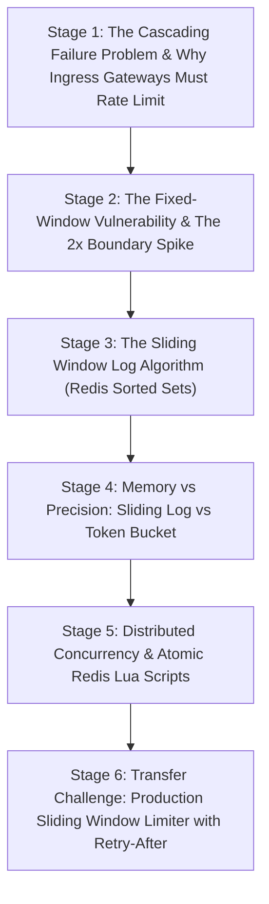

# ApexCaliber — World 34 Engineering & Pedagogical Specification

<text color="secondary" size="xs" weight="medium">RFC W34-001 · REDIS SLIDING WINDOW RATE LIMITER & TOKEN BUCKETS · V1.0</text>

<badge color="success">Phase 2: Networking Ingress Pipeline</badge>

This specification governs World 34 (`redis-sliding-window-rate-limiter`), establishing the organic stage dependency graph, the POE micro-experiments, Mode A/B simulation contracts, and the pre-wired executable code lab.

---

## 1. Product & Incident Anchor
- **World ID**: 34
- **Slug**: `redis-sliding-window-rate-limiter` (lc: 9504)
- **Citadel**: `backend_apis`
- **Real-World Incident**:
  *OpenAI / Stripe API Rate Limit Ban:* During an automated load test of a microservice calling upstream LLM APIs, the system used a naive fixed-window rate limiter set to 100 requests per minute. At minute mark 12:00:59, the client fired 100 requests. At 12:01:00, the fixed window reset, and the client fired another 100 requests. 200 requests hit the upstream gateway within 2 seconds, triggering an instant HTTP 429 IP ban that took down production AI workflows.
- **Core Insight**:
  1. Fixed-window rate limiters fail at window boundaries, allowing up to $2 \times$ bursts to overwhelm servers.
  2. The Sliding Window Log measures traffic over a continuous rolling window $[T - \text{window}, T]$, eliminating boundary spikes completely.

---

## 2. Organic Learning Progression (6 Stages)

---

## 3. Stage Specifications & POE Contracts

### Stage 1: The Cascading Failure Problem & Ingress Protection
- **Scenario**: A single rogue client or DDoS script starts spamming an expensive `/generate-report` or `/chat/completions` endpoint.
- **Mechanism**: Without rate limiting at the ingress layer (Nginx, Envoy, or Redis API Gateway), backend worker pools saturate, thread pools exhaust database connections, and all legitimate users experience 504 timeouts.
- **Predict**: Where should rate limiting be enforced to protect a distributed microservice cluster with minimal server compute cost?
  - `opt_a` (Correct): At the reverse proxy or API gateway layer before requests ever reach heavy backend application workers.
  - `opt_b`: Inside the relational database table triggers.
  - `opt_c`: Inside the frontend JavaScript client bundle.
- **Controls**:
  - `inbound_rps`: Slider (10 to 2000, default 200)
  - `rate_limiting_active`: Toggle (default: true)

### Stage 2: The Fixed-Window Vulnerability & The 2x Boundary Spike
- **Scenario**: Why do naive rate limiters using `INCR` + `EXPIRE` allow double-burst traffic surges?
- **Mechanism**: A fixed window resets cleanly on the minute mark (e.g. at `:00`). A client sending 100 requests at 12:00:59 and 100 requests at 12:01:01 succeeds in both windows, delivering 200 requests within 2 seconds.
- **Predict**: If an API allows 100 requests/minute with a fixed window, what is the maximum number of requests a client can successfully burst within a 2-second interval?
  - `opt_a` (Correct): 200 requests (100 at the end of window 1 + 100 at the start of window 2).
  - `opt_b`: Exactly 100 requests, because the clock enforces strict spacing.
  - `opt_c`: Unbounded requests until CPU hits 100%.
- **Controls**:
  - `burst_timing_offset_sec`: Slider (0s to 59s, default 58s)
  - `requests_per_burst`: Slider (10 to 200, default 100)

### Stage 3: The Sliding Window Log Algorithm (Redis Sorted Sets)
- **Scenario**: How can we enforce that at ANY arbitrary rolling window of length $W$, the request count never exceeds $M$?
- **Mechanism**: Using Redis Sorted Sets (`ZSET`):
  1. Record each request with score = timestamp $T$.
  2. Evict expired entries: `ZREMRANGEBYSCORE key 0 (T - W)`.
  3. Count remaining entries: `ZCARD key`.
  4. If `count < M`, add entry (`ZADD`) and return HTTP 200.
  5. If `count >= M`, reject with HTTP 429 and calculate `Retry-After`.
- **Predict**: What is the primary operational trade-off of the Sliding Window Log algorithm compared to Fixed Window counters?
  - `opt_a` (Correct): High memory consumption, because every single request timestamp must be stored in memory for the duration of the window.
  - `opt_b`: Inability to support multi-tenant applications.
  - `opt_c`: It only works on single-core CPU architectures.
- **Controls**:
  - `window_seconds`: Slider (10 to 120, default 60)
  - `max_requests`: Slider (2 to 20, default 5)

### Stage 4: Memory vs Precision: Sliding Log vs Token Bucket
- **Scenario**: At 10,000,000 active users, storing every timestamp in Redis consumes gigabytes of expensive RAM. How can we reduce memory to $O(1)$ while smoothing bursts?
- **Mechanism**:
  - *Sliding Window Counter*: Blends previous window count with current window weight:
    $$\text{Count} = \text{PrevCount} \times (1 - \text{fraction}) + \text{CurrCount}$$
  - *Token Bucket*: Refills tokens at a constant rate $R$. Allows burst capacity up to bucket size $B$ in $O(1)$ memory.
- **Predict**: Which rate limiting algorithm consumes $O(1)$ memory while supporting bursts of up to $B$ requests and smooth continuous refill?
  - `opt_a` (Correct): Token Bucket (stores only `tokens_available` and `last_refill_timestamp`).
  - `opt_b`: Sliding Window Log (stores full timestamp arrays).
  - `opt_c`: Round-Robin DNS.
- **Controls**:
  - `algorithm_choice`: Select (`Sliding_Window_Log`, `Token_Bucket`, `Sliding_Window_Counter`)
  - `bucket_capacity`: Slider (5 to 50, default 10)

### Stage 5: Distributed Concurrency & Atomic Redis Lua Scripts
- **Scenario**: In a microservice cluster with 10 FastAPI instances, what happens if two requests from the same user hit two different servers simultaneously?
- **Mechanism**: If server A runs `ZCARD` (returns 4), server B runs `ZCARD` (returns 4), both servers decide limit 5 is not reached and both insert, allowing 6 requests. To guarantee consistency without distributed lock overhead, Redis executes the entire sequence atomically inside an embedded Lua script.
- **Predict**: Why must Redis multi-step rate limiting operations be executed inside a Lua script or transaction?
  - `opt_a` (Correct): Redis executes Lua scripts atomically in a single thread, preventing race conditions where multiple server replicas interleave read and write operations.
  - `opt_b`: Lua scripts compress network bandwidth over TCP.
  - `opt_c`: Python cannot communicate with Redis directly.
- **Controls**:
  - `concurrent_worker_nodes`: Slider (1 to 10, default 4)
  - `atomic_lua_enabled`: Toggle (default: true)

### Stage 6: Transfer Challenge: Production Sliding Window Limiter with Retry-After
- **Scenario**: Implement the accurate rolling sliding window log simulator in Python: evict expired timestamps, enforce limits, compute precise `Retry-After` seconds, and return remaining capacity headers.
- **Starter Code**: Preloaded Python function `check_rate_limit(requests, window_seconds, max_requests)`.

---

## 4. Telemetry Contract (`apex.trace.v1`)
Events emitted during rate limiter simulation:
- `rate_limit_checked`: Inbound request timestamp evaluated.
- `timestamp_evicted`: Out-of-window entries pruned.
- `rate_limit_allowed`: Inbound request permitted (HTTP 200).
- `rate_limit_blocked`: Capacity exceeded; HTTP 429 emitted with `Retry-After` header.
