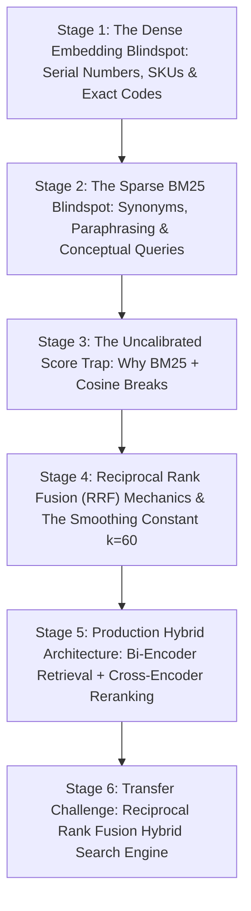

# ApexCaliber — World 35 Engineering & Pedagogical Specification

<text color="secondary" size="xs" weight="medium">RFC W35-001 · HYBRID RETRIEVAL, BM25 SCORE CALIBRATION & RECIPROCAL RANK FUSION (RRF) · V1.0</text>

<badge color="success">Phase 6: GenAI & Intelligent Systems</badge>

This specification governs World 35 (`reciprocal-rank-fusion-hybrid-search`), establishing the organic stage dependency graph, the POE micro-experiments, Mode A/B simulation contracts, and the pre-wired executable code lab.

---

## 1. Product & Incident Anchor
- **World ID**: 35
- **Slug**: `reciprocal-rank-fusion-hybrid-search` (lc: 9602)
- **Citadel**: `ai_resume`
- **Real-World Incident**:
  *WisdomBot Aerospace Part Number Hallucination:* Aircraft maintenance mechanics asked WisdomBot for exact fastener specifications: `MS21042-4 locknut torque limits`. The pure dense vector retrieval engine converted the prompt into an embedding and retrieved general articles about "threaded fasteners and bolt tightening". Because embedding models compress specific token strings into broad conceptual clusters, the exact part number `MS21042-4` was lost, leading the LLM to hallucinate incorrect torque ratings that could have caused critical in-flight structural failure.
- **Core Insight**:
  1. Dense vector embeddings excel at semantic paraphrasing ("how do I turn on debug mode?"), but blur precise identifiers like serial numbers, SKUs, and error codes (`ORA-01403`, `CVE-2024-38077`).
  2. Sparse keyword algorithms (BM25, TF-IDF) excel at exact keyword precision, but fail completely on synonyms and conversational questions.
  3. Combining raw scores via weighted sum ($0.5 \times BM25 + 0.5 \times Cosine$) fails because BM25 scores are unbounded $[0, \infty)$ while Cosine scores are bounded $[-1, 1]$, allowing BM25 variations to completely overwhelm semantic signals.
  4. Reciprocal Rank Fusion (RRF) solves the calibration problem by discarding raw scores and calculating importance solely from ordinal ranking positions:
     $$\text{RRF}(d) = \sum_{m \in \{\text{dense}, \text{sparse}\}} \frac{1}{k + \text{rank}_m(d)}$$
     where $k$ (standard constant 60) prevents top positions from dominating disproportionately.

---

## 2. Organic Learning Progression (6 Stages)

---

## 3. Stage Specifications & POE Contracts

### Stage 1: The Dense Embedding Blindspot: Serial Numbers, SKUs & Exact Codes
- **Scenario**: A user searches an e-commerce support database for `iPhone Model A2849 screen replacement`. Dense embeddings represent text as semantic coordinates. What happens to the exact model code `A2849`?
- **Mechanism**: Subword tokenizers break unfamiliar alphanumeric codes into generic fragments (`A`, `28`, `49`). The embedding model clusters the vector near general "smartphone screens". Documents containing completely different models (`A2650`) score nearly identical cosine similarity, causing the vector search to return the wrong replacement guides.
- **Predict**: Why does dense vector search frequently fail on exact part numbers like `MS21042-4` or error codes like `ORA-01403`?
  - `opt_a` (Correct): Embedding models project text into semantic concept space, blurring rare alphanumeric strings into general topical clusters and losing exact token identity.
  - `opt_b`: Vector databases only support words found in the Oxford English Dictionary.
  - `opt_c`: High-dimensional math cannot represent numbers greater than 100.
- **Controls**:
  - `query_type`: Select (`Exact Part Code (MS21042-4)`, `Natural Language Paraphrase`)
  - `retriever`: Select (`Pure Vector Search`, `Hybrid BM25 + Vector`)

### Stage 2: The Sparse BM25 Blindspot: Synonyms, Paraphrasing & Conceptual Queries
- **Scenario**: A user queries: "How do I upgrade to the paid plan?" The documentation page uses the heading: "Subscription Billing & Tier Elevation". How does BM25 perform?
- **Mechanism**: BM25 searches for term frequency and inverse document frequency of the exact tokens `upgrade`, `paid`, `plan`. None of these tokens appear in the target passage. BM25 scores it as 0.0, completely missing the most relevant document in the knowledge base.
- **Predict**: In what scenario does a sparse lexical retriever (like BM25) completely fail to return the correct document?
  - `opt_a` (Correct): When the user expresses their intent using synonyms or colloquial phrasing that does not contain the exact vocabulary used in the document text.
  - `opt_b`: When documents contain fewer than 10 words.
  - `opt_c`: When the search index is stored on an SSD instead of RAM.
- **Controls**:
  - `lexical_overlap`: Slider (0 to 100%, default 0%)
  - `synonym_density`: Select (`High Synonym Variation`, `Exact Lexical Match`)

### Stage 3: The Uncalibrated Score Trap: Why BM25 + Cosine Breaks
- **Scenario**: An engineer tries to combine BM25 and vector search by calculating a combined score: `score = 0.5 * bm25_score + 0.5 * cosine_score`. What goes wrong?
- **Mechanism**: Cosine similarity is bounded strictly between $[-1.0, 1.0]$ (typically $[0.0, 1.0]$ for text). BM25 scores, however, depend on document length and inverse document frequency, frequently reaching values like $18.5$, $42.1$, or higher. Adding them directly means BM25 completely drowns out the cosine score, effectively reducing the hybrid search to a pure keyword search.
- **Predict**: What happens if an engineer linearly sums raw BM25 scores and raw Cosine Similarity scores?
  - `opt_a` (Correct): Uncalibrated score mismatch: BM25 scores are unbounded $[0, \infty)$ while Cosine scores are bounded $[-1, 1]$, allowing BM25 magnitudes to completely dominate ranking.
  - `opt_b`: The scores cancel each other out to zero every time.
  - `opt_c`: The CPU encounters a floating-point overflow interrupt.
- **Controls**:
  - `bm25_raw_score`: Slider (0 to 50, default 25)
  - `cosine_raw_score`: Slider (0.0 to 1.0, default 0.85, step 0.05)

### Stage 4: Reciprocal Rank Fusion (RRF) Mechanics & The Smoothing Constant k=60
- **Scenario**: How does Reciprocal Rank Fusion solve the uncalibrated score problem without requiring complex score normalization?
- **Mechanism**: RRF ignores raw score values entirely and operates strictly on ordinal rank positions!
  $$\text{RRF}(d) = \frac{1}{k + \text{rank}_{\text{dense}}(d)} + \frac{1}{k + \text{rank}_{\text{sparse}}(d)}$$
  If a document ranks #1 in dense and #1 in sparse with $k=60$:
  Score $= \frac{1}{61} + \frac{1}{61} \approx 0.03278$.
  The constant $k=60$ dampens the exponential advantage of ranking #1 over ranking #2, rewarding documents that consistently appear across both retrieval lists.
- **Predict**: In Reciprocal Rank Fusion, what happens to a document that ranks near the top of BOTH the dense vector search and sparse BM25 search?
  - `opt_a` (Correct): It receives a compounded score boost from both rank reciprocal terms, outranking documents that only scored well in a single retriever.
  - `opt_b`: Its score is subtracted because duplicate appearances are penalized.
  - `opt_c`: It is filtered out as an anomalous outlier.
- **Controls**:
  - `smoothing_k`: Slider (10 to 100, default 60, step 10)
  - `document_ranks`: Select (`Doc A: #1 Dense, #1 Sparse`, `Doc B: #1 Dense, Missing Sparse`, `Doc C: #5 Dense, #5 Sparse`)

### Stage 5: Production Hybrid Architecture: Bi-Encoder Retrieval + Cross-Encoder Reranking
- **Scenario**: How do top-tier RAG platforms (Cohere, Perplexity, OpenAI) achieve state-of-the-art retrieval accuracy at millisecond latencies?
- **Mechanism**: Two-stage retrieval pipeline!
  1. Stage 1 (Fast Retrieval): Retrieve top 50 candidates using Hybrid Search (BM25 + Dense Embeddings fused via RRF) in ~15ms.
  2. Stage 2 (Precision Reranking): Feed the 50 candidate passages through a Cross-Encoder model (which attends across query and document tokens simultaneously) to produce deeply contextual semantic scores, selecting the final top 3 passages for the LLM.
- **Predict**: Why don't production search engines run Cross-Encoders across the entire 10,000,000 document corpus directly?
  - `opt_a` (Correct): Cross-Encoders process full query-document token interactions simultaneously, making them hundreds of times too slow for full corpus search; using them as a second-stage reranker on top-50 candidates balances speed and accuracy.
  - `opt_b`: Cross-Encoders can only process documents written in Latin.
  - `opt_c`: Cross-Encoders consume 1TB of network bandwidth per query.
- **Controls**:
  - `stage_1_candidate_pool`: Slider (10 to 100, default 50)
  - `reranker_model`: Select (`Cross-Encoder (Deep Attention)`, `RRF Ranking (Fast Ordinal)`)

### Stage 6: Transfer Challenge: Reciprocal Rank Fusion Hybrid Search Engine
- **Challenge**: Implement `reciprocal_rank_fusion(dense_ranks: list[str], sparse_ranks: list[str], k: int = 60) -> list[dict]`:
  1. Return `[]` if both rank lists are empty.
  2. Accumulate reciprocal rank scores: for 0-based index `i`, `rank = i + 1`, add `1.0 / (k + rank)`.
  3. Round each unique document's final score to 6 decimal places.
  4. Sort unique documents: primary by `rrf_score` descending, secondary by `doc_id` alphabetically ascending.
  5. Return list of dictionaries: `[{"doc_id": doc, "rrf_score": score}, ...]`.

---

## 4. Verification & Content Quality Guardrails
- Exposes the mathematical flaw of linear score addition between unbounded and bounded metrics.
- Validates that RRF produces robust, calibrated document ranking regardless of score distributions.
- Pre-wired code passes all test cases in `reciprocal-rank-fusion-hybrid-search.yaml`.
