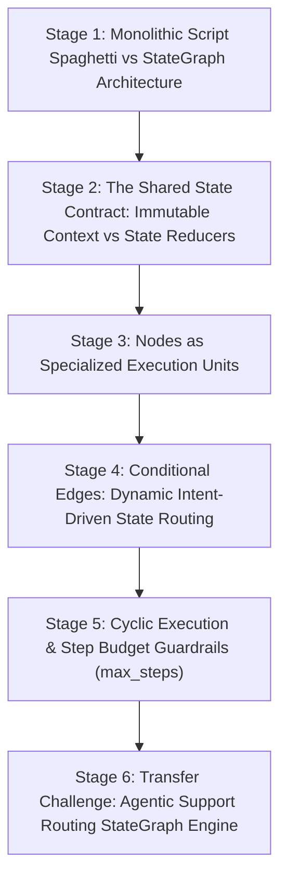

# ApexCaliber — World 36 Engineering & Pedagogical Specification

<text color="secondary" size="xs" weight="medium">RFC W36-001 · AUTONOMOUS AGENT STATE MACHINES, CONDITIONAL EDGES & LANGGRAPH ORCHESTRATION · V1.0</text>

<badge color="success">Phase 6: GenAI & Intelligent Systems</badge>

This specification governs World 36 (`agent-state-machine-graph`), establishing the organic stage dependency graph, the POE micro-experiments, Mode A/B simulation contracts, and the pre-wired executable code lab.

---

## 1. Product & Incident Anchor
- **World ID**: 36
- **Slug**: `agent-state-machine-graph` (lc: 9631)
- **Citadel**: `ai_resume`
- **Real-World Incident**:
  *PayLoop Autonomous Support Bot Meltdown:* During an unexpected UPI bank settlement outage, PayLoop's automated support bot received 200,000 inquiries per hour. The legacy bot was built as a monolithic script with 40 nested `if/elif/else` statements. When users submitted queries blending multiple intents (e.g., "My refund failed and my account is locked"), the script entered unhandled execution branches, failed to invoke authentication tools, and looped infinitely attempting to re-ask the user's name until server memory was exhausted.
- **Core Insight**:
  1. Monolithic linear scripts break down when autonomous agents need to branch dynamically, retry failed tool executions, or seek clarification.
  2. Modern agent frameworks (LangGraph, CrewAI) structure agent workflows as a directed cyclic StateGraph.
  3. State is decoupled into:
     - Nodes: Pure or mutating functions that perform specific work (e.g. `classifier`, `billing_agent`, `auth_agent`).
     - Conditional Edges: Router functions that inspect output state and dynamically choose the next target node.
  4. Because agent graphs allow cycles (loops for reflection or tool retries), an explicit Step Budget Guard (`max_steps`) is mandatory to guarantee termination.

---

## 2. Organic Learning Progression (6 Stages)



---

## 3. Stage Specifications & POE Contracts

### Stage 1: Monolithic Script Spaghetti vs StateGraph Architecture
- **Scenario**: A developer attempts to orchestrate a customer support LLM pipeline using a 500-line Python script with nested `while` and `if` loops. What happens when a new refund policy requires human approval before payment?
- **Mechanism**: In monolithic scripts, control flow, prompt construction, and tool execution are tightly coupled. Adding non-linear steps (like human approval or multi-turn retries) requires rewriting core loop mechanics. In a StateGraph, adding a human-in-the-loop step simply means adding an approval node and updating two edge pointers.
- **Predict**: What is the primary architectural advantage of modeling agent workflows as a directed graph rather than a sequential script?
  - `opt_a` (Correct): Nodes and conditional edges decouple state transformation from routing decisions, allowing complex non-linear branching, cyclical retries, and modular testing.
  - `opt_b`: Directed graphs allow Python code to run directly on GPU tensor cores.
  - `opt_c`: Scripts are only supported on Windows operating systems.
- **Controls**:
  - `orchestration_model`: Select (`Directed StateGraph (LangGraph)`, `Monolithic Script (Nested Ifs)`)
  - `workflow_complexity`: Select (`Multi-Intent Routing`, `Sequential Single-Pass`)

### Stage 2: The Shared State Contract: Immutable Context vs State Reducers
- **Scenario**: In an agent graph, how do different nodes (like a query classifier and a billing agent) share information without global variables?
- **Mechanism**: The workflow passes a centralized `state` dictionary between nodes. Each node receives the current state, performs its task, and returns updated state fields (e.g. `{"intent": "billing", "log": ["classified"]}`). State reducers merge updates deterministically into the shared context.
- **Predict**: How is context communicated between independent nodes in a StateGraph?
  - `opt_a` (Correct): Via a centralized state dictionary passed into and updated by each node along the execution path.
  - `opt_b`: Through global operating system environment variables.
  - `opt_c`: By saving JSON files to disk between each node execution.
- **Controls**:
  - `state_mutation_mode`: Select (`State Reducer Updates`, `Global Mutable Variable`)

### Stage 3: Nodes as Specialized Execution Units
- **Scenario**: You have 3 specialized support agents: `billing_agent` (handles refunds and charges), `auth_agent` (handles password and 2FA resets), and `general_agent` (handles FAQs). How are they represented?
- **Mechanism**: Each agent is an isolated Node in the graph. The node encapsulates specific system prompts, specialized tools (e.g. only `billing_agent` has access to the Stripe refund API), and constrained output schemas.
- **Predict**: Why is it safer to separate agents into specialized nodes rather than having one massive prompt with all tools enabled?
  - `opt_a` (Correct): Principle of Least Privilege: Giving each node only the tools and instructions relevant to its domain prevents tool hallucinations and unauthorized actions.
  - `opt_b`: LLMs refuse to run if they have more than 2 tools.
  - `opt_c`: Massive prompts are automatically blocked by cloud firewalls.
- **Controls**:
  - `agent_specialization`: Select (`Modular Domain Nodes`, `Monolithic All-In-One Agent`)

### Stage 4: Conditional Edges: Dynamic Intent-Driven State Routing
- **Scenario**: After the `classifier` node inspects the user's query and sets `state['intent'] = 'billing'`, how does the graph transition to the billing agent?
- **Mechanism**: Conditional Edges! Instead of hardcoding a direct link from `classifier` to `billing_agent`, the edge between `classifier` and the next node is dynamic:
  ```python
  def route_after_classification(state):
      if state["intent"] == "billing":
          return "billing_agent"
      elif state["intent"] == "auth":
          return "auth_agent"
      return "general_agent"
  ```
  The runtime calls this function to dynamically resolve the destination vertex.
- **Predict**: How does a StateGraph decide which node to execute after the classifier completes?
  - `opt_a` (Correct): A conditional edge routing function inspects state attributes (like intent) and returns the string identifier of the target node.
  - `opt_b`: The operating system kernel chooses the next node at random.
  - `opt_c`: All nodes run simultaneously in an uncoordinated race condition.
- **Controls**:
  - `simulated_query`: Select (`"I need a refund on order 123"`, `"Please reset my password"`, `"What are your business hours?"`)

### Stage 5: Cyclic Execution & Step Budget Guardrails (max_steps)
- **Scenario**: An agent attempts to solve a problem: if tool execution fails, it reflects and retries (a cycle in the graph). What happens if the tool continuously errors or the LLM hallucinates an invalid argument in an infinite loop?
- **Mechanism**: The graph will loop forever, consuming thousands of dollars in LLM API tokens. To prevent runaway costs and server resource starvation, all production agent graph runtimes enforce an explicit `max_steps` execution ceiling. If `step_count >= max_steps`, the graph forcibly halts with status `"max_steps_exceeded"`.
- **Predict**: Why must an agentic StateGraph enforce an explicit `max_steps` execution guard?
  - `opt_a` (Correct): To prevent infinite execution loops and runaway API token costs caused by cyclical tool retry failures or circular routing logic.
  - `opt_b`: Because Python can only count up to 10.
  - `opt_c`: Because web browsers crash if an agent runs for more than 3 seconds.
- **Controls**:
  - `max_steps_budget`: Slider (1 to 20, default 10)
  - `simulate_cycle`: Toggle (default: false)

### Stage 6: Transfer Challenge: Agentic Support Routing StateGraph Engine
- **Challenge**: Implement `run_state_graph(initial_state: dict, max_steps: int = 10) -> dict`:
  1. Nodes:
     - `'classifier'`: if `'refund'` in query -> intent='billing'; if `'reset'` in query -> intent='auth'; else intent='general'. Append `'classified'` to `log`.
     - `'billing_agent'`: append `'billing_resolved'` to `log`, set `resolved=True`.
     - `'auth_agent'`: append `'auth_resolved'` to `log`, set `resolved=True`.
     - `'general_agent'`: append `'general_resolved'` to `log`, set `resolved=True`.
  2. Conditional Edges: from `'classifier'`, route to `'billing_agent'`, `'auth_agent'`, or `'general_agent'` based on `intent`. All agents route to `'__end__'`.
  3. Enforce `max_steps`. Return `{'final_state': state, 'visited_nodes': visited_nodes, 'status': 'completed' | 'max_steps_exceeded'}`.

---

## 4. Verification & Content Quality Guardrails
- Separates deterministic state mutation from dynamic routing logic.
- Directly demonstrates why agentic workflows require step budgets to prevent runaway financial costs.
- Pre-wired code passes all test cases in `agent-state-machine-graph.yaml`.
