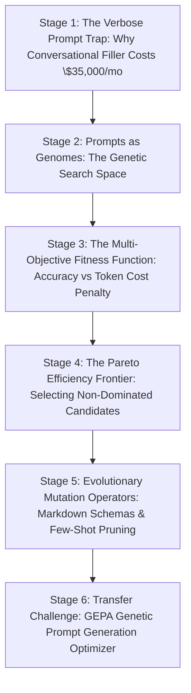

# ApexCaliber — World 37 Engineering & Pedagogical Specification

<text color="secondary" size="xs" weight="medium">RFC W37-001 · GENETIC PROMPT OPTIMIZATION (GEPA), TOKEN PENALTY SURFACES & PARETO PRUNING · V1.0</text>

<badge color="success">Phase 6: GenAI & Intelligent Systems</badge>

This specification governs World 37 (`gepa-genetic-prompt-optimizer`), establishing the organic stage dependency graph, the POE micro-experiments, Mode A/B simulation contracts, and the pre-wired executable code lab.

---

## 1. Product & Incident Anchor
- **World ID**: 37
- **Slug**: `gepa-genetic-prompt-optimizer` (lc: 9603)
- **Citadel**: `ai_resume`
- **Real-World Incident**:
  *Drizz Mobile Test Automation Token Invoice Shock:* When running hundreds of thousands of automated UI verification runs across GPT-4o, Drizz's monthly OpenAI API invoice suddenly surged past \$35,000. An audit revealed that engineers had crafted a verbose 1,800-token system prompt containing conversational filler ("Please be polite and ensure that you always..."), redundant instructions, and unformatted examples. Manually trimming words was risky because random deletions frequently caused subtle accuracy regressions on edge-case UI screens.
- **Core Insight**:
  1. Manual prompt engineering relies on trial-and-error, has no convergence guarantees, and cannot systematically optimize the trade-off between token cost and benchmark accuracy.
  2. Genetic and Evolutionary Prompt Architecture (GEPA / DSPy / LLEGO) formalizes prompt refinement into an automated genetic algorithm:
     - Prompts are treated as genomes in a candidate population.
     - Fitness is evaluated quantitatively against a benchmark test suite.
     - A cost penalty is applied when token length exceeds a defined budget:
       $$\text{fitness} = \text{accuracy} - \text{penalty}(\text{tokens}, \text{budget})$$
  3. Candidates that balance high accuracy with minimal token consumption lie on the Pareto Frontier, allowing automated selection of the optimal production prompt.

---

## 2. Organic Learning Progression (6 Stages)

---

## 3. Stage Specifications & POE Contracts

### Stage 1: The Verbose Prompt Trap: Why Conversational Filler Costs \$35,000/mo
- **Scenario**: An engineer writes an LLM prompt: "Please be very careful and do your best to analyze this JSON. Make sure you are polite and output only the valid answer." How does this conversational phrasing affect production economics?
- **Mechanism**: LLM APIs bill for every input token on every API call. Adding 100 unnecessary tokens across 1,000,000 monthly API calls costs 100,000,000 wasted input tokens (hundreds of dollars per month) with zero benefit to reasoning accuracy. Furthermore, verbose preambles dilute attention mechanisms on complex instructions.
- **Predict**: How does conversational filler ("Please be polite and carefully think...") impact production LLM applications?
  - `opt_a` (Correct): It increases API billing costs linearly across every API invocation and dilutes attention on crucial technical constraints without improving accuracy.
  - `opt_b`: It makes the LLM happier and prevents model hallucinations.
  - `opt_c`: It speeds up generation speed because polite prompts run on higher-priority servers.
- **Controls**:
  - `monthly_calls`: Slider (10,000 to 1,000,000, default 500,000)
  - `filler_token_count`: Slider (20 to 500, default 150)

### Stage 2: Prompts as Genomes: The Genetic Search Space
- **Scenario**: How can we search through thousands of possible prompt phrasings to find the best candidate without manually testing each one?
- **Mechanism**: Treat the system prompt as a genome! A population of prompt variants (e.g. 20 variations) is generated through programmatic mutations (e.g., converting prose to bullet points, extracting JSON schemas, reordering constraints). The algorithm evaluates the fitness of each candidate and evolves better candidates over successive generations.
- **Predict**: In genetic prompt optimization (GEPA), what represents the "individual genome"?
  - `opt_a` (Correct): A candidate system prompt string with specific instructions, formatting styles, and phrasing.
  - `opt_b`: The physical CPU chip running the server.
  - `opt_c`: The Python interpreter executable file.
- **Controls**:
  - `population_size`: Slider (5 to 50, default 20)
  - `mutation_rate`: Slider (0.1 to 0.5, default 0.2, step 0.05)

### Stage 3: The Multi-Objective Fitness Function: Accuracy vs Token Cost Penalty
- **Scenario**: If an optimizer only maximized accuracy, it would choose a 5,000-token prompt with 50 few-shot examples. If it only minimized token count, it would choose a 2-word prompt that fails on edge cases. How do we balance both?
- **Mechanism**: A composite fitness function!
  1. Measure benchmark accuracy on test queries: `accuracy` $\in [0.0, 1.0]$.
  2. If `tokens > token_budget`: apply a penalty `cost_penalty = (tokens - token_budget) * 0.01`.
  3. If `tokens <= token_budget`: `cost_penalty = 0.0`.
  4. Final fitness: `fitness = accuracy - cost_penalty`.
  This enforces a strict mathematical disincentive against bloating prompts beyond the target budget.
- **Predict**: Given a candidate with accuracy 0.95 and 250 tokens under a budget of 200 tokens (penalty 0.01 per excess token), what is its fitness?
  - `opt_a` (Correct): 0.45 (Penalty is (250 - 200) * 0.01 = 0.50; fitness = 0.95 - 0.50 = 0.45).
  - `opt_b`: 0.95 because accuracy is the only metric that matters.
  - `opt_c`: 0.0 because it exceeded the budget.
- **Controls**:
  - `token_budget`: Slider (100 to 500, default 200)
  - `excess_penalty_multiplier`: Slider (0.005 to 0.05, default 0.01, step 0.005)

### Stage 4: The Pareto Efficiency Frontier: Selecting Non-Dominated Candidates
- **Scenario**: You have 3 candidate prompts:
  - Candidate A: 95% accuracy, 180 tokens
  - Candidate B: 90% accuracy, 120 tokens
  - Candidate C: 85% accuracy, 220 tokens
  Which candidate is strictly inferior (dominated)?
- **Mechanism**: Candidate C is dominated: it has lower accuracy AND more tokens than Candidate A! Candidates A and B lie on the Pareto Frontier: neither is strictly better on both dimensions; Candidate A offers higher accuracy, while Candidate B offers lower cost. Genetic selection preserves the Pareto frontier to find the optimal trade-off point.
- **Predict**: In multi-objective prompt optimization, when is Candidate X considered "dominated" by Candidate Y?
  - `opt_a` (Correct): When Candidate Y achieves both equal or higher accuracy AND uses equal or fewer tokens than Candidate X.
  - `opt_b`: When Candidate X has an older timestamp.
  - `opt_c`: When Candidate Y was written by human engineers.
- **Controls**:
  - `frontier_view`: Select (`Pareto Frontier Highlighted`, `All Candidates Unfiltered`)

### Stage 5: Evolutionary Mutation Operators: Markdown Schemas & Few-Shot Pruning
- **Scenario**: What concrete prompt mutations produce high-accuracy compression?
- **Mechanism**:
  1. Markdown Schema Transformation: Replace verbose sentences ("The output must be a dictionary with keys name and age") with strict TypeScript/Pydantic code blocks.
  2. Filler Pruning: Strip polite introductory and concluding phrases.
  3. Dynamic Few-Shot Pruning: Keep only ambiguous boundary test cases, eliminating redundant simple examples.
- **Predict**: Which prompt refactoring technique typically achieves the highest compression without sacrificing structural compliance?
  - `opt_a` (Correct): Replacing paragraph prose instructions with concise Markdown code blocks or TypeScript/JSON schemas.
  - `opt_b`: Removing all vowels from the English language.
  - `opt_c`: Translating the prompt into binary 0s and 1s.
- **Controls**:
  - `mutation_technique`: Select (`Markdown Schema Compression`, `Filler Removal`, `Few-Shot Distillation`)

### Stage 6: Transfer Challenge: GEPA Genetic Prompt Generation Optimizer
- **Challenge**: Implement `optimize_prompt_generation(candidates: list[dict], token_budget: int) -> dict`:
  1. Return zeros if `candidates` is empty.
  2. For each candidate: calculate `cost_penalty = round((tokens - token_budget) * 0.01, 4)` if `tokens > token_budget` else `0.0`.
  3. Calculate `fitness = round(accuracy - cost_penalty, 4)`.
  4. Select winning candidate: primary by highest `fitness`, tie-breaker by lowest `tokens`, tertiary by original index.
  5. Return `{"selected_id": best["prompt_id"], "tokens": best["tokens"], "accuracy": best["accuracy"], "cost_penalty": best["cost_penalty"], "fitness": best["fitness"]}`.

---

## 4. Verification & Content Quality Guardrails
- Grounds prompt engineering in quantitative cost and accuracy optimization.
- Illustrates why Pareto frontiers eliminate dominated candidate prompts.
- Pre-wired code passes all test cases in `gepa-genetic-prompt-optimizer.yaml`.
