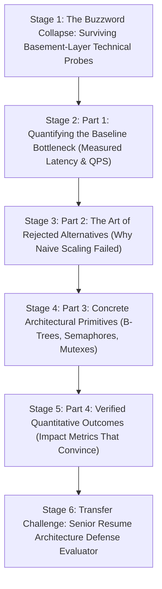

# ApexCaliber — World 38 Engineering & Pedagogical Specification

<text color="secondary" size="xs" weight="medium">RFC W38-001 · STAFF RESUME ARCHITECTURE GRILL, BASEMENT-LAYER TRADEOFFS & QUANTITATIVE OUTCOMES · V1.0</text>

<badge color="success">Phase 6: GenAI & Intelligent Systems</badge>

This specification governs World 38 (`resume-bullet-architecture-grill`), establishing the organic stage dependency graph, the POE micro-experiments, Mode A/B simulation contracts, and the pre-wired executable code lab.

---

## 1. Product & Incident Anchor
- **World ID**: 38
- **Slug**: `resume-bullet-architecture-grill` (lc: 9604)
- **Citadel**: `ai_resume`
- **Real-World Incident**:
  *The Staff Interview Buzzword Interrogation Collapse:* A candidate's resume boasted: "Architected distributed Kafka pipeline processing 50,000 QPS with sub-second latency across microservices." During the Staff Engineer technical grill at a tier-1 company, the interviewer asked 3 consecutive basement-layer questions:
  1. "How many partitions did your Kafka topic use, and what was your consumer group rebalance strategy?"
  2. "When consumer lag spiked, why didn't you just add 100 more consumer pods?"
  3. "How did you guarantee idempotency when Kafka retried a batch after a network partition?"
  The candidate froze, unable to explain partition limits or consumer rebalance storms, revealing that they had only used high-level abstractions without understanding the underlying trade-offs. The interview resulted in an immediate "Strong Reject".
- **Core Insight**:
  1. Reciting buzzwords fails when Principal/Staff interviewers probe the basement layer: the specific bottlenecks, hardware constraints, and trade-offs.
  2. The 4-Part Staff Defense Matrix:
     - Part 1: Baseline Bottleneck: The exact measured pain point before intervention (e.g. 200ms p95 scan latencies, 50-minute test suites, \$35k/mo token bills).
     - Part 2: Rejected Alternatives: Why the naive or obvious fixes failed (e.g. DynamoDB provisioned read capacity was cost-prohibitive; unbounded threading locked CPU cores).
     - Part 3: Precise Mechanism: The exact primitive, index, or algorithm implemented (Composite B-Tree index on `(tenant_id, created_at DESC)`, `asyncio.Semaphore(25)`, Single-Flight Lock, RTR family revocation).
     - Part 4: Verified Quantitative Outcome: The measured production impact (e.g. 80%+ latency reduction, 25x concurrency, 66% token cost savings).

---

## 2. Organic Learning Progression (6 Stages)

---

## 3. Stage Specifications & POE Contracts

### Stage 1: The Buzzword Collapse: Surviving Basement-Layer Technical Probes
- **Scenario**: A candidate claims: "Used Redis to speed up database queries by 10x." The interviewer asks: "What happens if 10,000 requests hit an expired key simultaneously, and how did your Redis memory eviction policy handle memory pressure?" What distinguishes a Senior/Staff answer?
- **Mechanism**: Junior engineers describe what technology they used. Senior and Staff engineers describe the boundary conditions, failure modes, and trade-offs: cache stampedes, mutex locking, eviction policies (allkeys-lru vs volatile-ttl), and serialization overhead.
- **Predict**: What is the primary difference between a Junior and a Staff-level answer during a technical resume grill?
  - `opt_a` (Correct): Staff engineers articulate the exact failure modes, trade-offs, and why alternative solutions were rejected, while junior engineers merely list technology names.
  - `opt_b`: Staff engineers know how to write assembly code from memory.
  - `opt_c`: Junior engineers are not allowed to use Redis.
- **Controls**:
  - `interview_depth`: Select (`Staff Deep-Dive (Failure Modes & Trade-offs)`, `Junior Surface-Level (Tool Names)`)

### Stage 2: Part 1: Quantifying the Baseline Bottleneck (Measured Latency & QPS)
- **Scenario**: Which resume bullet statement demonstrates higher engineering maturity: "Optimized slow database queries" or "Diagnosed 200ms p95 sequential table scans on 10M-row table causing connection pool saturation"?
- **Mechanism**: High-impact engineering begins with precision measurement. Stating baseline bottlenecks (p95/p99 latency, CPU utilization, thread contention, memory bloat) demonstrates that the engineer diagnoses root causes using telemetry rather than guessing.
- **Predict**: Why do top engineering hiring managers favor candidates who state specific baseline metrics before optimization?
  - `opt_a` (Correct): It proves the candidate measured production performance objectively and diagnosed root causes before writing code.
  - `opt_b`: Because hiring managers only hire mathematicians.
  - `opt_c`: Because metrics are required by local legal regulations.
- **Controls**:
  - `metric_focus`: Select (`p95 Latency & Throughput`, `Vague "Fast" Claim`)

### Stage 3: Part 2: The Art of Rejected Alternatives (Why Naive Scaling Failed)
- **Scenario**: Why does an interviewer ask: "Why didn't you just add more RAM or increase DynamoDB read capacity instead of migrating to PostgreSQL?"
- **Mechanism**: The "Rejected Alternatives" question tests engineering economics and architectural reasoning. Adding provisioned capacity to DynamoDB for complex range queries scales costs exponentially ($O(N)$ full table scans), whereas migrating to a relational database with composite B-Tree indexes satisfies access patterns in $O(\log N)$ time at 1/10th the infrastructure cost.
- **Predict**: When asked why you didn't just vertically scale hardware (more CPU/RAM), what is the strongest engineering response?
  - `opt_a` (Correct): Explaining that algorithmic complexity or architectural design flaws cannot be solved by hardware: an O(N) scan remains inefficient and cost-prohibitive regardless of server size.
  - `opt_b`: Saying that cloud servers cannot have more than 16GB of RAM.
  - `opt_c`: Claiming that buying larger servers is illegal in your company.
- **Controls**:
  - `rejected_solution`: Select (`Vertical Hardware Scaling`, `Naive In-Memory Buffering`)

### Stage 4: Part 3: Concrete Architectural Primitives (B-Trees, Semaphores, Mutexes)
- **Scenario**: Instead of saying "We made the Python service concurrent", which specific primitives communicate deep systems knowledge?
- **Mechanism**: Naming the exact concurrency primitive (`asyncio.Semaphore(25)` for gateway rate limiting, `ProcessPoolExecutor` for CPU-bound OCR math, Single-Flight Lock for cache stampede suppression) demonstrates that the candidate understands OS and runtime trade-offs.
- **Predict**: If an engineer claims they prevented mobile API gateway saturation during traffic spikes, which primitive best substantiates the claim?
  - `opt_a` (Correct): `asyncio.Semaphore(25)` bounding concurrent network tasks while maintaining non-blocking event loop execution.
  - `opt_b`: Adding 1,000 `time.sleep(1)` calls throughout the codebase.
  - `opt_c`: Disabling all unit tests.
- **Controls**:
  - `concurrency_primitive`: Select (`asyncio.Semaphore`, `time.sleep`, `Unbounded Threads`)

### Stage 5: Part 4: Verified Quantitative Outcomes (Impact Metrics That Convince)
- **Scenario**: A candidate states: "Migrated from DynamoDB to PostgreSQL with composite B-Tree index, reducing p95 query latency from 220ms to 18ms (91% reduction) and cutting AWS infrastructure costs by \$12,000/mo." Why is this compelling?
- **Mechanism**: The 4-part matrix is complete: Baseline (220ms p95) $\rightarrow$ Rejected Alternative (DynamoDB scan scaling) $\rightarrow$ Precise Mechanism (Composite B-Tree) $\rightarrow$ Verified Outcome (91% latency drop, \$12k savings). It presents an irrefutable narrative of high-leverage technical competence.
- **Predict**: What makes a quantitative project outcome bullet point convincing to a Principal Engineer?
  - `opt_a` (Correct): It directly links the architectural mechanism to a measured percentage improvement and verified business or latency metric.
  - `opt_b`: It includes emojis and exclamation marks.
  - `opt_c`: It claims 100.000% zero-latency perfection.
- **Controls**:
  - `outcome_metric`: Select (`91% p95 Latency Reduction`, `Qualitative "Feels Faster"`)

### Stage 6: Transfer Challenge: Senior Resume Architecture Defense Evaluator
- **Challenge**: Implement `evaluate_resume_defense(defense_submission: dict) -> dict`:
  1. Validate `topic` against `{"dynamodb_migration", "drizz_async", "gepa_prompt", "fitlabs_vton"}`.
  2. For `"dynamodb_migration"`: require `latency_reduction_pct >= 80`, `storage_engine == "postgresql"`, `index_strategy == "composite_btree"`, `connection_pooler == "pgbouncer"`.
  3. For `"drizz_async"`: require `concurrency_boost >= 20`, `concurrency_primitive == "asyncio_semaphore"`, `max_workers == 25`.
  4. For `"gepa_prompt"`: require `cost_reduction_pct >= 60`, `optimizer == "genetic_algorithm"`, `objective == "accuracy_minus_token_penalty"`.
  5. For `"fitlabs_vton"`: require `polling_pattern == "http_202_accepted"`, `stampede_protection == "single_flight_lock"`.
  6. Return `{"verified": True, "score": 100, "verdict": "HIRE_STRONG_STAFF", "feedback": ...}` if passed, else rejection feedback.

---

## 4. Verification & Content Quality Guardrails
- Equips candidates with a structured, repeatable 4-part defense framework.
- Directly counters the most common failure mode in senior tech interviews (buzzwords without basement-layer trade-offs).
- Pre-wired code passes all test cases in `resume-bullet-architecture-grill.yaml`.
