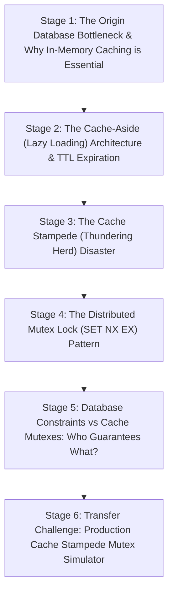

# ApexCaliber — World 39 Engineering & Pedagogical Specification

<text color="secondary" size="xs" weight="medium">RFC W39-001 · REDIS CACHE-ASIDE PATTERN, STAMPEDE MUTEX & ORIGIN PROTECTION · V1.0</text>

<badge color="success">Phase 3: Storage, ACID & Caching</badge>

This specification governs World 39 (`redis-cache-stampede-mutex`), establishing the organic stage dependency graph, the POE micro-experiments, Mode A/B simulation contracts, and the pre-wired executable code lab.

---

## 1. Product & Incident Anchor
- **World ID**: 39
- **Slug**: `redis-cache-stampede-mutex` (lc: 9332)
- **Citadel**: `sql_dbms`
- **Real-World Incident**:
  *IPL Final Live Scoreboard Database Meltdown:* During an IPL cricket final, 50,000 requests per second queried the live match scorecard. The cached scoreboard key in Redis had a TTL of 5 seconds. The exact millisecond the TTL expired, 12,000 concurrent worker threads experienced an instantaneous cache miss. All 12,000 threads simultaneously fired identical multi-table SQL queries at the PostgreSQL primary. The database connection pool was instantly depleted, CPU utilization spiked to 100%, and the application cluster collapsed under cascading 504 Gateway Timeouts.
- **Core Insight**:
  1. Relational databases are optimized for relational integrity and consistency, not for serving 50,000 identical read queries per second.
  2. Cache-Aside shields origin databases, but key expiration under high concurrency triggers a catastrophic Thundering Herd.
  3. A distributed Mutex Lock (`SET key token NX EX`) ensures exactly ONE worker queries the origin database, while all other callers wait and read the warm cache.
  4. *Pedagogical Nuance (GPT-6 Review)*: Database constraints and atomic increments guarantee state correctness; the Redis mutex exists strictly to mitigate origin database resource exhaustion.

---

## 2. Organic Learning Progression (6 Stages)

---

## 3. Stage Specifications & POE Contracts

### Stage 1: The Origin Database Bottleneck & In-Memory Caching
- **Scenario**: A social media app reaches 100,000 active users. All users view the same viral homepage feed. The database CPU hits 100% and queries slow down to 8 seconds.
- **Mechanism**: Reading from disk or executing complex SQL joins costs milliseconds per query and locks connection pool slots. In-memory data stores like Redis serve responses from RAM in <1ms over single-threaded in-memory hash tables, handling 100,000+ QPS per node.
- **Predict**: What is the typical latency differential between querying an indexed relational database row on NVMe SSD versus querying a Redis key in RAM?
  - `opt_a` (Correct): Redis RAM lookups take <1ms, whereas relational database queries typically take 5ms to 50ms (or seconds under pool contention).
  - `opt_b`: Relational databases are faster because SQL queries compile directly into GPU instructions.
  - `opt_c`: There is zero performance difference because both store data on disk.
- **Controls**:
  - `concurrent_requests`: Slider (100 to 10000, default 1000)
  - `caching_layer_enabled`: Toggle (default: false)

### Stage 2: The Cache-Aside (Lazy Loading) Architecture & TTL Expiration
- **Scenario**: How does the Cache-Aside pattern work during normal production operation?
- **Mechanism**:
  1. Application checks Redis: `GET key`.
  2. If Cache HIT: Return data to client immediately (<1ms).
  3. If Cache MISS: Query PostgreSQL origin database, store result in Redis with a Time-To-Live (`SET key data EX 300`), and return data to client.
- **Predict**: What is the purpose of setting a TTL (Time-To-Live) on cached keys in Redis?
  - `opt_a` (Correct): To prevent RAM from exhausting and ensure the cache eventually evicts stale data if application update events are dropped.
  - `opt_b`: Because Redis keys automatically delete after 3 queries.
  - `opt_c`: To force the client browser to refresh its cookies.
- **Controls**:
  - `cache_ttl_seconds`: Slider (5 to 300, default 60)
  - `cache_hit_ratio_target`: Slider (50 to 99, default 95)

### Stage 3: The Cache Stampede (Thundering Herd) Disaster
- **Scenario**: Key `match_score_123` expires at 12:00:00. At 12:00:00.010, 5,000 concurrent users refresh the screen. What happens to the database?
- **Mechanism**: All 5,000 requests experience a simultaneous cache miss. None see the key in Redis. All 5,000 workers fire the exact same SQL query to PostgreSQL simultaneously. The database runs out of connection pool slots, thread thrashing occurs, and queries time out.
- **Predict**: When an intensely requested cache key expires under 5,000 concurrent requests, what happens without mutex protection?
  - `opt_a` (Correct): Every concurrent worker queries the database simultaneously, exhausting the database connection pool and causing cascading 504 timeouts.
  - `opt_b`: The database queues the queries sequentially without any performance loss.
  - `opt_c`: Redis automatically delays returning the miss until the database is ready.
- **Controls**:
  - `concurrent_misses_at_expiry`: Slider (10 to 5000, default 1000)
  - `db_query_cost_ms`: Slider (10 to 500, default 100)

### Stage 4: The Distributed Mutex Lock (`SET NX EX`) Pattern
- **Scenario**: How can we ensure that out of 5,000 concurrent misses, exactly ONE worker queries the database while the other 4,999 wait and read the warm cache?
- **Mechanism**:
  1. On cache miss, attempt atomic lock acquisition: `SET lock:key token NX EX 10`.
  2. The WINNER gets `OK`: queries PostgreSQL and writes `SET key data EX 60`, then deletes the lock.
  3. The LOSERS fail to acquire the lock: they sleep for 50ms and retry reading from Redis, hitting the freshly populated cache in RAM!
- **Predict**: How does `SET lock:key token NX EX 10` guarantee that only one thread queries the database?
  - `opt_a` (Correct): The NX flag ensures the key is set ONLY if it does not already exist, making lock acquisition an atomic single-winner test-and-set operation.
  - `opt_b`: It reboots Redis so other threads cannot connect.
  - `opt_c`: It forces the database to refuse connections from all other worker threads.
- **Controls**:
  - `use_mutex_lock`: Toggle (default: true)
  - `lock_retry_backoff_ms`: Slider (10 to 200, default 50)

### Stage 5: Database Constraints vs Cache Mutexes: Who Guarantees What?
- **Scenario**: Does a Redis distributed lock replace database unique constraints or row-level ACID transactions for inventory purchases?
- **Mechanism**:
  - *Critical Architectural Distinction*: Redis locks are advisory and non-durable across network partitions (e.g. split-brain or GC pauses).
  - The database primary key, foreign key, and `UPDATE inventory SET stock = stock - 1 WHERE stock > 0` constraints guarantee financial and inventory correctness.
  - The Redis mutex exists solely as an architectural shield to protect the origin database from resource exhaustion.
- **Predict**: If a Redis node crashes and releases a lock prematurely while a worker is still writing, how does a resilient architecture prevent double-selling inventory?
  - `opt_a` (Correct): The database enforces an atomic check or constraint (e.g. `WHERE stock > 0`); the DB remains the authoritative source of transactional truth.
  - `opt_b`: Redis locks are mathematically guaranteed to never fail even if servers lose power.
  - `opt_c`: By running the Redis cluster on three different operating systems.
- **Controls**:
  - `simulate_redis_partition`: Toggle (default: false)
  - `db_atomic_constraints_active`: Toggle (default: true)

### Stage 6: Transfer Challenge: Production Cache Stampede Mutex Simulator
- **Scenario**: Build the Cache Stampede Mutex simulator in Python: manage an in-memory cache, track active lock keys, coordinate concurrent callers, count database queries vs lock waits, and verify that only 1 DB query is fired per batch of misses.
- **Starter Code**: Preloaded Python function `simulate_stampede_mutex(database, requests)`.

---

## 4. Telemetry Contract (`apex.trace.v1`)
Events emitted during Redis caching simulation:
- `cache_lookup`: Key probed in Redis.
- `cache_hit`: Key found in RAM; response returned.
- `cache_miss`: Key absent or expired.
- `mutex_acquired`: Lock `lock:key` acquired with `NX EX`.
- `mutex_contended`: Lock busy; caller sleeps and retries.
- `origin_db_query`: Query executed against relational database.
- `cache_populated`: Redis populated with fresh TTL.
