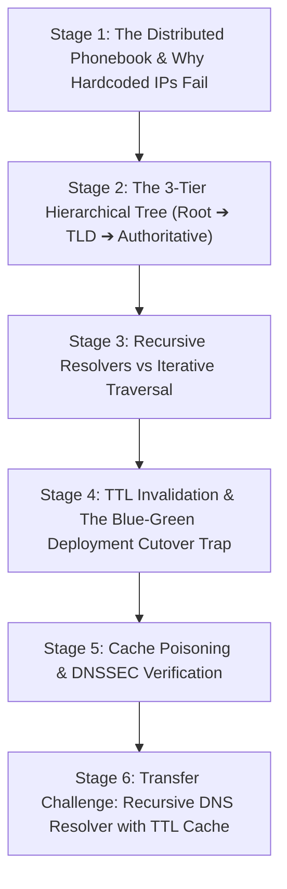

# ApexCaliber — World 40 Engineering & Pedagogical Specification

<text color="secondary" size="xs" weight="medium">RFC W40-001 · DNS HIERARCHICAL RESOLUTION & TTL CACHING · V1.0</text>

<badge color="success">Phase 2: Networking Ingress Pipeline</badge>

This specification governs World 40 (`dns-recursive-resolver`), establishing the organic stage dependency graph, the POE micro-experiments, Mode A/B simulation contracts, and the pre-wired executable code lab.

---

## 1. Product & Incident Anchor
- **World ID**: 40
- **Slug**: `dns-recursive-resolver` (lc: 9701)
- **Citadel**: `computer_networking`
- **Real-World Incident**:
  *Swiggy Delivery App Blue-Green Cutover Failure:* During a major backend migration, Swiggy cut over its order-tracking API cluster to a new Kubernetes IP. Because DNS resolver caching was misconfigured on mobile clients (TTL ignored or set too high), 100,000 active delivery drivers repeatedly queried the upstream DNS root servers for `track.swiggy.in` on every GPS ping, or hit stale decommissioned instances.
- **Core Insight**:
  1. The internet relies on hierarchical delegation: Root Nameservers (`.`) $\rightarrow$ Top-Level Domain Nameservers (`.com`) $\rightarrow$ Authoritative Nameservers (`netflix.com`).
  2. Local recursive resolvers cache responses according to Time-To-Live (TTL), shielding root servers from 99%+ of global query volume.

---

## 2. Organic Learning Progression (6 Stages)

---

## 3. Stage Specifications & POE Contracts

### Stage 1: The Distributed Phonebook & Why Hardcoded IPs Fail
- **Scenario**: When building client applications, why can't we simply hardcode backend IP addresses (e.g., `http://198.51.100.42:8000`) instead of paying DNS latency?
- **Mechanism**: Modern clouds dynamically rotate container IPs during autoscaling, server reboots, and blue-green deployments. Hardcoded IP clients break permanently when target servers terminate.
- **Predict**: If an API gateway IP changes from `198.51.100.1` to `198.51.100.2`, what happens to clients with hardcoded IPs?
  - `opt_a` (Correct): Clients immediately fail with Connection Refused or Network Unreachable because routers send packets to a non-existent or decommissioned host.
  - `opt_b`: BGP routers automatically re-route the old IP packets to the new server IP.
  - `opt_c`: The client's operating system queries DNS to discover the updated IP address.
- **Controls**:
  - `ip_rotation_interval_sec`: Slider (10s to 300s, default 60s)
  - `use_domain_names`: Toggle (default: true)

### Stage 2: The 3-Tier Hierarchical Tree (Root ➔ TLD ➔ Authoritative)
- **Scenario**: How does a resolver in Bangalore resolve `api.flipkart.com` without a single monolithic global server crashing under load?
- **Mechanism**: Domain delegation separates concerns:
  1. 13 Root Server clusters (`a.root-servers.net` to `m.root-servers.net`) direct queries to Top-Level Domains.
  2. TLD servers (`.com`, `.in`) store NS records for domain registrants.
  3. Authoritative nameservers (Route 53, Cloudflare) hold the actual `A` / `AAAA` resource records.
- **Predict**: Who is the ultimate authoritative source of truth for the IP address of `api.netflix.com`?
  - `opt_a` (Correct): Netflix's authoritative nameservers (e.g. `ns1.netflix.com` hosted on Route 53 or Cloudflare).
  - `opt_b`: The global Root Nameservers (`a.root-servers.net`).
  - `opt_c`: The local Internet Service Provider (ISP) router in the user's home.
- **Controls**:
  - `target_domain`: Select (`api.netflix.com`, `auth.github.com`, `pay.stripe.com`)
  - `hierarchy_depth`: Slider (1 to 4 hops)

### Stage 3: Recursive Resolvers vs Iterative Traversal
- **Scenario**: When your browser queries a website, does your laptop talk to Root, TLD, and Authoritative servers directly?
- **Mechanism**: The client OS uses a lightweight *Stub Resolver* that delegates the entire search to a *Recursive Resolver* (like Google `8.8.8.8` or Cloudflare `1.1.1.1`). The recursive resolver performs multiple *Iterative Queries* across the global hierarchy on the client's behalf.
- **Predict**: What is the key distinction between a recursive query and an iterative query?
  - `opt_a` (Correct): A recursive query requests "give me the final IP answer or error", whereas an iterative query returns "I don't know the answer, but ask this next nameserver".
  - `opt_b`: Recursive queries run over TCP; iterative queries run over UDP.
  - `opt_c`: Iterative queries are cached, while recursive queries cannot be cached.
- **Controls**:
  - `resolver_mode`: Select (`recursive_caching`, `direct_iterative`)
  - `dns_cache_enabled`: Toggle (default: true)

### Stage 4: TTL Invalidation & The Blue-Green Deployment Cutover Trap
- **Scenario**: A payment engineering team updates their DNS record from `Old Cluster (IP 1)` to `New Cluster (IP 2)`. The DNS record has a TTL of 86,400 seconds (24 hours). 6 hours later, they shut down the Old Cluster, causing a severe outage.
- **Mechanism**: Resolvers cache DNS records for `TTL` seconds. Until the TTL expires, intermediate ISP resolvers will NOT query authoritative servers, serving stale IPs to users.
- **Predict**: To execute a zero-downtime DNS cutover, what MUST the DevOps team do 24 hours BEFORE the migration?
  - `opt_a` (Correct): Lower the record TTL to 60 seconds beforehand so stale caches expire quickly on cutover day.
  - `opt_b`: Force restart all 13 global root DNS servers.
  - `opt_c`: Send HTTP 301 redirects from the client browser.
- **Controls**:
  - `dns_record_ttl_sec`: Slider (60s to 86400s, default 300s)
  - `time_since_cutover_sec`: Slider (0s to 1200s, default 150s)

### Stage 5: Cache Poisoning & DNSSEC Verification
- **Scenario**: An attacker wants to intercept banking credentials for `bank.com`. How can they redirect millions of users without hacking the bank's servers?
- **Mechanism**: Kaminsky DNS Cache Poisoning sends forged UDP responses with random Transaction IDs to a recursive resolver while it waits for an authoritative response. DNSSEC stops this by cryptographically signing resource records with public/private keypairs (`RRSIG` and `DNSKEY`).
- **Predict**: Why does traditional DNS over UDP without DNSSEC make spoofing possible?
  - `opt_a` (Correct): UDP is connectionless and stateless; an attacker can easily forge the source IP and guess the 16-bit Transaction ID and UDP port.
  - `opt_b`: UDP encrypts the IP address, preventing resolvers from verifying the sender.
  - `opt_c`: DNS servers accept any packet that arrives on TCP port 53.
- **Controls**:
  - `enable_dnssec`: Toggle (default: true)
  - `spoofed_packets_injected`: Slider (0 to 1000, default 50)

### Stage 6: Transfer Challenge: Recursive DNS Resolver with TTL Cache
- **Scenario**: Build the production in-memory Recursive DNS Resolver that handles queries, tracks cache hits vs root queries, computes hit rates, and handles cache evictions.
- **Starter Code**: Preloaded Python function `simulate_dns_resolver(root_zone, queries)`.

---

## 4. Telemetry Contract (`apex.trace.v1`)
Events emitted during DNS simulation:
- `dns_query_initiated`: Client sends query for domain.
- `dns_cache_lookup`: Resolver checks in-memory dictionary.
- `dns_cache_hit`: Answer returned immediately in <1ms.
- `dns_iterative_step`: Hop to Root, TLD, or Authoritative nameserver.
- `dns_record_resolved`: Authoritative IP and TTL received and stored.
