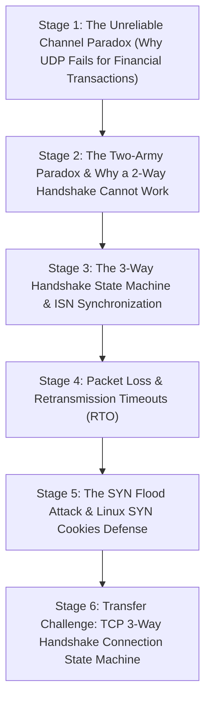

# ApexCaliber — World 41 Engineering & Pedagogical Specification

<text color="secondary" size="xs" weight="medium">RFC W41-001 · TCP 3-WAY HANDSHAKE, SEQUENCE NUMBERS & SYN FLOOD DEFENSE · V1.0</text>

<badge color="success">Phase 2: Networking Ingress Pipeline</badge>

This specification governs World 41 (`tcp-three-way-handshake`), establishing the organic stage dependency graph, the POE micro-experiments, Mode A/B simulation contracts, and the pre-wired executable code lab.

---

## 1. Product & Incident Anchor
- **World ID**: 41
- **Slug**: `tcp-three-way-handshake` (lc: 9702)
- **Citadel**: `computer_networking`
- **Real-World Incident**:
  *Razorpay Gateway SYN Flood Attack:* During Diwali flash sales, an attacker flooded an API gateway with 500,000 spoofed `SYN` packets per second with forged IP addresses. The Linux kernel's half-open connection backlog queue (`tcp_max_syn_backlog`) filled up in 200ms, causing the kernel to drop legitimate checkout handshakes from genuine users. Enabling Linux `tcp_syncookies` restored service without allocating per-socket memory.
- **Core Insight**:
  1. A 2-way handshake cannot guarantee connection freshness because delayed duplicate packets from dead sessions create phantom ghost connections.
  2. The 3-way handshake synchronizes independent random Initial Sequence Numbers (ISNs) for full-duplex communication:
     $$\text{Client ISN} = x \xrightarrow{\text{SYN}} \text{Server Ack} = x + 1$$
     $$\text{Server ISN} = y \xrightarrow{\text{SYN-ACK}} \text{Client Ack} = y + 1$$

---

## 2. Organic Learning Progression (6 Stages)

---

## 3. Stage Specifications & POE Contracts

### Stage 1: The Unreliable Channel Paradox (UDP vs TCP)
- **Scenario**: When transferring a payment instruction or software update across the public internet, physical routers drop packets due to buffer bloat and congestion.
- **Mechanism**: UDP simply transmits packets without guarantees. Lost packets are gone forever, and out-of-order packets scramble data. TCP is a transport-layer protocol that creates an illusion of a reliable, in-order, lossless byte stream over an unreliable packet network.
- **Predict**: If an API server streams order payloads using UDP and intermediate switches drop 5% of packets, what does the client application experience?
  - `opt_a` (Correct): Data corruption, missing JSON keys, and failed deserialization because UDP provides no retransmission or reordering.
  - `opt_b`: The operating system pauses network transmission until dropped packets are recovered.
  - `opt_c`: The physical Ethernet cable automatically increases voltage to redeliver lost packets.
- **Controls**:
  - `packet_loss_rate_pct`: Slider (0% to 50%, default 10%)
  - `protocol_mode`: Select (`UDP_Stateless`, `TCP_Reliable`)

### Stage 2: The Two-Army Paradox & Why a 2-Way Handshake Cannot Work
- **Scenario**: Why can't TCP use a simple 2-way handshake: Client sends "Connect", Server replies "OK"?
- **Mechanism**: In distributed asynchronous networks, packets can be delayed in router queues for seconds or minutes. If a client sends a "Connect" packet, crashes, reboots, and the delayed "Connect" packet finally arrives at the server, a 2-way handshake forces the server to allocate socket memory and wait for data that will never arrive (a Phantom Connection).
- **Predict**: In a 2-way handshake protocol, what happens when an old duplicate "Connect" packet from a crashed past session arrives at the server?
  - `opt_a` (Correct): The server opens a phantom connection, allocating memory and worker threads for a client that does not exist.
  - `opt_b`: The server detects the client has crashed by pinging the client CPU directly.
  - `opt_c`: The router discards the packet because its timestamp is older than 5 seconds.
- **Controls**:
  - `simulate_network_delay_ms`: Slider (50ms to 5000ms, default 1500ms)
  - `client_crashed`: Toggle (default: true)

### Stage 3: The 3-Way Handshake State Machine & ISN Synchronization
- **Scenario**: How do client and server agree on sequence numbers and verify that BOTH transmission and reception paths are operational?
- **Mechanism**:
  1. Client sends `SYN (seq=client_isn)`: State `CLOSED` $\rightarrow$ `SYN_SENT`.
  2. Server receives SYN, picks `server_isn`, replies with `SYN-ACK (seq=server_isn, ack=client_isn+1)`: State `LISTEN` $\rightarrow$ `SYN_RCVD`.
  3. Client verifies `ack == client_isn+1`, replies with `ACK (seq=client_isn+1, ack=server_isn+1)`: State `SYN_SENT` $\rightarrow$ `ESTABLISHED`.
  4. Server verifies `ack == server_isn+1`: State `SYN_RCVD` $\rightarrow$ `ESTABLISHED`.
- **Predict**: Why does a SYN packet consume 1 sequence number even though it carries 0 bytes of user data?
  - `opt_a` (Correct): Because the SYN flag itself is a state transition that must be reliably acknowledged; consuming 1 sequence number ensures the receiver's ACK can prove it saw the SYN.
  - `opt_b`: Because the TCP header itself is 1 byte long.
  - `opt_c`: It does not; sequence numbers only increment when payload bytes are transmitted.
- **Controls**:
  - `client_isn`: Slider (1000 to 9000, default 1000)
  - `server_isn`: Slider (1000 to 9000, default 5000)

### Stage 4: Packet Loss & Retransmission Timeouts (RTO)
- **Scenario**: What happens when the server's `SYN-ACK` packet is dropped by an ISP firewall?
- **Mechanism**: The client does not know whether the SYN was lost or the SYN-ACK was lost. It starts a Retransmission Timer (RTO). When RTO expires, it re-transmits the SYN with exponential backoff (e.g. 1s, 2s, 4s, 8s).
- **Predict**: If the final client `ACK` is dropped in transit, what state is the server left in?
  - `opt_a` (Correct): The server remains in `SYN_RCVD` and retransmits its `SYN-ACK` until it receives an ACK or hits its timeout limit.
  - `opt_b`: The server immediately resets the connection and returns to `LISTEN`.
  - `opt_c`: The server transitions to `ESTABLISHED` because it sent its SYN-ACK.
- **Controls**:
  - `drop_packet_type`: Select (`None`, `DROP_SYN`, `DROP_SYN_ACK`, `DROP_ACK`)

### Stage 5: The SYN Flood Attack & Linux SYN Cookies Defense
- **Scenario**: An attacker sends 1,000,000 SYN packets with spoofed source IPs and never sends the final ACK.
- **Mechanism**: In naive kernels, every SYN allocates a Transmission Control Block (TCB) in the SYN backlog table. When the table fills up, new legitimate SYNs are dropped. With *SYN Cookies*, the server does NOT allocate memory upon receiving a SYN; instead, it encodes the connection state inside the `server_isn` using a cryptographic hash:
  $$\text{server\_isn} = \text{SHA256}(\text{client\_ip}, \text{client\_port}, \text{secret}) \pmod{2^{32}}$$
  Only when the client returns a valid ACK matching this hash is memory allocated!
- **Predict**: How do SYN Cookies protect a server against SYN Flood attacks without allocating memory?
  - `opt_a` (Correct): The server derives the sequence number from a cryptographic hash of connection parameters, deferring all memory allocation until the client proves its IP authenticity by returning the final ACK.
  - `opt_b`: The server blocks all incoming TCP connections from foreign countries.
  - `opt_c`: The server increases RAM automatically from cloud swap space.
- **Controls**:
  - `syn_flood_rps`: Slider (100 to 100000, default 5000)
  - `enable_syn_cookies`: Toggle (default: true)

### Stage 6: Transfer Challenge: TCP 3-Way Handshake Connection State Machine
- **Scenario**: Implement the connection state machine in Python: validate transitions (`CLOSED` $\rightarrow$ `SYN_SENT` $\rightarrow$ `ESTABLISHED`), handle packet loss flags (`DROP_SYN`, `DROP_SYN_ACK`, `DROP_ACK`), and maintain sequence arithmetic.
- **Starter Code**: Preloaded Python function `simulate_tcp_handshake(client_isn, server_isn, packet_events)`.

---

## 4. Telemetry Contract (`apex.trace.v1`)
Events emitted during TCP simulation:
- `tcp_syn_sent`: Client transmits SYN packet.
- `tcp_syn_ack_received`: Server transmits SYN-ACK.
- `tcp_ack_sent`: Client confirms receipt with final ACK.
- `tcp_connection_established`: Both sockets reach ESTABLISHED state.
- `packet_dropped`: Packet dropped in transit by simulated chaos.
