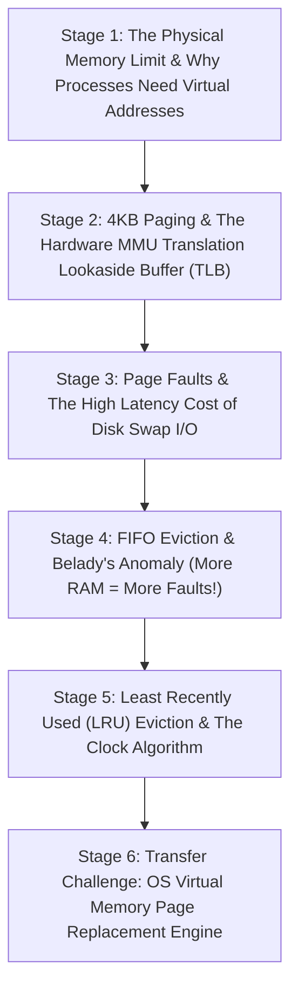

# ApexCaliber — World 42 Engineering & Pedagogical Specification

<text color="secondary" size="xs" weight="medium">RFC W42-001 · VIRTUAL MEMORY PAGING, MMU ADDRESS TRANSLATION & LRU REPLACEMENT · V1.0</text>

<badge color="success">Phase 4: Runtime, Concurrency & Memory</badge>

This specification governs World 42 (`virtual-memory-page-replacement`), establishing the organic stage dependency graph, the POE micro-experiments, Mode A/B simulation contracts, and the pre-wired executable code lab.

---

## 1. Product & Incident Anchor
- **World ID**: 42
- **Slug**: `virtual-memory-page-replacement` (lc: 9431)
- **Citadel**: `os_concurrency`
- **Real-World Incident**:
  *Kubernetes Pod OOMKilled & Swap Thrashing Freeze:* An application container configured with a 2GB memory limit experienced an uncontrolled memory spike. Because physical RAM was exhausted, the Linux kernel `kswapd` daemon began thrashing pages between physical RAM and disk swap space. CPU utilization hit 100% in `iowait`, query response times degraded from 20ms to 45 seconds, and the Linux kernel Out-Of-Memory (OOM) killer abruptly terminated the container with exit code 137.
- **Core Insight**:
  1. Virtual memory creates an illusion of unlimited, private contiguous memory for every process while physical RAM is shared and fragmented.
  2. The Memory Management Unit (MMU) translates virtual addresses to physical frames using page tables and TLB caches.
  3. When RAM is full, page replacement algorithms choose victim pages to evict. FIFO suffers from Belady's Anomaly (more frames can cause more faults), while LRU guarantees stack optimality.

---

## 2. Organic Learning Progression (6 Stages)

---

## 3. Stage Specifications & POE Contracts

### Stage 1: The Physical Memory Limit & Virtual Address Spaces
- **Scenario**: How can an operating system run three separate programs, each requiring 4GB of RAM, on a laptop that has only 8GB of physical RAM?
- **Mechanism**: The OS isolates logical program addresses from physical hardware memory. Every process has its own private virtual address space from `0x00000000` to `0xFFFFFFFF`. Physical RAM frames are dynamically allocated and mapped on demand.
- **Predict**: What happens if Process A writes data to virtual memory address `0x00400000` and Process B writes data to the exact same virtual address `0x00400000`?
  - `opt_a` (Correct): Nothing collides! Each process has an independent page table mapping `0x00400000` to completely different physical RAM frames.
  - `opt_b`: Process B overwrites Process A's data, causing a segmentation fault.
  - `opt_c`: The CPU pauses Process B until Process A terminates.
- **Controls**:
  - `virtual_memory_gb`: Slider (4 to 32, default 16)
  - `physical_ram_gb`: Slider (2 to 16, default 8)

### Stage 2: 4KB Paging & The Hardware MMU Translation Lookaside Buffer (TLB)
- **Scenario**: A 64-bit CPU executes billions of instructions per second. How does the CPU translate virtual addresses to physical memory addresses without halving system performance?
- **Mechanism**: Memory is partitioned into 4KB pages. The Memory Management Unit (MMU) uses multi-level page tables to translate page numbers. To prevent a memory lookup on every memory access, the MMU caches recent translations in a high-speed hardware cache called the Translation Lookaside Buffer (TLB).
- **Predict**: What happens during a TLB Miss?
  - `opt_a` (Correct): The MMU must perform a "Page Table Walk", reading multi-level page tables from main memory (taking 10 to 50 nanoseconds) before caching the translation.
  - `opt_b`: The process immediately crashes with a segmentation fault.
  - `opt_c`: The operating system reboots the CPU.
- **Controls**:
  - `tlb_cache_size`: Slider (16 to 512, default 64)
  - `memory_access_locality`: Slider (1 to 10, default 8)

### Stage 3: Page Faults & The High Latency Cost of Disk Swap I/O
- **Scenario**: What happens when a process accesses a virtual page that has not yet been loaded from disk or was swapped out to NVMe storage?
- **Mechanism**: The MMU detects the page table entry's *Present Bit* is 0 and raises a hardware interrupt: a Page Fault. The CPU switches to kernel mode, the OS scheduler pauses the process, reads the 4KB block from disk swap space into an empty RAM frame, updates the page table, and resumes the process.
- **Predict**: What is the typical latency penalty when an access triggers a major Page Fault reading from SSD swap compared to a direct RAM hit?
  - `opt_a` (Correct): Reading from RAM takes ~100 nanoseconds; reading from SSD swap takes ~100 microseconds (1,000x slower), causing severe application stutter.
  - `opt_b`: Disk swap and RAM have identical speed due to PCIe bus caching.
  - `opt_c`: Page faults execute in 0 nanoseconds.
- **Controls**:
  - `disk_swap_latency_us`: Slider (50 to 5000, default 200)
  - `simulate_page_fault`: Toggle (default: true)

### Stage 4: FIFO Eviction & Belady's Anomaly (More RAM = More Faults!)
- **Scenario**: You decide to use the simplest page replacement policy: First-In First-Out (evict the oldest loaded page). You notice that increasing RAM from 3 frames to 4 frames actually increases the total number of page faults!
- **Mechanism**: Belady's Anomaly is a counter-intuitive phenomenon where increasing physical page frames increases page fault frequency under FIFO eviction for specific reference strings (e.g. `[1, 2, 3, 4, 1, 2, 5, 1, 2, 3, 4, 5]`).
- **Predict**: Why does Belady's Anomaly occur in FIFO but NEVER in Least Recently Used (LRU)?
  - `opt_a` (Correct): LRU is a "stack algorithm" where the set of pages in $N$ frames is strictly a subset of the pages in $N+1$ frames; FIFO does not have this inclusion property.
  - `opt_b`: Because FIFO uses integer timestamps while LRU uses floating point numbers.
  - `opt_c`: Because LRU is implemented directly in hardware registers.
- **Controls**:
  - `physical_frame_capacity`: Slider (2 to 6, default 3)
  - `eviction_algorithm`: Select (`FIFO`, `LRU`)

### Stage 5: Least Recently Used (LRU) Eviction & The Clock Algorithm
- **Scenario**: True LRU requires updating a linked list or timestamp on EVERY memory access. Why can't OS kernels implement pure LRU in software?
- **Mechanism**: Updating software linked lists on every memory access would destroy CPU throughput. Operating systems use the *Clock (Second-Chance) Algorithm*: pages have a 1-bit *Reference Bit* set by MMU hardware on access. A circular pointer sweeps frames: if bit is 1, reset to 0 and skip; if bit is 0, evict as victim!
- **Predict**: How does the Clock (Second-Chance) algorithm approximate LRU with almost zero runtime overhead?
  - `opt_a` (Correct): It uses a single hardware-updated reference bit per page frame and a circular sweep pointer, eliminating expensive per-access software bookkeeping.
  - `opt_b`: It runs an atomic sorting algorithm across all RAM addresses every millisecond.
  - `opt_c`: It terminates the oldest process in the system.
- **Controls**:
  - `clock_pointer_speed`: Slider (1 to 10, default 5)
  - `algorithm_mode`: Select (`Exact_LRU`, `Clock_Second_Chance`)

### Stage 6: Transfer Challenge: OS Virtual Memory Page Replacement Engine
- **Scenario**: Implement an OS Virtual Memory Page Replacement Engine in Python supporting both FIFO and LRU: track physical frames, detect hits vs faults, evict victims, and record frame snapshots.
- **Starter Code**: Preloaded Python function `simulate_page_replacement(capacity, pages, algorithm)`.

---

## 4. Telemetry Contract (`apex.trace.v1`)
Events emitted during Virtual Memory simulation:
- `virtual_access_requested`: CPU references virtual page.
- `mmu_tlb_lookup`: MMU checks translation cache.
- `mmu_page_fault`: Page not in RAM; hardware trap raised.
- `frame_allocated`: Empty frame assigned.
- `victim_evicted`: Victim chosen by FIFO/LRU and swapped to disk.
- `frame_hit`: Page found in physical RAM.
